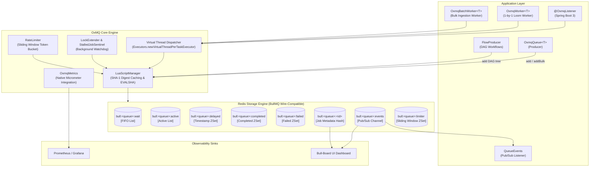
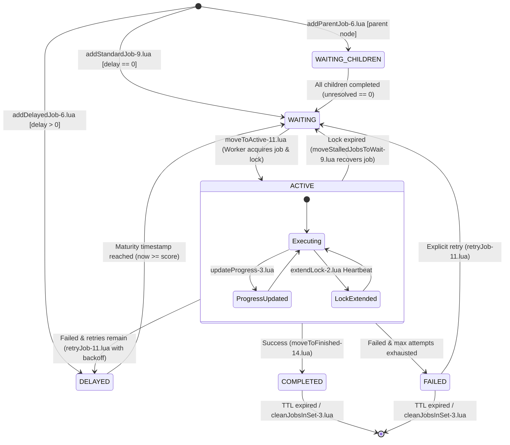
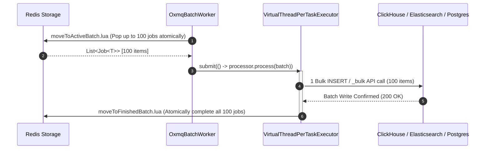
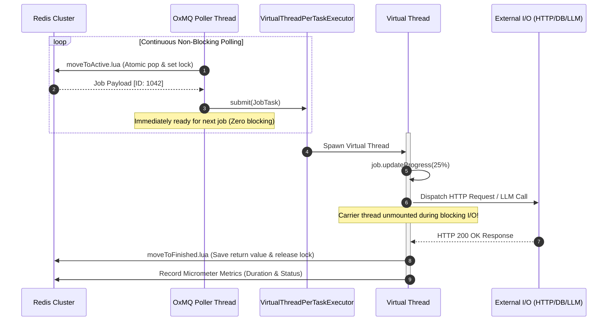
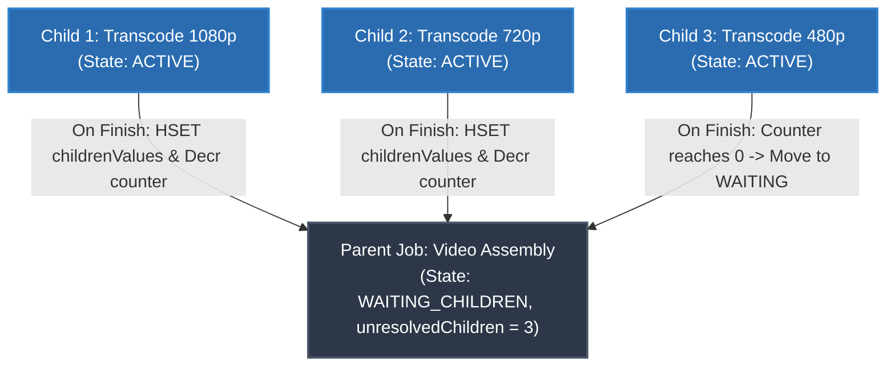
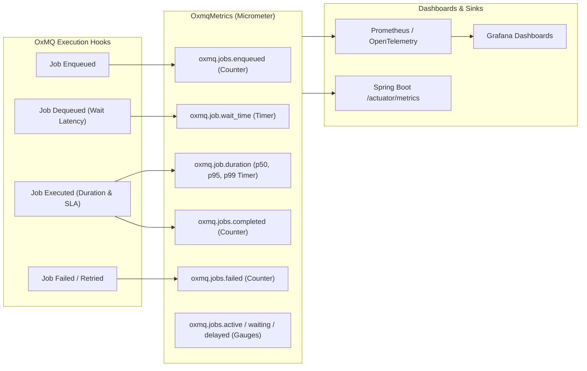
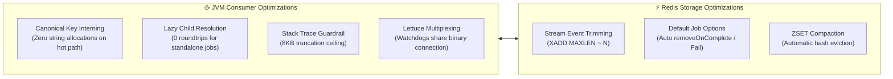

# 🏛️ OxMQ Architecture & Internals

This document details the architectural design, Redis data structures, concurrency model, DAG execution engine, Batch Dequeue pipeline, and performance telemetry in **OxMQ**.

---

## 1. High-Level System Architecture

OxMQ is engineered around 6 core pillars:
1. **Atomic Redis State Transitions:** All state transitions (`WAITING` $\rightarrow$ `ACTIVE` $\rightarrow$ `COMPLETED` / `FAILED` / `DELAYED`) execute via official BullMQ Lua scripts with single-roundtrip ACID guarantees.
2. **Virtual Thread Native with Java 17 Fallback:** Every task execution runs in an ultra-lightweight Java 21 Virtual Thread (with automatic fallback to high-performance platform thread pools on Java 17 LTS via `DispatcherExecutorFactory`), enabling 1,000+ to 10,000+ concurrent I/O-bound workers with near-zero memory overhead.
3. **High-Throughput Batch Dequeue:** Bulk pop up to $N$ jobs atomically in 1 Redis call for fast database ingestion (ClickHouse, Elasticsearch, PostgreSQL batch inserts).
4. **100% BullMQ v6 Wire & Script Parity:** Reuses official, battle-tested BullMQ v6 Lua scripts with zero custom Lua code. Standard BullMQ Redis key hierarchies enable seamless polyglot interoperability with Node.js/Python workers and instant compatibility with **Bull-Board UI**.
5. **Pluggable Storage Backend (`QueueBackend`):** Mirrors BullMQ v6's internal backend abstraction (`io.oxmq.backend.QueueBackend`), decoupling high-level queue operations from the Lettuce Redis connection driver (`RedisQueueBackend`).
6. **Native Performance Instrumentation:** Microsecond-resolution Micrometer timers, gauges, and counters built into the core path.

---

## 2. Job Lifecycle State Machine

Jobs transition through a strictly enforced, atomic state machine managed by official BullMQ Redis Lua scripts:

  

---

## 3. High-Throughput Batch Dequeue Architecture

For high-volume data pipelines (e.g. audit logs, clickstream events, metrics ingestion into ClickHouse, Elasticsearch, or PostgreSQL), OxMQ provides **Batch Dequeue**:

---

## 4. Virtual Thread Concurrency Model (with Java 17 Graceful Fallback)

Unlike traditional thread pools that exhaust operating system carrier threads when tasks perform blocking I/O (HTTP calls, DB queries, LLM inferences), OxMQ leverages Java 21 **Virtual Threads (Project Loom)** on JVM 21+, with automatic, zero-config fallback to platform thread pools on **Java 17 LTS** via [`DispatcherExecutorFactory`](/guide/virtual-threads):

---

## 5. Parent-Child DAG Workflow Engine (`FlowProducer`)

OxMQ supports complex task trees where parent tasks dynamically activate and consume the results of their children:

  

---

## 6. Native Performance Telemetry Pipeline

---

## 7. Official BullMQ Lua Script Engine & Key Topology

OxMQ directly incorporates the complete suite of **49 official standalone Lua scripts from BullMQ v6**. By executing the exact same Lua state transitions as BullMQ, OxMQ guarantees 100% wire and functional compatibility:

### Key Topology (`QueueKeys`)
| Key | Redis Type | Purpose |
| :--- | :--- | :--- |
| `bull:<queue>:wait` | LIST / STREAM | Pending jobs waiting to be claimed by workers |
| `bull:<queue>:active` | LIST | Currently executing jobs locked by workers |
| `bull:<queue>:delayed` | ZSET | Jobs scheduled for future timestamps (`score = timestamp`) |
| `bull:<queue>:waiting-children` | ZSET | Parent jobs waiting for dependencies to complete |
| `bull:<queue>:completed` | ZSET | Successfully finished jobs |
| `bull:<queue>:failed` | ZSET | Failed jobs that have exhausted all retries |
| `bull:<queue>:<jobId>` | HASH | Job metadata, payload, opts, stacktrace, progress |
| `bull:<queue>:<jobId>:lock` | STRING | Worker ownership token with lock lease TTL |
| `bull:<queue>:events` | STREAM / PUBSUB | Real-time state transition events |
| `bull:<queue>:dn:<dedupId>` | STRING | `keepLastIfActive` deduplication buffer storing latest payload |
| `bull:<queue>:pc` | ZSET | Priority counter set for prioritized jobs |

### BullMQ v6 Architectural Enhancements in OxMQ
1. **Priority-Preserving Retries (`reprocessJob-9.lua`)**: Re-queuing failed or completed jobs checks if `priority > 0` and atomically adds the job back to the priority sorted set (`KEYS[8] prioritized`, `KEYS[9] pc`), ensuring high-priority jobs jump ahead upon dead-letter replay.
2. **DAG Child Dependency Re-attachment (`moveJobsToWait-8.lua`)**: In bulk retries, the script detects parent linkages (`parentKey`) and atomically restores retried child jobs to `parentKey:dependencies`, preventing premature parent job resolution.
3. **Zero-Attempt Worker Postponement (`moveToDelayed-11.lua`)**: Accepts `skipAttempt: true` (ARGV[6]), enabling workers to defer execution via `DelayedException` without burning attempt budgets.
4. **Deduplication Buffer Re-queueing (`moveToFinished-14.lua`)**: Automatically checks the `dn:<dedupId>` key and re-dispatches the last deduplicated job upon active task completion.

### MessagePack Binary Protocol (`BullMsgPack`)
BullMQ scripts unpack complex arguments (`opts`, `jobArgs`) using `cmsgpack.unpack(ARGV[i])`. OxMQ encodes these options into binary MessagePack format using Jackson's MessagePack format and maps key names using BullMQ's option compression table (`fpof` for `failParentOnFailure`, `cpof` for `continueParentOnFailure`, `idof` for `ignoreDependencyOnFailure`, etc.).

---

## 8. Memory Optimization & Resource Efficiency Architecture

In high-throughput distributed systems processing tens of thousands of jobs per second, unbounded memory allocations can degrade GC latency or exhaust Redis capacity:

1. **Zero-Allocation Poller Hot-Path**:
   - Interns canonical BullMQ hash field keys (`id`, `name`, `data`, `opts`, etc.) and pre-sizes field map capacities to prevent map rehashes and Young Gen garbage collector churn.
2. **Lazy Parent-Child Result Supplier**:
   - `Job<T>` defers fetching child job return values via a `Supplier<Map<String, Object>>`. Standalone jobs (99.9% of traffic) execute **0 Redis network calls** for `:processed` hashes.
3. **Lettuce Connection Multiplexing**:
   - `LockExtender` (heartbeats) and `StalledJobSentinel` (recovery) multiplex over the shared thread-safe binary connection, slashing background TCP sockets by 66%. Dedicated blocking sockets (`bpop`, `xread`) are guarded with deterministic `try ... finally { conn.close(); }` closures.
4. **Stack Trace Truncation Guardrail**:
   - Limits exception failure reasons to `8,192` characters (8 KB) with an explicit marker to protect Redis RAM and consumer heap during cascading outage loops.
5. **Global Retention Inheritance & Stream Trimming**:
   - Queues and Spring Boot starters automatically apply `removeOnComplete` and `removeOnFail` defaults without requiring repetitive configuration on every `queue.add(...)` call.
   - Bounded Redis Streams (`maxLenEvents`) ensure `events` streams never grow unbounded under sustained load.

*For complete implementation details, benchmarking metrics, and production tuning parameters, see the [Memory Optimization & Resource Efficiency Guide](/operations/memory-optimization).*

---

## 🙏 Attribution

OxMQ builds upon the foundational queue architecture developed by the open-source **[BullMQ](https://github.com/taskforcesh/bullmq)** community. The official BullMQ Lua scripts are included under the permissive MIT license in [`BULLMQ_ATTRIBUTION.md`](https://github.com/gaurav10610/oxmq/blob/main/oxmq-core/src/main/resources/lua/BULLMQ_ATTRIBUTION.md).

---

## 👤 Architect & Author

**Gaurav Kumar Yadav**
* 💼 **LinkedIn:** [linkedin.com/in/gaurav-kumar-yadav-6125817a](https://www.linkedin.com/in/gaurav-kumar-yadav-6125817a/)
* 🐙 **GitHub:** [@gaurav10610](https://github.com/gaurav10610)

