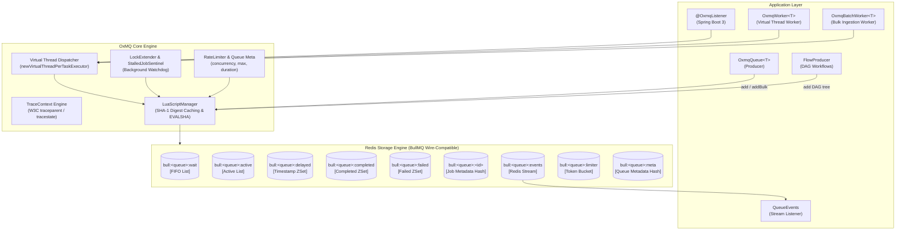
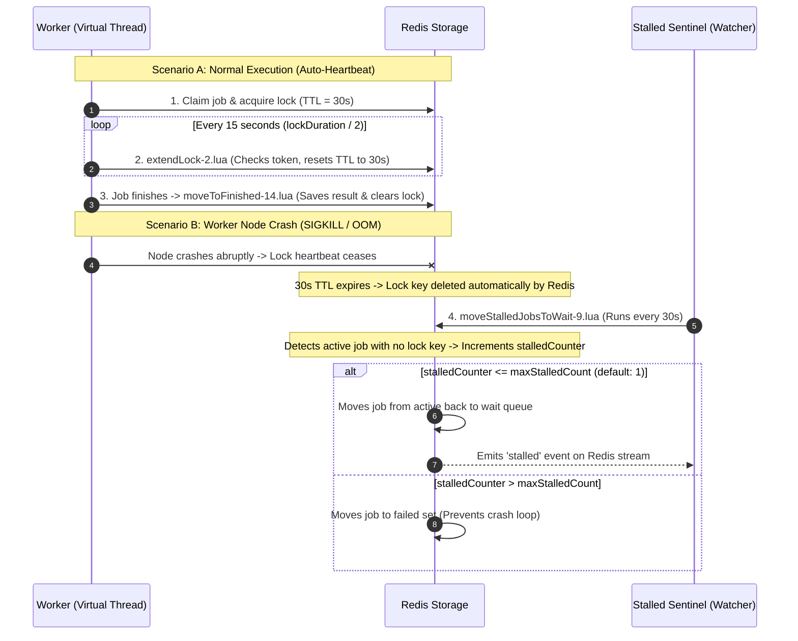
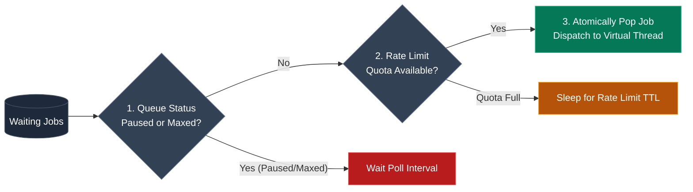
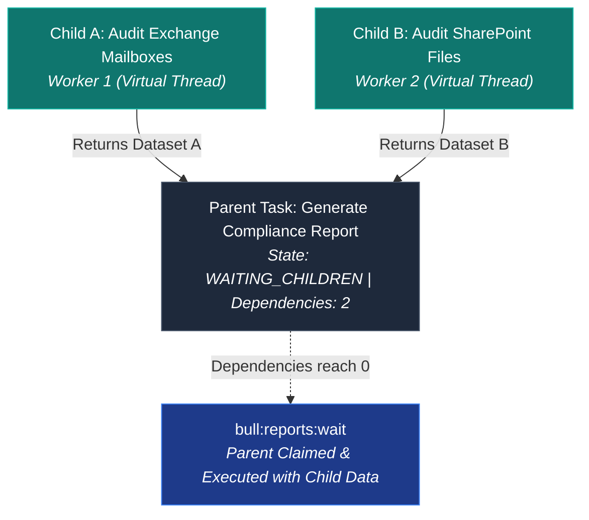
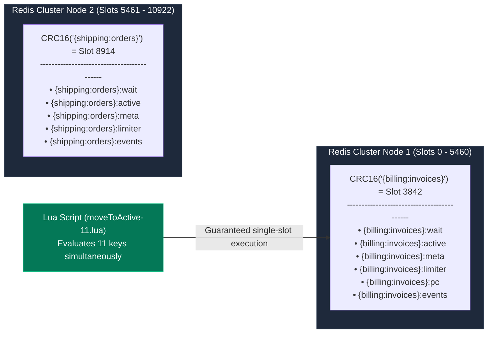
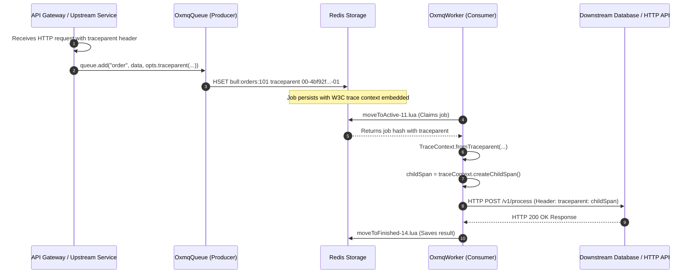

# Architecture & Engine Internals

This document details the architectural design, low-level Redis data structures, concurrency model, DAG execution engine, Batch Dequeue pipeline, and distributed tracing protocols implemented in **OxMQ**.

---

## 1. High-Level System Architecture

OxMQ is engineered around 6 foundational pillars:
1. **Atomic State Transitions**: All state transitions (`WAITING` &rarr; `ACTIVE` &rarr; `COMPLETED` / `FAILED` / `DELAYED`) execute via official BullMQ Lua scripts with single-roundtrip ACID atomicity.
2. **Virtual Thread Native**: Built for Java 21+ Project Loom Virtual Threads (with automatic fallback to platform thread pools on Java 17 LTS), enabling 10,000+ concurrent I/O-bound workers with ~1 KB heap footprint per task.
3. **High-Throughput Batch Dequeue**: Bulk pop up to $N$ jobs atomically in a single Redis call (`OxmqBatchWorker`) with `maxBatchBytes` memory safety for fast database ingestion.
4. **100% BullMQ Wire & Script Parity**: Reuses the official 49 BullMQ Lua scripts with standard Redis key topologies, unlocking seamless polyglot interoperability (Java &harr; Node.js) and instant compatibility with **Bull-Board UI**.
5. **Pluggable Storage Backend (`QueueBackend`)**: Decouples high-level queue abstractions from the underlying Lettuce Redis driver (`RedisQueueBackend`).
6. **Microsecond Observability**: Built-in Micrometer instrumentation, OpenTelemetry W3C distributed tracing, and pre-configured Grafana dashboards.



---

## 2. Low-Level Redis Data Model & Hash Field Dictionary

Every job in OxMQ is stored in Redis as a Hash at the key `bull:<queue>:<jobId>`. The table below details every canonical field, its serialization encoding, and its purpose across the lifecycle:

| Hash Field | Wire Key | Type | Description |
| :--- | :--- | :--- | :--- |
| `id` | `id` | String | Unique job identifier (auto-incrementing or deterministic custom ID). |
| `name` | `name` | String | Logical task name (e.g. `send-email`, `process-invoice`). |
| `data` | `data` | String (JSON) | Serialized payload object. |
| `opts` | `opts` | String (JSON) | Serialized `JobOptions` (retry attempts, backoff parameters, delays, retention policies). |
| `timestamp` | `timestamp` | Int64 | Epoch millisecond timestamp when the job was initially enqueued. |
| `processedOn` | `processedOn` | Int64 | Epoch millisecond timestamp when a worker locked the job and transitioned to `ACTIVE`. |
| `finishedOn` | `finishedOn` | Int64 | Epoch millisecond timestamp when execution terminated (`COMPLETED` or `FAILED`). |
| `attemptsStarted` | `ats` | Int32 | Number of times a worker has claimed the job and entered `ACTIVE`. |
| `attemptsMade` | `attemptsMade` | Int32 | Number of times the job has finished an execution attempt (failed or completed). |
| `returnvalue` | `returnvalue` | String (JSON) | Value returned by the worker upon successful completion. |
| `failedReason` | `failedReason` | String | Error message if the job failed (automatically capped at 8 KB to prevent memory exhaustion). |
| `stacktrace` | `stacktrace` | String (JSON) | Diagnostic exception stack trace (automatically bounded to 8 KB with truncation markers). |
| `progress` | `progress` | Number / JSON | Real-time progress metric reported by the running worker (e.g. `0` to `100`). |
| `childrenValues` | `childrenValues` | Hash Key Ref | Return values of completed child DAG tasks (lazily evaluated; 0 overhead for standard jobs). |
| `ignoredChildrenFailures` | `:failed` | Hash Key Ref | Error messages of failed child jobs when `ignoreDependencyOnFailure` is enabled. |
| `traceparent` | `traceparent` | String | W3C Distributed Tracing header (`00-{traceId}-{spanId}-{traceFlags}`). |
| `tracestate` | `tracestate` | String | W3C Distributed Tracing vendor metadata. |
| `deferredFailure` | `defa` | Int32 (Flag) | Present (`1`) when job failure was deferred by worker interceptor or sentinel. |

---

## 3. Lock Watchdog & Stalled Recovery State Machine

To guarantee that long-running jobs never lose their locks while healthy, and crashed worker nodes are swiftly recovered, OxMQ coordinates a **heartbeat lock timer** with a **stalled job sentinel**:



> [!NOTE]
> The auto-heartbeat timer uses non-blocking Lettuce connections to multiplex heartbeat calls across all active tasks on a single TCP socket, preventing socket exhaustion.

---

## 4. Atomic Polling & Rate Limiter Execution Pipeline

Every job dequeue operation in OxMQ executes BullMQ's official `moveToActive-11.lua`. This script evaluates queue state, cluster concurrency caps, and sliding-window rate limits atomically in a single Redis roundtrip:



### Execution Rules inside `moveToActive-11.lua`:
1. **Queue Metadata Check**: Reads `concurrency`, `paused`, `max`, and `duration` from `bull:<queue>:meta`.
2. **Concurrency Enforced**: If `concurrency` is configured and `LLEN bull:<queue>:active >= concurrency`, returns `{0, 0, 0, 0}`.
3. **Rate Limit Enforced**: If `max` and `duration` are configured, checks the counter `bull:<queue>:limiter`. If count &ge; max, returns `{0, 0, expireTimeMs, 0}`. The worker unmounts and sleeps for `expireTimeMs` without polling.
4. **Atomic Dispatch**: If clear, executes `RPOPLPUSH wait active` (or `ZPOPMIN prioritized active`), sets the lock key, records `processedOn`, and returns the full job hash.

---

## 5. Parent-Child DAG Workflow Engine (`FlowProducer`)

OxMQ's `FlowProducer` orchestrates complex directed acyclic graphs (DAGs) without external workflow engines:



### Mechanical Steps during DAG Completion:
1. **Atomic Leaf Execution**: Child jobs run concurrently across worker nodes.
2. **Result Propagation**: When a child finishes, `moveToFinished-14.lua` saves its return value into the parent's `childrenValues` hash and decrements the parent's unresolved dependency counter.
3. **Parent Promotion**: When the dependency counter reaches 0, Redis automatically transitions the parent from `waiting-children` to `wait`.
4. **Failure Policies**:
   - `failParentOnFailure = true`: Any child failure immediately fails the parent.
   - `ignoreDependencyOnFailure = true`: The child error is recorded in `{parentJob}:failed` (accessible via `parentJob.getIgnoredChildrenFailures()`), and the parent continues execution.

---

## 6. Redis Cluster CRC16 Slot Allocation & Hash-Tag Routing

Redis Cluster partitions keys across 16,384 hash slots. Multi-key Lua scripts (`moveToActive`, `moveToFinished`, `addBulk`) require that all evaluated keys belong to the **same hash slot**, or Redis aborts with a `CROSSSLOT Keys in request don't hash to the same slot` error.

OxMQ guarantees cluster safety via automated hash-tags `{prefix:queue}`:



When building cross-queue DAG workflows, use `FlowProducer.forCluster("{myWorkflow}")` to ensure parents and children share the identical cluster slot.

---

## 7. OpenTelemetry Distributed Tracing Protocol

OxMQ natively propagates W3C Trace Context across queues, workers, and microservices:



---

## 8. Virtual Thread Concurrency vs Platform Threads

When tasks perform blocking I/O (such as JDBC database queries, third-party REST API calls, or file reads), Java 21 Project Loom unmounts the Virtual Thread from its underlying OS carrier thread:

```
Platform Threads (Java 17 LTS):
[OS Carrier Thread #1] ====> [Blocks on Database Query (100ms)] ====> CPU Idle / Thread Pinned

Virtual Threads (Java 21 Loom):
[OS Carrier Thread #1] ====> [Task A blocks on DB]
                           |
                           +---> Carrier thread immediately switches to Task B!
                                 (Task A virtual thread unmounts in user space with ~1 KB heap)
```

- **Memory Footprint**: ~1 KB heap per virtual thread vs ~1 MB stack per platform thread.
- **Concurrency Limit**: 10,000+ concurrent workers on a single JVM node with zero carrier thread starvation.
- **Graceful Fallback**: On Java 17 LTS runtimes, OxMQ's `DispatcherExecutorFactory` transparently falls back to an optimized dynamic platform thread pool.
