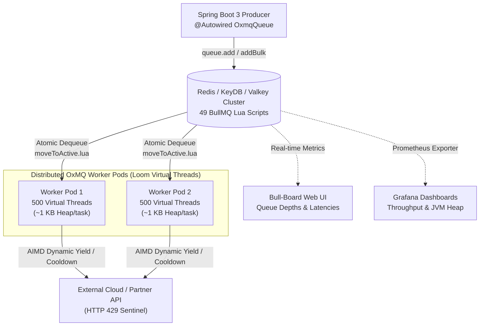

# Why We Don’t Always Need Kafka: High-Throughput Background Queues in Spring Boot with Redis & Virtual Threads

*By Gaurav Kumar Yadav • Canonical URL: [https://gaurav10610.github.io/oxmq/guide/spring-boot.html](https://gaurav10610.github.io/oxmq/guide/spring-boot.html)*

---

Every engineering team eventually hits this architectural crossroads:

> *"Our application needs background workers for payment processing, report generation, webhooks, and email notifications. What should we use?"*

Too often, the default answer is: **"Let's spin up Apache Kafka."**

Three months later, the team is wrestling with partition rebalances, consumer group lag, broker ZooKeeper/KRaft quorum tuning, and high AWS MSK bills—all for a workload that just needed reliable task retries, sliding-window rate limiting, and parent-child task workflows.

If you don't need petabyte-scale append-only event streaming with weeks of historical replay, **Kafka is often the wrong tool for task queues**.

In this article, we’ll explore how to build a modern, high-throughput distributed background processing engine in **Spring Boot 3+** using **Redis**, **Java 21 Project Loom Virtual Threads**, and **[OxMQ](https://github.com/gaurav10610/oxmq)**—the Virtual Thread-native Java alternative to BullMQ.

---

## The Distributed Task Queue Dilemma in Java

In Node.js, developers have [BullMQ](https://github.com/taskforcesh/bullmq)—a battle-tested Redis queue that executes Lua scripts for atomic state transitions, supports delayed scheduling, sliding-window rate limiters, and parent-child DAG flows, with instant visibility via the open-source [Bull-Board Web UI](https://github.com/felixmosh/bull-board).

In Java, teams typically faced frustrating trade-offs:
1. **In-Memory `ExecutorService`**: Fast, but loses all tasks on crash or pod restart. No distributed lock or cluster coordination.
2. **Spring `@Scheduled` & DB polling (`db-scheduler`, `shedlock`)**: Great for simple crons, but database table polling collapses under 5,000+ jobs/s and creates high DB CPU contention.
3. **Redisson Queues**: Opaque Lua implementations, no parent-child DAG orchestration, and no out-of-the-box monitoring UI.
4. **Kafka / RabbitMQ**: Heavy operational overhead, lack of native token-bucket rate limiting per tenant, and complex delayed job retries (dead-letter exchange looping).

This is why we built **[OxMQ](https://github.com/gaurav10610/oxmq)**.

---

## Architecture: How OxMQ Works

OxMQ executes BullMQ’s official **49 battle-tested Lua scripts** directly inside Redis. This guarantees:
- **100% Atomic State Transitions**: No race conditions between workers claiming tasks.
- **Polyglot Cross-Talk**: A Node.js microservice can push jobs that Java workers consume, and vice-versa.
- **Instant Bull-Board Web UI**: Point the open-source Bull-Board dashboard at your Redis instance to inspect queues, pause workers, and review failed jobs with zero Node.js code.



---

## 1. Project Loom Virtual Threads: The Concurrency Breakthrough

Before Java 21, running 500 concurrent worker threads meant allocating **500 MB to 1 GB of OS stack memory** (each platform thread takes ~1 MB). When workers blocked on slow network calls (e.g. Stripe API, OpenAI, or database transactions), underlying OS carrier threads sat idle, wasting CPU cycles.

With Java 21 Project Loom:
- Virtual Threads are managed by the JVM, consuming **only ~1 KB of heap memory** each.
- When an OxMQ worker blocks on network I/O, the JVM unmounts the virtual thread, freeing the carrier thread to execute other jobs.
- On benchmark tests, OxMQ sustains **800+ concurrent workers** on a **strictly flat 35 OS threads** under realistic 10ms I/O delays.

---

## 2. Spring Boot 3 Declarative Setup

Getting started in Spring Boot takes under 2 minutes:

### Step 1: Add Dependency

```xml
<dependency>
    <groupId>io.github.gaurav10610</groupId>
    <artifactId>oxmq-spring-boot-starter</artifactId>
    <version>1.10.0</version>
</dependency>
```

### Step 2: Configure `application.yml`

```yaml
oxmq:
  redis:
    uri: redis://localhost:6379
  namespace: billing-service # Multi-tenant context isolation
  worker:
    concurrency: 50           # 50 Virtual Threads on Java 21+
```

### Step 3: Produce Jobs

```java
@Service
public class PaymentService {

    @Autowired
    private OxmqQueue<PaymentRequest> paymentQueue;

    public void processPayment(String orderId, double amount) {
        // Enqueue with exponential backoff & memory retention
        paymentQueue.add("charge-customer",
            new PaymentRequest(orderId, amount),
            JobOptions.builder()
                .attempts(5)
                .backoff(Backoff.exponential(1000)) // 1s, 2s, 4s, 8s
                .keepJobs(KeepJobs.builder().count(5000).build()) // Prevent Redis RAM bloat
                .build()
        );
    }
}
```

### Step 4: Consume Jobs Declaratively

```java
@Component
public class PaymentWorker {

    @OxmqListener(queue = "billing-service:charge-customer", concurrency = 50)
    public PaymentResult handlePayment(Job<PaymentRequest> job) throws Exception {
        PaymentRequest req = job.getData();
        
        // Report progress in real-time to Redis & Bull-Board
        job.updateProgress(50);
        
        return paymentGateway.charge(req.getOrderId(), req.getAmount());
    }
}
```

---

## 3. Handling Cloud Throttling: The AIMD Adaptive Rate Limiter Plugin

In modern microservices, external APIs (Microsoft Graph, Stripe, Shopify) enforce dynamic quotas and return `HTTP 429 Too Many Requests` with a `Retry-After` header.

OxMQ provides native **Enterprise Interceptor Plugins** to solve this:

1. **`RateLimitSentinelPlugin`**: Automatically catches `HTTP 429`, extracts `Retry-After`, and engages a distributed Redis lockout across all cluster pods. Upcoming jobs defer without burning retry attempts.
2. **`AdaptiveRateLimiterPlugin`**: Uses TCP-style **AIMD (Additive Increase, Multiplicative Decrease)** to tune concurrency dynamically:
   - On HTTP 429: Immediately halves capacity (`L(t+1) = max(L_min, ⌊L(t) × 0.5⌋)`).
   - On clean execution: Additively increases capacity (`L(t+1) = min(L_max, L(t) + 25 RUs)`).

```java
@Bean
public JobInterceptor adaptiveRateLimiter(RedisClient redisClient) {
    return AdaptiveRateLimiterPlugin.builder()
        .minLimit(25)
        .maxLimit(250)
        .dampingWindowMs(60_000) // Freeze upgrades during recovery to prevent flapping
        .redisClient(redisClient)
        .build();
}
```

---

## 4. Performance Benchmarks: 10,001-Node DAG Trees

In benchmark stress tests executing massive 10,001-node parent-child DAG dependency trees:
- **Resolution Throughput**: **2,645.1 jobs/sec** (resolved in 3.78s).
- **Peak Ingestion Rate**: **~3,250 nodes/sec** (saturating Redis TCP buffer).
- **Redis Memory**: Asymptotically stabilizes at **~904 Bytes per node** (~8.68 MB for 10,001 jobs).
- **Virtual Thread Overhead**: Flat 35 OS carrier threads.

Full benchmark code and reproduction scripts are open-sourced in the repo.

---

## 5. Instant Bull-Board Web UI Integration

You can spin up the open-source Bull-Board dashboard in Docker in seconds:

```bash
docker run -d -p 3000:3000 \
  -e REDIS_HOST=localhost \
  -e REDIS_PORT=6379 \
  felixmosh/bull-board
```

Open `http://localhost:3000` to immediately inspect queue depths, pause/resume workers, trigger manual retries, and review JSON stack traces.

---

## Conclusion & Resources

If you’re building distributed background processing in Java and want high performance without Kafka-level operational baggage:
- **Project Repository:** [github.com/gaurav10610/oxmq](https://github.com/gaurav10610/oxmq)
- **Official Documentation:** [gaurav10610.github.io/oxmq](https://gaurav10610.github.io/oxmq/)
- **Maven Central:** `io.github.gaurav10610:oxmq:1.10.0`
- **License:** 100% Free & Open Source (Apache 2.0 / MIT)

⭐ If you find OxMQ helpful, star the project on GitHub and let us know your feedback!
