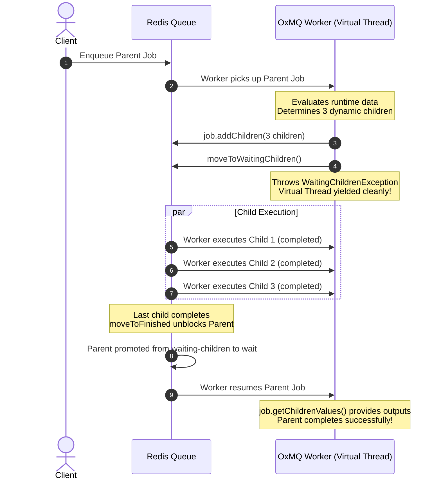

# Jobs

A **Job** represents an individual unit of work in OxMQ. Jobs carry user-defined payloads, execution options, lifecycle states, progress telemetry, step logs, and return values.

---

## Job Anatomy & Data Model

In Redis, every job is stored as a hash under the key `bull:<queue>:<jobId>`:

| Field | Type | Description |
| :--- | :--- | :--- |
| `id` | `String` | Unique identifier (auto-generated or custom-provided). |
| `name` | `String` | Logical job name (e.g. `process-payment`, `send-email`). |
| `data` | `JSON String` | Serialized payload object. |
| `opts` | `JSON String` | Serialized `JobOptions` (delays, retries, backoff parameters). |
| `timestamp` | `long` | Epoch millisecond timestamp when the job was enqueued. |
| `processedOn` | `long` | Timestamp when a worker claimed the job and entered `ACTIVE`. |
| `finishedOn` | `long` | Timestamp when the job finished execution (`COMPLETED` or `FAILED`). |
| `attemptsMade`| `int` | Number of times the job has finished an execution attempt. |
| `attemptsStarted`| `int` | Number of times a worker has picked up the job to start executing. |
| `returnvalue` | `JSON String` | Value returned by the worker upon successful completion. |
| `failedReason`| `String` | Error message if the job failed (automatically bounded to 8 KB to safeguard Redis and JVM heap). |
| `stacktrace` | `JSON Array` | Stack trace of exception (bounded to 8 KB with truncation marker to prevent OOM). |
| `progress` | `Number / JSON` | Real-time execution progress (e.g. `0` to `100`). |
| `childrenValues` | `Map<String, Object>` | Return values of completed child DAG tasks (lazily evaluated on-demand; 0 network calls for standard jobs). |
| `ignoredChildrenFailures` | `Map<String, String>` | Failure reasons of failed child tasks when `ignoreDependencyOnFailure` is enabled (lazily loaded from `job:failed` hash). |
| `traceparent` | `String` | W3C Distributed Tracing header (`00-{traceId}-{spanId}-{traceFlags}`) for end-to-end telemetry propagation. |
| `tracestate` | `String` | W3C Distributed Tracing state vendor metadata. |

---

## JobOptions Reference

Customize job execution behavior using the `JobOptions` builder:

```java
JobOptions options = JobOptions.builder()
    // Execution Timing
    .delay(Duration.ofSeconds(30))           // Wait 30s before becoming available
    
    // Retries & Resilience
    .attempts(5)                             // Retry up to 5 times on exception
    .exponentialBackoff(                     // Exponential backoff strategy
        Duration.ofSeconds(2),               // Initial backoff: 2s, 4s, 8s, 16s...
        Duration.ofMinutes(5)                // Max backoff cap: 5m
    )
    
    // Scheduling & Priority
    .priority(1)                             // Lower number = higher execution priority
    .lifo(false)                             // False = FIFO (queue), True = LIFO (stack)
    
    // Deduplication & Debounce
    .jobId("tx_987654")                      // Custom deterministic ID (prevents duplicates)
    .deduplicationId("checkout_user_42")     // Custom deduplication key
    .debounceDuration(Duration.ofSeconds(5)) // Resets execution timer on rapid submissions
    
    // Multi-Tenant Virtual Queue Groups
    .group("tenant_acme")                    // Assign to virtual group for fair round-robin scheduling
    // Or with bounded backlog:
    .group(GroupOptions.builder().id("tenant_acme").maxSize(500).build())
    
    // In-Flight Hard Execution Timeout
    .jobTimeout(Duration.ofSeconds(45))      // Watchdog interrupts thread after 45s of active execution
    
    // Housekeeping & Redis Memory Pruning (KeepJobs)
    .removeOnComplete(KeepJobs.of(1000, Duration.ofHours(2))) // Retain last 1,000 completed jobs or < 2 hours
    .removeOnFail(KeepJobs.age(Duration.ofDays(7)))           // Purge failed jobs older than 7 days
    
    // DAG Workflow Policies
    .failParentOnFailure(true)                 // If child fails, immediately fail parent DAG job
    .removeDependencyOnFailure(false)          // If true, unlink failed child so parent can still run
    
    // OpenTelemetry W3C Distributed Tracing
    .traceparent("00-4bf92f3577b34da6a3ce929d0e0e4736-00f067aa0ba902b7-01")
    .tracestate("congo=t61rcWkgMzE")
    .build();
```

---

## Job Lifecycle States (`JobState`)

OxMQ models the complete lifecycle of a job via the **`JobState`** enum:

| State | BullMQ Wire Value | Description |
| :--- | :--- | :--- |
| `WAITING` | `"waiting"` | Job is queued in `wait` list, ready to be claimed by an available worker. |
| `ACTIVE` | `"active"` | Worker has claimed the job and locked it; Virtual Thread is executing task. |
| `DELAYED` | `"delayed"` | Scheduled for future execution via Redis sorted set timestamps. |
| `WAITING_CHILDREN` | `"waiting-children"` | Parent DAG job waiting for dependent child tasks to complete. |
| `COMPLETED` | `"completed"` | Successfully processed, storing its return value in Redis. |
| `FAILED` | `"failed"` | Exhausted all retries or failed with a non-recoverable error. |
| `PAUSED` | `"paused"` | Queue is paused; waiting jobs accumulate safely in Redis without dispatch. |

### Inspecting Job State Programmatically:
```java
// Inspect state via Job instance
JobState state = job.getState();

// Or inspect via Queue by jobId
JobState stateFromQueue = queue.getJobState(job.getId());

// Ergonomic helper predicates:
if (state.isCompleted()) {
    log.info("Job successfully completed with output: {}", job.getReturnvalue());
} else if (state.isFailed()) {
    log.error("Job failed: {}", job.getFailedReason());
} else if (state.isActive()) {
    log.info("Job is currently in-flight on a worker");
}
```

---

## Self-Contained Job Mutators & Lifecycle Operations

Mirrored after BullMQ's rich `Job` class API, an OxMQ `Job<T>` returned by `queue.add()` or fetched via `queue.getJob()` is a fully connected, self-contained domain object with direct mutator methods:

```java
// 1. Dynamic Payload Updating (Mirrors BullMQ job.updateData)
// Atomically updates payload in Redis while job is queued or active
job.updateData(new OrderPayload("modified_order_v2"));

// 2. Immediate Promotion of Delayed Jobs (Mirrors BullMQ job.promote)
// Pulls a scheduled/delayed job out of delayed ZSET and enqueues into wait
job.promote();

// 3. Dynamic Delay Mutation (Mirrors BullMQ job.changeDelay)
// Adjusts the remaining scheduled delay in milliseconds
job.changeDelay(Duration.ofMinutes(15));

// 4. Dynamic Priority Adjustment (Mirrors BullMQ job.changePriority)
// Modifies execution priority (1 = highest priority)
job.changePriority(1);

// 5. Explicit Retry of Failed Jobs (Mirrors BullMQ job.retry)
// Resets failed state and returns job to wait queue
job.retry();

// 6. Complete Removal from Redis (Mirrors BullMQ job.remove)
// Atomically purges the job and locks from Redis
boolean removed = job.remove();

// 7. Clear Job Logs (Mirrors BullMQ job.clearLogs)
// Flushes the job's append-only execution log list
boolean logsCleared = job.clearLogs();

// 8. Inspect Parent DAG Dependencies (Mirrors BullMQ job.getDependencies)
// Returns child dependency status breakdown for workflow parents
JobDependencies deps = job.getDependencies();
System.out.println("Pending child jobs: " + deps.unprocessedChildKeys());
System.out.println("Completed child results: " + deps.processedChildren());

// 9. Inspect Workflow Execution Tree (Mirrors BullMQ job.getFlow)
// Fetches the entire DAG tree hierarchy rooted at this parent job
JobNode workflowTree = job.getFlow();
System.out.println("Total child nodes: " + workflowTree.getChildren().size());
```

---

## Request-Reply Synchronization (`waitUntilFinished`)

A producer or controller can await the final result of a background job directly from the `Job` instance:

### Synchronous Virtual-Thread Safe Waiting:
```java
Job<OrderPayload> job = queue.add("checkout", order);

try {
    // Blocks the calling thread (unmounts carrier thread on Java 21 Loom)
    Object result = job.waitUntilFinished(queueEvents, Duration.ofSeconds(10));
    System.out.println("Job completed with result: " + result);
} catch (TimeoutException e) {
    System.err.println("Timed out waiting for worker");
} catch (ExecutionException e) {
    System.err.println("Worker execution failed: " + e.getCause().getMessage());
}
```

### Asynchronous / Non-Blocking:
```java
CompletableFuture<Object> future = job.waitUntilFinishedAsync(queueEvents, Duration.ofSeconds(30));
future.thenAccept(result -> log.info("Async result received: {}", result));
```

---

## Real-Time Progress & Execution Logs

Workers can stream real-time progress and emit diagnostic logs directly from the execution loop:

```java
OxmqWorker<TranscodeRequest> worker = OxmqWorker.<TranscodeRequest>builder()
    .queueName("video-transcoder")
    .redisUri("redis://localhost:6379")
    .processor(job -> {
        TranscodeRequest request = job.getData();

        // 1. Log step messages (visible in Bull-Board & queryable via API)
        job.log("Starting FFmpeg pass 1 of 2...");

        for (int frame = 1; frame <= 100; frame++) {
            renderFrame(frame);

            // 2. Report progress percentage (0 to 100)
            if (frame % 10 == 0) {
                job.updateProgress(frame);
            }
        }

        job.log("Transcoding completed successfully.");
        return new TranscodeResult("/videos/" + request.id() + ".mp4", 1080);
    })
    .build();
```

### Querying Logs from Queue API:

```java
List<String> logs = queue.getJobLogs(jobId);
logs.forEach(System.out::println);
```

---

## Automatic Retries & Backoff Calculation

When an exception is thrown inside a worker processor:
1. OxMQ checks if `attemptsMade < attempts`.
2. If retries remain:
   - **Fixed Backoff**: Delays the next attempt by the configured fixed duration.
   - **Exponential Backoff**: Delays the next attempt by `initialDelay * 2^(attemptsMade - 1)`, capped at `maxDelay`.
3. The job is placed into `bull:<queue>:delayed` with a calculated maturity timestamp score.
4. When the timestamp arrives, Redis automatically promotes the job back to `bull:<queue>:wait`.
5. If all attempts are exhausted, the job moves to `bull:<queue>:failed`.

---

## ⏱️ Hard Execution Timeouts & Cancellation Tokens

Long-running or hanging tasks (e.g. unresponsive third-party HTTP endpoints, infinite loops, hanging database queries) can tie up worker virtual threads and lock resources indefinitely.

OxMQ provides both **Preemptive Watchdog Timeouts** and **Cooperative Cancellation Tokens**:

### 1. Setting Execution Timeouts

Specify timeouts per-job or as a worker default:

```java
// Option A: Per-job timeout via JobOptions
queue.add("transcode-video", payload, 
        JobOptions.builder()
                .jobTimeout(Duration.ofMinutes(5)) // Hard timeout after 5m
                .build());

// Option B: Worker-level default timeout
OxmqWorker<String> worker = OxmqWorker.<String>builder()
        .queueName("transcode-queue")
        .defaultJobTimeout(Duration.ofMinutes(10))
        .processor(this::processJob)
        .build();
```

### 2. Watchdog Preemption & Interruption

When a job's execution duration exceeds its configured timeout:
1. A dedicated background daemon watchdog thread triggers.
2. The executing virtual thread receives a `Thread.interrupt()` signal.
3. If the processor blocks on I/O, `InterruptedException` is raised.
4. If an uncaught interrupt or timeout occurs, OxMQ captures `JobTimeoutException`.
5. The thread's interrupt flag is safely cleared, allowing OxMQ to update Redis without `RedisCommandInterruptedException`.
6. The job is marked `FAILED` with `Job execution timed out after X ms`.

### 3. Cooperative Cancellation Tokens

For long-running CPU loops or step-by-step algorithms, check the job's `CancellationToken`:

```java
public String processJob(Job<BatchInput> job) throws InterruptedException {
    for (Record item : job.getData().getRecords()) {
        // Option A: Throw JobCancelledException if cancelled or timed out
        job.getCancellationToken().throwIfCancelled();

        // Option B: Polling check
        if (job.isCancelled()) {
            return "PARTIALLY_CANCELLED";
        }

        processSingleRecord(item);
    }
    return "SUCCESS";
}
```

---

## Non-Recoverable Errors (`UnrecoverableError`)

If an exception indicates a fatal condition that will never succeed on retry (e.g. malformed payload, account suspended), throw `UnrecoverableError`:

```java
import io.oxmq.exception.UnrecoverableError;

if (user.isSuspended()) {
    throw new UnrecoverableError("User account suspended. Bypassing retries.");
}
```

OxMQ catches `UnrecoverableError` and immediately moves the job to `FAILED`, bypassing remaining attempts.

---

## Worker-Driven Postponement (`DelayedException`)

In BullMQ v6, a worker can postpone execution without consuming an attempt count or marking the attempt as failed. In OxMQ, simply throw `DelayedException`:

```java
import io.oxmq.exception.DelayedException;

if (!paymentGatewayReady()) {
    // Postpone execution for 10 seconds without incrementing attemptsMade!
    throw new DelayedException(Duration.ofSeconds(10));
}
```

Behind the scenes, OxMQ catches `DelayedException` and executes BullMQ's `moveToDelayed-11.lua` with `skipAttempt: true`. The job transitions back to `DELAYED` without exhausting attempts or recording failure reasons.

---

## Dynamic Job Parking (`WaitingException` & `WaitingChildrenException`)

Workers can dynamically yield and park execution when waiting for external conditions or dependent child trees:

- **`WaitingException`**: Moves the job back to `WAITING` state to be retried after other queued jobs.
- **`WaitingChildrenException`**: Parks a job in `WAITING_CHILDREN` until dependencies complete.

---

## Programmatic Job Discarding (`job.discard()`)

In BullMQ, workers can call `job.discard()` to instruct the queue to abandon any remaining retry attempts and fail the job immediately. OxMQ provides native parity with `job.discard()`:

```java
OxmqWorker<OrderRequest> worker = OxmqWorker.<OrderRequest>builder()
    .queueName("orders")
    .redisUri("redis://localhost:6379")
    .processor(job -> {
        OrderRequest order = job.getData();
        if (order.isFraudulent()) {
            // Mark job as discarded: any subsequent failure aborts retries immediately!
            job.discard();
            throw new RuntimeException("Detected fraudulent transaction; retries aborted.");
        }
        return processOrder(order);
    })
    .build();
```

When `job.discard()` is invoked:
1. `job.isDiscarded()` transitions to `true`.
2. When the processor throws an exception or fails, `OxmqWorker` detects the discarded state and treats it as an unrecoverable failure.
3. The job immediately transitions to `FAILED` (`moveToFinished-14.lua`) regardless of how many retry attempts were initially configured.

---

## Inspecting Ignored Children Failures (`getIgnoredChildrenFailures()`)

In parent-child DAG workflows configured with `ignoreDependencyOnFailure(true)` (or `failParentOnFailure(false)`), parent jobs continue to execute even if one or more child jobs fail.

To inspect which children failed and retrieve their error messages, use `job.getIgnoredChildrenFailures()`:

```java
OxmqWorker<ReportAggregator> worker = OxmqWorker.<ReportAggregator>builder()
    .queueName("report-parent")
    .redisUri("redis://localhost:6379")
    .processor(parentJob -> {
        // Successful child task outputs (lazily loaded)
        Map<String, Object> childResults = parentJob.getChildrenValues();
        
        // Failed child task error messages (lazily loaded from Redis hash {job:failed})
        Map<String, String> failedChildren = parentJob.getIgnoredChildrenFailures();
        
        if (!failedChildren.isEmpty()) {
            failedChildren.forEach((childJobId, errorReason) -> {
                log.warn("Child task {} failed with reason: {}", childJobId, errorReason);
            });
        }
        
        return aggregateReport(childResults, failedChildren);
    })
    .build();
```

`getIgnoredChildrenFailures()` is evaluated **lazily on-demand**. Standard jobs or DAGs without failed children incur zero Redis network calls.

---

## Resumable State Machines & Job Progress Checkpointing

For long-running multi-stage batch jobs, data extraction pipelines, or complex multi-step workflows, a transient network error or pod restart in Step 4 shouldn't force the job to re-execute Steps 1, 2, and 3 from scratch.

OxMQ introduces native **Resumable State Machines and Job Checkpointing**:

```java
public record PipelineState(int recordsExtracted, String lastProcessedId, boolean stagingComplete) {}

OxmqWorker<DataPipelinePayload> worker = OxmqWorker.<DataPipelinePayload>builder()
    .queueName("etl-pipeline")
    .processor(job -> {
        // 1. Restore previous checkpoint if this attempt is a retry
        PipelineState state = job.getCheckpoint(PipelineState.class);
        String currentStep = job.getCheckpointStep();

        if (state == null) {
            state = new PipelineState(0, null, false);
        }

        // Step 1: Extract records
        if (!"STAGE_EXTRACT_DONE".equals(currentStep)) {
            state = runExtraction(state);
            job.checkpoint("STAGE_EXTRACT_DONE", state); // Persisted atomically in Redis!
        }

        // Step 2: Transform & Enrich
        if (!"STAGE_TRANSFORM_DONE".equals(currentStep)) {
            state = runTransformation(state);
            job.checkpoint("STAGE_TRANSFORM_DONE", state);
        }

        // Step 3: Load into target Data Warehouse
        loadDataWarehouse(state);
        return "PIPELINE_COMPLETE";
    })
    .build();
```

### Checkpointing Semantics:
1. `job.checkpoint(step, state)` immediately persists both the logical stage identifier (`checkpoint_step`) and serialized state payload (`checkpoint`) to Redis hash `bull:<queue>:<jobId>`.
2. When the job fails and is retried by backoff policies or reassigned to a different worker pod, `job.getCheckpoint(Class<T>)` and `job.getCheckpointStep()` immediately restore the exact point of execution.
3. Steps completed prior to the checkpoint are skipped, preventing redundant computation, double-charging, or duplicate external API calls.

---

## Declarative Per-Job-Type Timeout Mappings

In production microservices, a single worker pool often handles diverse job types with vastly different execution profiles (e.g., `send-sms` should fail after 5 seconds, whereas `export-large-csv` requires up to 10 minutes).

OxMQ allows configuring **Declarative Per-Job-Type Timeouts** on workers:

### Java Builder API:
```java
OxmqWorker<Void> worker = OxmqWorker.<Void>builder()
    .queueName("tasks")
    .defaultJobTimeout(Duration.ofSeconds(30))       // Fallback for unspecified jobs
    .jobTimeout("fast-notification", Duration.ofSeconds(5))
    .jobTimeout("generate-pdf", Duration.ofMinutes(2))
    .jobTimeout("monthly-analytics", Duration.ofMinutes(15))
    .processor(job -> {
        // Fast notification will be aborted after 5s; monthly analytics gets 15m
        return executeTask(job);
    })
    .build();
```

### Spring Boot `@OxmqListener`:
```java
@Component
public class TaskListener {

    @OxmqListener(
        queue = "tasks",
        concurrency = 20,
        jobTimeoutMs = 30000, // 30s default
        jobTimeouts = {
            @JobTimeout(task = "fast-notification", timeout = 5000),
            @JobTimeout(task = "generate-pdf", timeout = 120000),
            @JobTimeout(task = "monthly-analytics", timeout = 900000)
        }
    )
    public void handleTask(Job<Object> job) {
        // Watchdog automatically monitors active virtual thread and enforces specific timeout
    }
}
```

If an active virtual thread exceeds its specific deadline:
1. The watchdog marks `job.isCancelled()` as true with reason `"Job execution timed out after X ms"`.
2. The virtual thread is interrupted (`Thread.interrupt()`).
3. The job fails with `JobTimeoutException` and triggers normal retry backoff.

---

## Dynamic Runtime Child Spawning in DAGs

Standard workflows require the entire DAG dependency graph to be known upfront before enqueuing. However, real-world workflows often require **dynamic branching**: a parent task inspects runtime data, decides how many sub-tasks to execute, schedules them, pauses itself, and automatically resumes once all children complete.

OxMQ enables **Dynamic Runtime Child Spawning**:

```java
OxmqWorker<Object> worker = OxmqWorker.builder()
    .queueName("orchestration-queue")
    .processor(job -> {
        if ("parent-orchestrator".equals(job.getName())) {
            // Check if we are resuming after child tasks completed
            Map<String, Object> childOutputs = job.getChildrenValues();
            if (childOutputs != null && !childOutputs.isEmpty()) {
                log.info("All dynamic children finished! Outputs: {}", childOutputs);
                return "AGGREGATED_SUCCESS";
            }

            // Phase 1: Dynamically determine child tasks at runtime
            List<OrderPart> parts = fetchOrderParts(job.getData());
            List<FlowJob> children = new ArrayList<>();
            for (OrderPart part : parts) {
                children.add(FlowJob.of("parts-queue", "process-part", part));
            }

            // Spawn children and pause parent:
            // This schedules child jobs in Redis, moves parent into WAITING_CHILDREN,
            // and throws WaitingChildrenException to yield the worker Virtual Thread!
            job.addChildren(children);
            return null; // Unreachable - thread yields
        }
        return "OK";
    })
    .build();
```

### Dynamic Flow Execution Sequence:


---

## OpenTelemetry Distributed Tracing (`TraceContext`)

OxMQ natively supports W3C distributed tracing standards (`traceparent` and `tracestate`), allowing distributed traces to flow seamlessly across microservice boundaries, queues, and DAG dependencies.

```java
import io.oxmq.tracing.TraceContext;

// 1. Enqueue job with existing OpenTelemetry trace context
TraceContext parentContext = TraceContext.of(
    "00-4bf92f3577b34da6a3ce929d0e0e4736-00f067aa0ba902b7-01",
    "rojo=1"
);

Job<PaymentRequest> job = queue.add("payments", request, JobOptions.builder()
    .traceparent(parentContext.traceparent())
    .tracestate(parentContext.tracestate())
    .build());

// 2. Consume and propagate trace in worker
OxmqWorker<PaymentRequest> worker = OxmqWorker.<PaymentRequest>builder()
    .queueName("payments")
    .processor(job -> {
        // Extract incoming W3C TraceContext
        TraceContext incomingTrace = job.getTraceContext();
        if (incomingTrace != null) {
            log.info("Processing job under Trace ID: {}", incomingTrace.traceId());
            
            // Create child span context for downstream calls
            TraceContext childSpan = incomingTrace.createChildSpan();
            httpClient.setHeader("traceparent", childSpan.traceparent());
        }
        return processPayment(job.getData());
    })
    .build();
```
