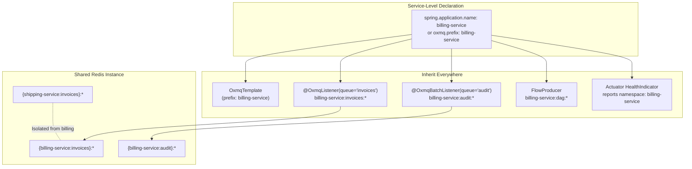

# Context Isolation & Multi-Tenant Namespacing

In distributed microservice architectures, enterprise organizations frequently run dozens or hundreds of services against a shared, highly-available Redis cluster or managed Redis cache (e.g., AWS ElastiCache, Azure Redis, GCP Memorystore). 

Without native context isolation, multiple services sharing the same queue names (such as `orders`, `notifications`, `audit-logs`, or `invoices`) collide catastrophically:
- Service A's background workers inadvertently pop Service B's confidential jobs.
- Job deduplication keys collide across tenants.
- Scheduled cron tasks overwrite one another.
- Redis Stream event listeners leak cross-service telemetry.

**OxMQ solves this natively** with zero runtime overhead. OxMQ provides complete **Context Isolation** through a deterministic namespacing engine built on top of the battle-tested BullMQ wire protocol.

---

## The "Define Once at Service Level, Inherit Everywhere" Pattern

Developer ergonomics are paramount. Asking developers to repeat a `namespace` or `prefix` parameter on every queue declaration, worker instantiation, batch listener, and DAG producer is error-prone and violates DRY principles.

OxMQ introduces the **"Define Once at Service Level, Inherit Everywhere"** pattern:



1. **Auto-Detected from Spring Boot**: If your microservice defines `spring.application.name=billing-service`, OxMQ automatically uses `billing-service` as the Redis namespace prefix for every single queue, worker, batch processor, DAG workflow, and Actuator health check.
2. **Global Property Override**: Set `oxmq.prefix=my-custom-prefix` in `application.yml` or via system property `-Doxmq.prefix=...` to override without touching application code.
3. **OxmqClient Entrypoint**: In plain Java, initialize an `OxmqClient` once per service with `.prefix("billing-service")` and vend all queues, workers, batch workers, flow producers, and stream listeners from it.

---

## Strict 7-Tier Precedence Hierarchy

When a queue, worker, or workflow resolves its target namespace, OxMQ checks the following strict precedence ladder:

| Precedence | Level | Configuration Mechanism | Example / Target Use Case |
| :--- | :--- | :--- | :--- |
| **1 (Highest)** | Explicit Annotation / Method | `@OxmqListener(prefix = "shipping")`<br/>`OxmqQueue.builder().prefix("shipping")` | Cross-service consumption or isolated multi-queue override |
| **2** | Spring Boot Property | `oxmq.prefix=payments` in `application.yml` | Domain-level clustering across multiple microservice apps |
| **3** | Spring Application Name | `spring.application.name=checkout-service` | Zero-configuration microservice isolation |
| **4** | Client Instance Scope | `OxmqClient.builder().prefix("auth").build()` | Plain Java 17+ / 21 standalone apps |
| **5** | Environment Variable | `export OXMQ_PREFIX=tenant-eu-west` | Kubernetes Pod / Docker container dynamic injection |
| **6** | JVM System Property | `-Doxmq.prefix=staging-alpha` | CI/CD testing pipelines and staging environments |
| **7 (Fallback)** | Upstream BullMQ Default | `"bull"` | 100% backward compatibility with upstream BullMQ |

---

## Spring Boot 3+ Usage

### 1. Zero-Config Service-Level Isolation

Just set your application name in `application.yml`:

```yaml
spring:
  application:
    name: order-service

oxmq:
  redis:
    uri: redis://shared-redis-cluster:6379
  default-concurrency: 20
  virtual-threads: true
```

That's it! Every listener in this service will now automatically operate under the `order-service` namespace:

```java
@Service
public class OrderProcessingService {

    // Automatically maps to Redis key pattern: order-service:orders:*
    @OxmqListener(queue = "orders")
    public void processOrder(OrderDto order) {
        log.info("Processing order {} strictly within order-service context", order.id());
    }

    // Automatically maps to Redis key pattern: order-service:payment-events:*
    @OxmqBatchListener(queue = "payment-events", batchSize = 10)
    public void processBatch(List<Job<PaymentEvent>> events) {
        log.info("Processing batch of {} payment events", events.size());
    }
}
```

### 2. Cross-Service Queue Operations (`toService`)

Sometimes a service needs to submit work to a queue owned by another microservice on the same Redis cluster without running that service's workers.

Use `OxmqTemplate.toService("target-service")`:

```java
@Service
public class CheckoutService {

    @Autowired
    private OxmqTemplate oxmqTemplate;

    public void checkout(Cart cart) {
        // 1. Submit internal job to order-service
        oxmqTemplate.send("internal-audit", new AuditLog("checkout_started"));

        // 2. Cross-service dispatch: enqueue job into shipping-service namespace!
        oxmqTemplate.toService("shipping-service")
                .send("dispatch-queue", new ShippingOrder(cart.id(), cart.address()));
    }
}
```

### 3. Cross-Service Worker Override

If a worker in the `billing-service` needs to subscribe directly to a queue owned by `shipping-service`, use the explicit `prefix` attribute on `@OxmqListener`:

```java
@Component
public class CrossServiceAuditSubscriber {

    @OxmqListener(queue = "shipments", prefix = "shipping-service")
    public void onExternalShipment(ShipmentDto shipment) {
        log.info("Billing received shipment notice: {}", shipment.trackingId());
    }
}
```

---

## Plain Java 17+ & Java 21 Usage (`OxmqClient`)

For applications not using Spring Boot, `OxmqClient` serves as the centralized service gateway:

```java
// Initialize once at service startup
OxmqClient client = OxmqClient.builder()
        .prefix("inventory-service")
        .redisUri("redis://shared-redis:6379")
        .build();

// All queues created from this client inherit "inventory-service"
OxmqQueue<StockUpdate> queue = client.queue("stock-updates", StockUpdate.class);
queue.add("item-100", new StockUpdate(100, +50));

// Workers created from this client inherit "inventory-service"
OxmqWorker<StockUpdate> worker = client.worker("stock-updates", job -> {
    log.info("Updating stock for: {}", job.getData());
    return true;
});
worker.start();

// Fluent cross-service switching:
OxmqClient analyticsClient = client.forService("analytics-service");
analyticsClient.queue("metrics", MetricEvent.class).add("pulse", new MetricEvent());
```

---

## Redis Cluster Hash-Tags & Single-Slot Guarantees

In Redis Cluster mode, multi-key Lua scripts must operate on keys that map to the exact same hash slot. Redis achieves this using **Hash Tags** `{...}`.

OxMQ formats its key hierarchy as:
```text
{prefix:queueName}:wait
{prefix:queueName}:active
{prefix:queueName}:delayed
{prefix:queueName}:completed
{prefix:queueName}:failed
{prefix:queueName}:id
{prefix:queueName}:events
```

Because the hash tag encompasses `{prefix:queueName}`, all data structures for that specific queue within that specific service namespace are guaranteed to hash to the exact same Redis cluster shard. 

At the same time, different services (e.g. `{billing:orders}` and `{shipping:orders}`) distribute naturally across all available master nodes in the cluster, ensuring uniform cluster utilization.

---

## Multi-Service Bull-Board Dashboard Topologies

[Bull-Board](https://github.com/felixmosh/bull-board) is the de-facto web dashboard for BullMQ and OxMQ. Because OxMQ maintains 100% wire-format parity with BullMQ, Bull-Board can visualize multi-tenant OxMQ clusters effortlessly.

### Option A: Unified Multi-Service Dashboard with Custom Display Names

In a single Node.js Bull-Board instance, instantiate `BullMQAdapter` instances passing the custom `prefix`:

```javascript
import { createBullBoard } from '@bull-board/api';
import { BullMQAdapter } from '@bull-board/api/bullMQAdapter.js';
import { ExpressAdapter } from '@bull-board/express';
import { Queue } from 'bullmq';
import express from 'express';

const connection = { host: 'localhost', port: 6379 };
const serverAdapter = new ExpressAdapter();
serverAdapter.setBasePath('/admin/queues');

// Register queues across different service namespaces
const billingInvoices = new Queue('invoices', { prefix: 'billing-service', connection });
const shippingInvoices = new Queue('invoices', { prefix: 'shipping-service', connection });
const authAudit = new Queue('audit', { prefix: 'auth-service', connection });

createBullBoard({
  queues: [
    new BullMQAdapter(billingInvoices, { displayName: '[Billing] Invoices' }),
    new BullMQAdapter(shippingInvoices, { displayName: '[Shipping] Invoices' }),
    new BullMQAdapter(authAudit, { displayName: '[Auth] Audit Logs' }),
  ],
  serverAdapter,
});

const app = express();
app.use('/admin/queues', serverAdapter.getRouter());
app.listen(3000, () => console.log('Bull-Board running at http://localhost:3000/admin/queues'));
```

### Option B: Automatic Namespace Discovery

You can auto-discover all service queues across the shared Redis instance dynamically by scanning for `{prefix:queue}:id`:

```javascript
import { createBullBoard } from '@bull-board/api';
import { BullMQAdapter } from '@bull-board/api/bullMQAdapter.js';
import { ExpressAdapter } from '@bull-board/express';
import { Queue } from 'bullmq';
import Redis from 'ioredis';
import express from 'express';

const redis = new Redis('redis://localhost:6379');
const connection = { host: 'localhost', port: 6379 };

async function startDashboard() {
  // Scan Redis keys matching *:id to find all active {prefix}:{queue} pairs
  const keys = await redis.keys('*:id');
  const adapters = keys.map(key => {
    // key is like "billing-service:invoices:id" or "bull:tasks:id"
    const parts = key.split(':');
    const prefix = parts.slice(0, -2).join(':');
    const queueName = parts[parts.length - 2];
    const q = new Queue(queueName, { prefix, connection });
    return new BullMQAdapter(q, { displayName: `[${prefix}] ${queueName}` });
  });

  const serverAdapter = new ExpressAdapter();
  serverAdapter.setBasePath('/admin/queues');
  createBullBoard({ queues: adapters, serverAdapter });

  const app = express();
  app.use('/admin/queues', serverAdapter.getRouter());
  app.listen(3000, () => console.log('Multi-service Bull-Board live at :3000/admin/queues'));
}

startDashboard();
```

---

## Actuator Health Check Integration

When Spring Boot Actuator is present on the classpath, OxMQ's `OxmqHealthIndicator` automatically includes the active namespace in health metrics:

```bash
curl http://localhost:8080/actuator/health
```

```json
{
  "status": "UP",
  "components": {
    "oxmq": {
      "status": "UP",
      "details": {
        "redis": "CONNECTED",
        "namespace": "billing-service",
        "registeredWorkers": 3,
        "workersRunning": true
      }
    }
  }
}
```

---

## Summary of Enterprise Benefits

1. **Total Data Isolation**: Queues, hashes, sorted sets, locks, deduplication sets, and stream channels are completely partitioned.
2. **Zero Cross-Talk**: Service A's workers cannot accidentally consume Service B's messages, even if both queues are named `tasks`.
3. **No Developer Friction**: Service-level defaults mean developers never write boilerplate prefixes in business logic.
4. **Seamless Cross-Service Messaging**: Use `toService(prefix)` for explicit, typed cross-service event publishing.
5. **Cluster-Friendly**: Redis hash-tagging `{prefix:queue}` provides native shard colocation on Redis Clusters without cross-slot errors.
