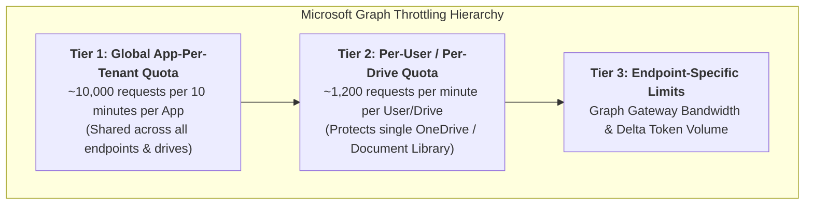
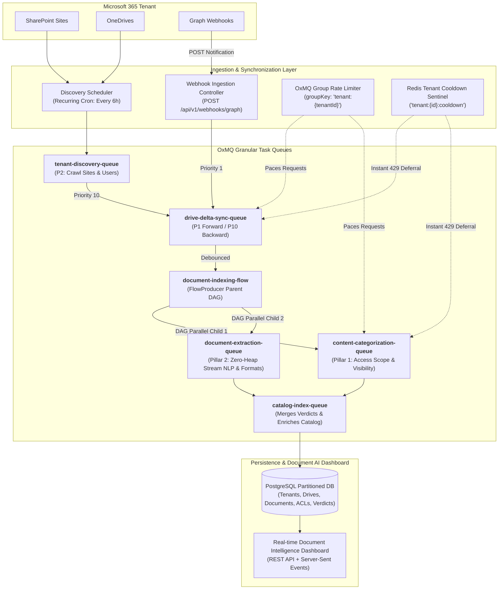
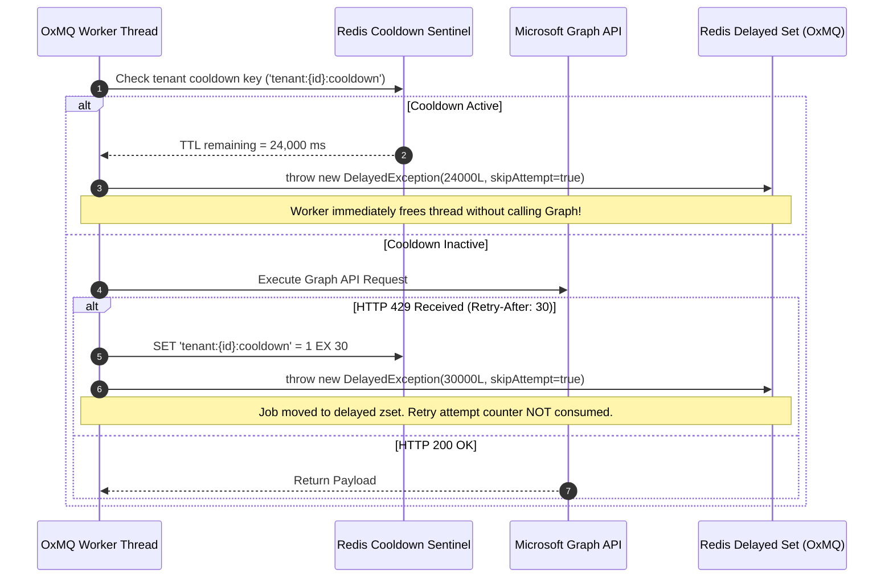
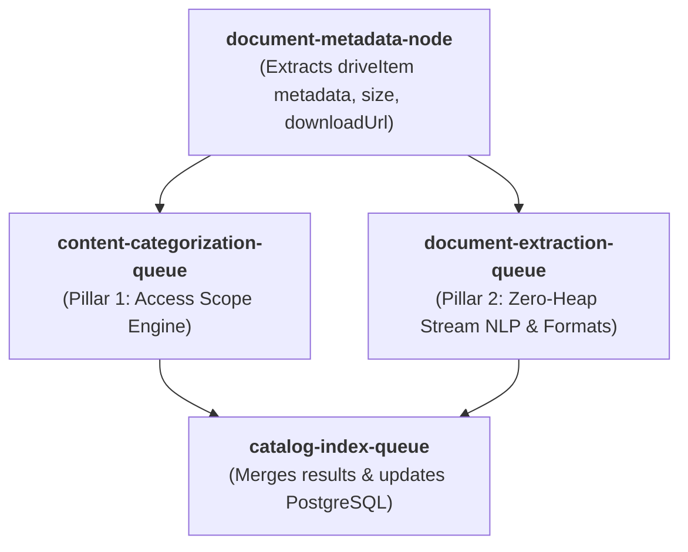
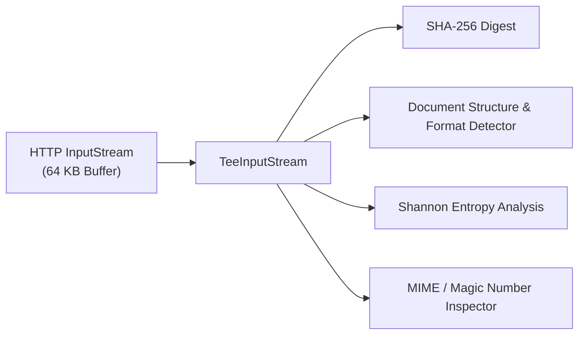

# OxDoc 365: Enterprise Content Intelligence & Document AI Pipeline
## High-Scale Architecture & Technical Specification (Java 17 LTS + OxMQ)

::: tip Specialized Deep-Dive Guides
For exhaustive, engineering-grade walkthroughs of specific subsystems inside the `oxdoc-365` module:
* [⚡ Advanced Rate Limiting, Throttling & Adaptive Capacity](https://github.com/gaurav10610/oxmq/blob/main/oxmq-examples/oxdoc-365/docs/RATE_LIMITING_AND_THROTTLING.md)
* [🛡️ Failure Handling & Disaster Recovery Guide](https://github.com/gaurav10610/oxmq/blob/main/oxmq-examples/oxdoc-365/docs/FAILURE_HANDLING_AND_DISASTER_RECOVERY.md)
* [🏢 Multi-Tenant Architecture & Dynamic Licensing](https://github.com/gaurav10610/oxmq/blob/main/oxmq-examples/oxdoc-365/docs/MULTI_TENANT_ARCHITECTURE.md)
* [🔬 Dual-Pillar Content Extraction & Categorization DAG](https://github.com/gaurav10610/oxmq/blob/main/oxmq-examples/oxdoc-365/docs/DUAL_PILLAR_INSPECTION_ENGINE.md)
* [📐 Data Model, Schemas & LLD Specification](https://github.com/gaurav10610/oxmq/blob/main/oxmq-examples/oxdoc-365/docs/DATA_MODEL_AND_LLD_SPECIFICATION.md)
* [📊 Observability, Metrics & Production Benchmarks](https://github.com/gaurav10610/oxmq/blob/main/oxmq-examples/oxdoc-365/docs/OBSERVABILITY_AND_BENCHMARKS.md)
:::

---

## 1. Executive Summary & Enterprise Scale Targets

**OxDoc 365** is an enterprise-grade SaaS Content Intelligence, Document AI, and knowledge indexing pipeline designed to catalog, analyze, normalize, and extract text and structured datasets from **SharePoint Sites** and **User OneDrives** at hyperscale.

### Scale & Performance SLA (Microsoft-Scale Baseline)
| Dimension | Enterprise Metric | Architectural Enforcement |
| :--- | :--- | :--- |
| **Tenant Scale** | 1,000+ Enterprise Tenants | Multi-tenant context isolation via OxMQ dynamic namespacing & tenant sharding. |
| **Monitored Scope** | 100,000+ Drives / Libraries | Parallel delta queries with persistent `@odata.deltaLink` checkpoints in Redis via `CheckpointStatePlugin`. |
| **Inventory Footprint** | 50,000,000+ Documents | Partitioned PostgreSQL storage by `(tenant_id, drive_id)` + Redis cache. |
| **Sustained Throughput**| 10,000+ documents / sec | Specialized OxMQ queue pipeline running on tuned Java 17 platform thread pools. |
| **Forward Latency** | ≤ 30 seconds (event to index) | Priority 1 scheduling + debounced webhook processing. |
| **Backward Impact** | Zero starvation of forward traffic | Dynamic token-bucket yielding (< 25% capacity → backward deferral). |
| **Runtime Memory** | < 512 MB JVM Heap per worker pod | Zero-copy streaming downloads (`@microsoft.graph.downloadUrl` bypass). |

---

## 2. Microsoft Graph API Mechanics & Quota Hierarchy (100% Verified)

Microsoft Graph enforces a strict, hierarchical throttling model that spans three distinct dimensions. Understanding this hierarchy is essential for building a production system that never triggers cascading bans.



### 2.1 Graph Endpoints Inventory
1. **SharePoint Discovery:**
   * `GET /v1.0/sites/getAllSites?$select=id,name,webUrl`: Discovers all site collections across the enterprise.
   * `GET /v1.0/sites/{site-id}/drives?$select=id,name,driveType,quota`: Enumerates all document libraries within each site.
2. **OneDrive Discovery:**
   * `GET /v1.0/users?$filter=accountEnabled eq true&$select=id,userPrincipalName`: Discovers all active enterprise users.
   * `GET /v1.0/users/{user-id}/drive`: Resolves each user's personal OneDrive document library.
3. **Change Tracking (Delta Queries):**
   * Initial enumeration: `GET /v1.0/drives/{drive-id}/root/delta` (follows `@odata.nextLink` until the final page returns `@odata.deltaLink`).
   * Incremental sync: `GET {saved-delta-link}` (returns only items modified, created, or deleted since the previous checkpoint).
4. **Permissions & Content Visibility:**
   * `GET /v1.0/drives/{drive-id}/items/{item-id}/permissions`: Retrieves the complete Access Control List (ACL).
   * Evaluates `inheritedFrom` property: if present, the item inherits permissions from an ancestor folder; if absent, the item has **unique/direct permissions**.
5. **Content Streaming & Direct Azure Blob Bypass (Critical Optimization):**
   * Standard call: `GET /v1.0/drives/{drive-id}/items/{item-id}/content` (routes bytes through the Microsoft Graph gateway, heavily consuming Graph API quotas).
   * **Enterprise Bypass:** Query item metadata with `$select=@microsoft.graph.downloadUrl`. This returns a short-lived pre-authenticated SAS URL directly into Azure Blob storage. Downloading bytes directly from Azure Blob storage **bypasses Microsoft Graph API gateway limits completely**, preventing rate-limit exhaustion during heavy document extraction.

### 2.2 Webhook Subscriptions & Lifecycle Management
* **Target:** `POST /v1.0/subscriptions` with `resource: "/drives/{drive-id}/root"`, `changeType: "updated"`, and `expirationDateTime: now + 42300 minutes`.
* **Validation Handshake:** Microsoft Graph validates the webhook endpoint by sending a `POST` request with query param `validationToken=<string>`. The controller immediately returns HTTP 200 with the plain-text token in the response body within 10 seconds.
* **Notification Payload:** Notifications contain only metadata (`tenantId`, `clientState`, `resource`). They **do not** contain file deltas. The notification serves as an invalidation signal that immediately schedules a job on `drive-delta-sync-queue`.
* **Renewal Daemon:** A recurring OxMQ job runs every 48 hours to execute `PATCH /v1.0/subscriptions/{id}` to refresh expirations before they lapse.

---

## 3. End-to-End Enterprise Architecture



---

## 4. Specialized Queues & Distributed Rate Limiting

To solve the dual challenges of task isolation and aggregate tenant quota protection, OxDoc 365 pairs **domain-specialized queues** with a **unified tenant-level token bucket**.

### 4.1 Queue Configuration Matrix
| Queue Name | Primary Responsibility | Concurrency (Java 17) | Default Priority | Rate Limit Policy |
| :--- | :--- | :--- | :--- | :--- |
| `tenant-discovery-queue` | Discovers all Sites, Drives, and Users | 5 threads / pod | 5 (Normal) | Max 5 calls / sec per tenant |
| `drive-delta-sync-queue` | Executes `/delta` queries & ingests document deltas | 20 threads / pod | 1 (Forward) / 10 (Backward) | Bound to tenant group token bucket |
| `content-categorization-queue` | Resolves direct vs. inherited ACLs & visibility | 30 threads / pod | Inherited from DAG | Bound to tenant group token bucket |
| `document-extraction-queue` | Streams bytes from SAS URL & analyzes formats | 25 threads / pod | Inherited from DAG | Download concurrency cap (No Graph quota) |
| `catalog-index-queue` | Merges visibility & extraction data into PostgreSQL | 15 threads / pod | Inherited from DAG | Database write pool batching |

### 4.2 Unified Tenant Token Bucket (`groupKey`)
Every queue that makes Microsoft Graph API requests enforces a shared group limiter:
```java
RateLimiterOptions tenantLimiter = RateLimiterOptions.builder()
    .max(50)                                // Max 50 Graph API calls
    .duration(Duration.ofSeconds(1))        // per second
    .groupKey("tenant:" + tenantId)         // Shared across all workers for this tenant
    .build();
```
* **Protection:** Even if `drive-delta-sync-queue` and `content-categorization-queue` run simultaneously at full concurrency, their combined request rate against Tenant A cannot exceed 50 req/s.

### 4.3 Resilience Strategy: Approach 5 (`DelayedException` + Tenant Cooldown Sentinel)
When Microsoft Graph returns HTTP 429:



---

## 5. Forward vs. Backward Scan Prioritization

To prevent historical baseline crawling from interfering with real-time document updates, OxDoc 365 enforces a strict priority arbitration protocol.

### 5.1 Priority Levels
* **Forward Ingest Jobs (Real-time Events):**
  * Origin: Microsoft Graph Webhook notifications or real-time polling.
  * Priority: `1` (Highest).
  * Behavior: Dispatched immediately to the head of the wait queue.
* **Backward Ingest Jobs (Historical Baseline):**
  * Origin: Initial tenant onboarding crawl or periodic deep baseline crawl.
  * Priority: `10` (Lowest).
  * Behavior: Yields whenever forward jobs are queued or when API quota is constrained.

### 5.2 Dynamic Headroom Yielding
Before a backward ingest worker invokes a Microsoft Graph API call, it inspects the tenant's remaining token-bucket capacity in Redis:

::: info Headroom Evaluation Formula
> **Available Quota Ratio** = `Remaining Tokens` / `Bucket Capacity`
:::

* If **Available Quota Ratio < 0.25** (less than 25% quota remaining):
  ```java
  // Yield capacity to high-priority forward events
  throw new DelayedException(5_000L, true); // Defer for 5 seconds without consuming retry attempt
  ```

### 5.3 Office 365 Auto-Save Burst Debouncing
Office 365 users editing documents produce dozens of webhook events within seconds. OxMQ's v6 deduplication buffers and consolidates these bursts:
```java
JobOptions forwardJobOptions = JobOptions.builder()
    .priority(1)
    .deduplication(DeduplicationOptions.builder()
        .id("forward-file-" + driveId + "-" + itemId)
        .debounceDuration(Duration.ofSeconds(15))
        .keepLastIfActive(true)
        .build())
    .build();
```
* **Impact:** A 1-minute editing session generating 20 save events is consolidated into **one** final ingestion pass, cutting API and processing load by > 95%.

---

## 6. Dual-Pillar Content Intelligence Architecture

Every document item is processed via an **OxMQ `FlowProducer` DAG**:



### 6.1 Pillar 1: True Content Visibility & Access Scope Engine
Evaluates `GET /drives/{drive-id}/items/{item-id}/permissions`:
* **Inheritance Resolution:**
  * If `inheritedFrom != null`: The file inherits permissions from `inheritedFrom.id`. The engine links the file to the parent folder's cached permission model, avoiding redundant database records.
  * If `inheritedFrom == null`: The file has unique/explicit permissions. The engine parses every ACE (Access Control Entry).
* **Normalized Access Scope Classification:**
  1. 🔴 **PUBLIC_ANONYMOUS:** Accessible via an anonymous link (`link.scope == "anonymous"`). Open knowledge base access without authentication.
  2. 🟠 **EXTERNAL_GUEST:** Shared with external parties (`link.scope == "users"` with external Azure AD guest accounts / invited emails).
  3. 🟡 **ORGANIZATION_WIDE:** Accessible to anyone within the enterprise (`link.scope == "organization"`).
  4. 🟢 **INTERNAL_RESTRICTED:** Shared with specific internal users or Azure AD security groups.
  5. 🔒 **PRIVATE:** Accessible exclusively by the owner.

### 6.2 Pillar 2: Zero-Heap Streaming Document Extraction & NLP Engine
Downloads file content via the direct Azure Blob SAS URL (`@microsoft.graph.downloadUrl`) and streams bytes through a pipeline using small 64 KB ring buffers:



1. **Content Fingerprint:** Computes SHA-256 on the fly; enables cross-drive deduplication and version tracking.
2. **Document Normalization:** Automatically parses and indexes text word counts, reading duration, language detection (`en`), and preview summaries.
3. **Structured Spreadsheet & Model Extraction:** Identifies tabular datasets (`.xlsx`, `.csv`) and computes schema dimensions and row density.
4. **Binary & Embedding Archive Indexing:** Detects compressed dataset archives (`.bin`, `.tar.gz`, `.zip`) via Shannon entropy (H > 7.5) and tags them for specialized vectorization.

---

## 7. Java 17 Concurrency & Memory Management Model

### 7.1 Platform Thread Pool Tuning
In Java 17 LTS, OxMQ workers execute on standard OS platform threads. Concurrency is configured specifically to balance throughput against memory constraints:

```java
OxmqConfiguration config = OxmqConfiguration.builder()
    .redisUrl("redis://localhost:6379")
    .concurrency(25)                        // 25 platform threads per worker instance
    .stalledInterval(Duration.ofSeconds(30))// Detect stalled jobs if worker crashes
    .lockDuration(Duration.ofSeconds(45))   // Lock renewed automatically while processing
    .build();
```

### 7.2 Zero-Heap Memory Enforcement
* **No `byte[]` Heap Accumulation:** Files are never loaded into byte arrays or `ByteArrayOutputStream`.
* **Streaming Digest Calculation:**
  ```java
  MessageDigest sha256 = MessageDigest.getInstance("SHA-256");
  byte[] buffer = new byte[65536]; // 64 KB reuse buffer
  int bytesRead;
  while ((bytesRead = inputStream.read(buffer)) != -1) {
      sha256.update(buffer, 0, bytesRead);
      entropyCalculator.consume(buffer, bytesRead);
  }
  ```
* **Resident Memory Footprint:** Bounded to < 50 MB per thread regardless of whether the document being scanned is 100 KB or 10 GB.

---

## 8. Relational Storage Schema (PostgreSQL Partitioned)

```sql
-- 1. Tenants Table
CREATE TABLE tenant_configs (
    tenant_id VARCHAR(64) PRIMARY KEY,
    name VARCHAR(255) NOT NULL,
    azure_client_id VARCHAR(128) NOT NULL,
    azure_client_secret VARCHAR(255) NOT NULL,
    azure_tenant_id VARCHAR(128) NOT NULL,
    rate_limit_per_second INT DEFAULT 50,
    created_at TIMESTAMP WITH TIME ZONE DEFAULT NOW()
);

-- 2. Drives / Document Libraries
CREATE TABLE oxdoc_monitored_drives (
    drive_id VARCHAR(128) PRIMARY KEY,
    tenant_id VARCHAR(64) REFERENCES tenant_configs(tenant_id),
    drive_type VARCHAR(32) NOT NULL, -- 'SHAREPOINT_LIBRARY' or 'USER_ONEDRIVE'
    name VARCHAR(255) NOT NULL,
    owner_principal VARCHAR(255),
    delta_token TEXT,
    webhook_subscription_id VARCHAR(128),
    webhook_expires_at TIMESTAMP WITH TIME ZONE,
    last_synced_at TIMESTAMP WITH TIME ZONE
);

-- 3. Partitioned Documents Catalog
CREATE TABLE oxdoc_indexed_documents (
    file_id VARCHAR(128) NOT NULL,
    drive_id VARCHAR(128) NOT NULL,
    tenant_id VARCHAR(64) NOT NULL,
    file_name VARCHAR(512) NOT NULL,
    file_path TEXT NOT NULL,
    file_size BIGINT NOT NULL,
    mime_type VARCHAR(128),
    access_scope VARCHAR(32) NOT NULL,    -- PUBLIC_ANONYMOUS, EXTERNAL_GUEST, ORG_WIDE, INTERNAL, PRIVATE
    has_unique_permissions BOOLEAN NOT NULL,
    indexing_verdict VARCHAR(32) NOT NULL, -- INDEXED_SEARCHABLE, STRUCTURED_DOCUMENT, BINARY_ARCHIVED, PARSED_METADATA_ONLY
    analysis_details TEXT,
    sha256 CHAR(64),
    scan_origin VARCHAR(16) NOT NULL,     -- 'FORWARD' or 'BACKWARD'
    indexed_at_timestamp TIMESTAMP WITH TIME ZONE DEFAULT NOW(),
    PRIMARY KEY (tenant_id, drive_id, file_id)
) PARTITION BY LIST (tenant_id);
```

---

## 9. Local Developer & Free Testing Guide

To test this complete end-to-end pipeline locally without incurring costs or requiring existing enterprise credentials, follow this setup guide.

### 9.1 How to Create a Free Microsoft 365 Developer Account (E5 Tenant)
Microsoft provides a **100% free renewable Microsoft 365 Developer Subscription** designed specifically for developers:
1. Navigate to the [Microsoft 365 Developer Program](https://developer.microsoft.com/en-us/microsoft-365/dev-program).
2. Click **Join Now** and sign in with any standard personal Microsoft account (`@outlook.com` or `@hotmail.com`).
3. Select your region, enter a company name (e.g., `OxDoc Labs`), and choose **Configurable Sandbox**.
4. Set up an administrator username (e.g., `admin@yourdomain.onmicrosoft.com`) and password.
5. **Pre-provisioned Sample Data:** During setup, check **"Users pack"** and **"Mail and Events pack"**. This automatically provisions 25 fictitious users, multiple SharePoint Sites, and realistic OneDrives filled with sample documents.
6. This developer subscription is **free for 90 days and renews automatically indefinitely** as long as developer activity is detected.

### 9.2 Register Azure AD App for OxDoc 365
1. Sign in to the [Microsoft Entra Admin Center](https://entra.microsoft.com) using your newly created admin credentials.
2. Go to **Identity** → **Applications** → **App registrations** → **New registration**:
   * Name: `OxDoc-365-Engine`
   * Supported account types: *Accounts in this organizational directory only (Single tenant)*
   * Redirect URI: Leave blank. Click **Register**.
3. Note down the **Application (client) ID** and **Directory (tenant) ID**.
4. Go to **Certificates & secrets** → **New client secret** → Generate secret and copy the **Value**.
5. Go to **API permissions** → **Add a permission** → **Microsoft Graph** → **Application permissions**:
   * `Sites.Read.All` (read all SharePoint site collections and document libraries)
   * `Files.Read.All` (read metadata and stream file contents across all drives)
   * `User.Read.All` (enumerate active tenant users and discover OneDrives)
6. Click **Grant admin consent for [Your Tenant]** (all permissions will show green checkmarks).

### 9.3 Local Webhook Tunneling (Receiving Graph Events on `localhost`)
Because Microsoft Graph sends webhook notifications over the public Internet, your local application needs a public URL to receive validation requests:
1. Install [ngrok](https://ngrok.com) or [cloudflared](https://developers.cloudflare.com/pages/how-to/preview-deployments/#cloudflare-tunnel).
2. Start the tunnel to your local Spring Boot port:
   ```bash
   ngrok http 8080
   ```
3. Copy the HTTPS forwarding address (e.g., `https://abc1234.ngrok-free.app`).
4. In your `application.yml`, set:
   ```yaml
   oxdoc:
     webhook:
       notification-url: https://abc1234.ngrok-free.app/api/v1/webhooks/graph
   ```

### 9.4 Enterprise Mock Microsoft 365 Server & Local Docker Infrastructure
For out-of-the-box local testing without requiring paid Azure enterprise credentials, OxDoc 365 includes a dedicated **Enterprise Mock Microsoft 365 Server** and **Dockerized PostgreSQL persistence**:

```yaml
oxdoc:
  client:
    mode: LIVE # LiveGraphClient connects to Microsoft Graph v1.0 REST API
  azure:
    tenant-id: "tenant-mid-2500"
    client-id: "oxdoc-365-enterprise-app"
    client-secret: "secret-token-xyz"
    graph-base-url: "http://localhost:8081/v1.0" # Mock M365 Server (or https://graph.microsoft.com/v1.0 in cloud)
    login-base-url: "http://localhost:8081"       # Mock M365 Server (or https://login.microsoftonline.com in cloud)
  mock-admin:
    base-url: "http://localhost:8081/mock-admin"
```

#### How It Works:
1. **Real Physical Files on Disk:** The mock server creates and maintains real physical files on disk under `./data/m365-storage` (structured knowledge base articles, financial spreadsheets, PDFs, architecture whitepapers, and binary dataset archives).
2. **Exact Graph v1.0 REST API Contract:** Exposes standard endpoints (`/v1.0/sites/getAllSites`, `/sites/{siteId}/drives`, `/users`, `/users/{userId}/drive`, `/drives/{driveId}/root/delta`, `/permissions`, and binary streaming download URL).
3. **Single Configuration Toggle:** Only the `graph-base-url` changes between local testing (`http://localhost:8081/v1.0`) and production cloud (`https://graph.microsoft.com/v1.0`). All connector code, HTTP request processing, and extraction pipelines are 100% identical.
4. **Full Dockerized Infrastructure:**
   Start all infrastructure (PostgreSQL 16, Redis 7, Bull-Board, Prometheus, Grafana) with one command:
   ```bash
   ./start-oxdoc.sh
   ```

### 9.5 Multi-Tenant License Tiers, OxMQ Native Plugins & Grafana Dashboards

OxDoc 365 models all 5 official Microsoft 365 Paid License Tiers simultaneously:
- **`tenant-smb-250` (Acme TinyCorp):** Small Business (250 seats, 25 RUs/s burst)
- **`tenant-mid-2500` (Contoso Logistics):** Mid-Market Growth (2,500 seats, 50 RUs/s burst)
- **`tenant-ent-10k` (Fabrikam Financial):** Enterprise E3/E5 (10,000 seats, 90 RUs/s burst)
- **`tenant-large-35k` (Northwind Health):** Large Enterprise (35,000 seats, 150 RUs/s burst)
- **`tenant-global-100k` (MegaCorp Global):** Hyperscale Global (100,000 seats, 250 RUs/s burst)

All rate limiting, circuit breaking, and quota yielding are powered natively by **OxMQ Enterprise Plugins**:
1. **`GroupRateLimiterPlugin`:** Dynamic token bucket isolation per tenant.
2. **`RateLimitSentinelPlugin`:** Automatic distributed lockout upon receiving HTTP 429 `Retry-After`.
3. **`PriorityQuotaGovernorPlugin`:** Headroom-based yielding protecting VIP Priority 1 scans from background Priority 10 crawls.
4. **Grafana Dashboards:** Pre-provisioned at `http://localhost:3001/d/oxmq-overview` to monitor queue depths, execution throughput, and per-tenant rate yield counters.

### 9.6 Enterprise Fallback Hierarchy & Adaptive Self-Tuning Rate Limiting

To handle real-world permission constraints and dynamic load, OxDoc 365 incorporates a **4-Level Discovery Waterfall** paired with an **Adaptive Self-Tuning Capacity Controller**:

#### 1. 4-Level License Discovery Waterfall
* **Level 1 (Static Override):** Pinned via YAML configuration (`oxdoc.tenants.overrides.<tenantId>=<TIER>`) or REST Admin API. Bypasses discovery and adaptive tuning.
* **Level 2 (Graph API SKUs):** Calls `GET /v1.0/subscribedSkus` and `GET /v1.0/organization` to inspect exact paid seat counts and active SKUs (`O365_BUSINESS_PREMIUM`, `SPE_E3`, `SPE_E5`).
* **Level 3 (User Count Heuristic):** If `subscribedSkus` fails with 403 or is unassigned, queries `GET /v1.0/users?$count=true` using standard `User.Read.All` scope to estimate tenant size.
* **Level 4 (Safe Baseline Fallback):** Defaults unresolvable tenants to Tier 1 (`SMB`: 250 seats, 25 RUs/s) as a conservative baseline.

#### 2. Conservative AIMD Adaptive Capacity Controller
* **Auto-Downgrade on HTTP 429:** When an HTTP 429 throttle occurs, the controller immediately steps down the tenant's tier by one level (e.g., `ENTERPRISE` 90 RUs/s → `MID_MARKET` 50 RUs/s), cutting traffic and granting recovery breathing room.
* **Oscillation Damping Lock:** Prevents flapping ("yo-yo" throttling) by freezing upgrades for a damping window (`damping-window-ms`, default 60s) after any downgrade.
* **Auto-Upgrade on Sustained Clean Work:** If a tenant sustains clean processing without throttles across consecutive evaluation windows (`clean-windows-for-upgrade = 2`), the controller steps up the tier by one level, adjusting OxMQ token bucket burst limits in real time without downtime or restart.

#### 3. Administrative REST Endpoints
* `POST /api/v1/dashboard/tenants/{tenantId}/override-tier?tier={TIER}`: Pin a tenant to an explicit tier (`SMB`, `MID_MARKET`, `ENTERPRISE`, `LARGE_ENTERPRISE`, `HYPERSCALE`).
* `DELETE /api/v1/dashboard/tenants/{tenantId}/override-tier`: Clear static override and restore dynamic adaptive tuning.
* `POST /api/v1/dashboard/tenants/{tenantId}/evaluate-tier`: Trigger immediate on-demand adaptive tier evaluation.

### 9.7 Native OxMQ Plugins Adoption
OxDoc 365 delegates rate limiting and checkpointing natively to **`oxmq-core`**:
1. **`AdaptiveRateLimiterPlugin`**: Houses the AIMD controller, damping lock, static overrides, and Redis synchronization, providing `.asLimitResolver()` to `GroupRateLimiterPlugin`.
2. **`CheckpointStatePlugin`**: Persists delta query tokens in Redis hash `oxmq:checkpoint:m365-delta-sync`. Automatically injects the cursor via thread-local context and commits tokens on job completion via `CheckpointSupplier`.

### 9.8 Kubernetes Production Deployment & Disaster Recovery
- **Kubernetes Specs (`k8s/`)**: Production manifests in [`oxmq-examples/oxdoc-365/k8s/`](file:///Users/gaurav/git/oxmq/oxmq-examples/oxdoc-365/k8s/) with HTTP health probes (`/actuator/health/liveness`, `/readiness`), `preStop` hook sleep 10s, and `terminationGracePeriodSeconds: 45`.
- **System Metrics Dashboard (`oxmq-system-metrics.json`)**: Pre-provisioned Grafana dashboard tracking isolated JVM Heap memory pools (Eden, Survivor, Old Gen), Non-Heap/Metaspace, CPU, HikariCP pools, and adaptive capacity gauges.
- **Disaster Recovery Benchmark (`run_multi_tenant_resilience_test.sh`)**: Executed from a 100% clean Docker wipe across all 5 tiers (5,000 documents) with injected 429/503 storms, abrupt Redis crash/restart, and pod SIGTERM with checkpoint recovery:
  - **Results**: 5,000 / 5,000 documents processed, 0 duplicate scans, peak Heap: **106.4 MB**.
