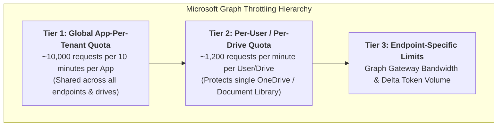
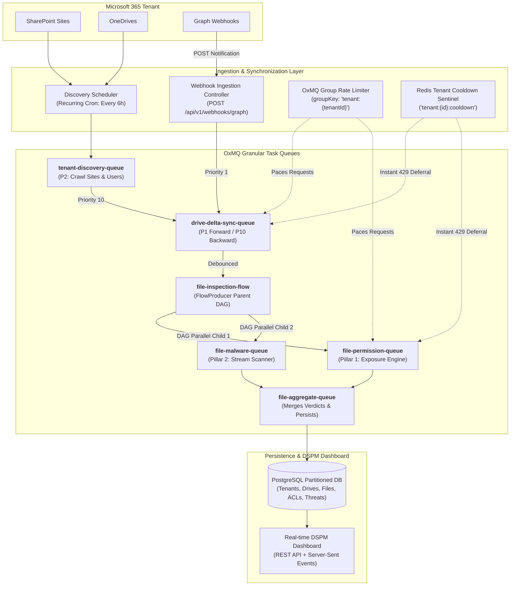
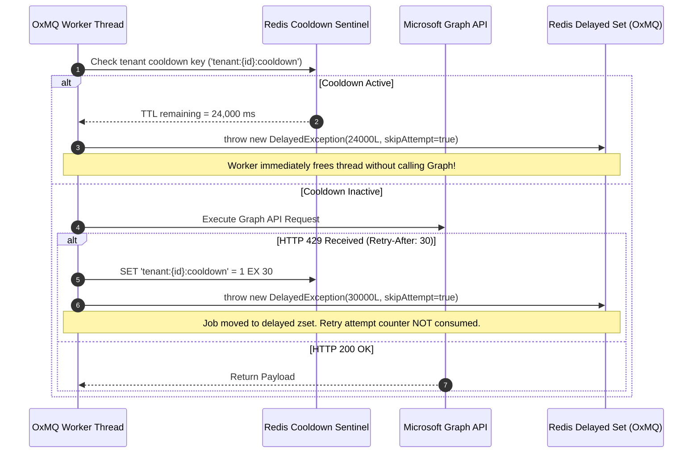
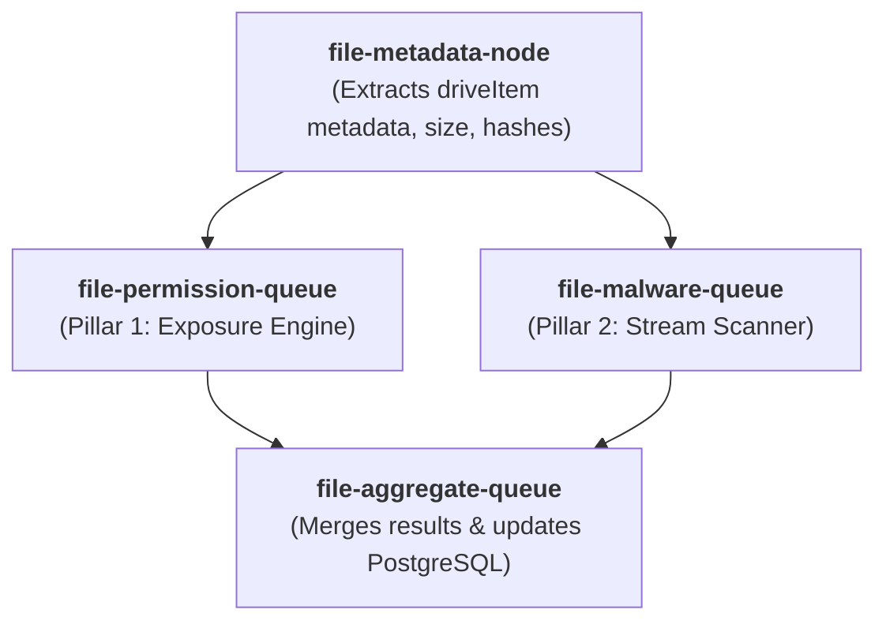
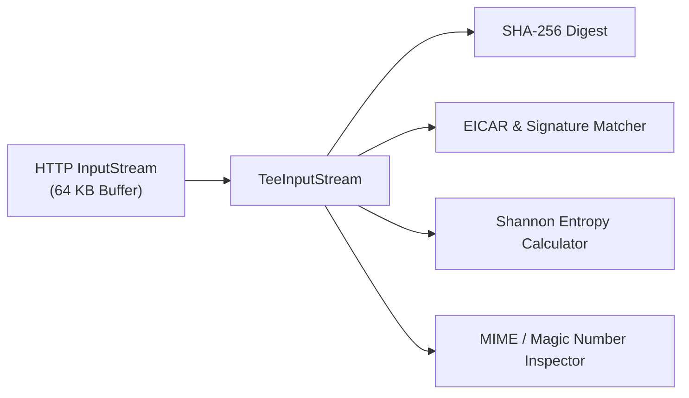

# OxGuard 365: Enterprise SaaS DSPM & Threat Analysis Engine
## High-Scale Architecture & Technical Specification (Java 17 LTS + OxMQ)

---

## 1. Executive Summary & Enterprise Scale Targets

**OxGuard 365** is an enterprise-grade SaaS Data Security Posture Management (DSPM) and file-level threat detection engine designed to inspect, catalog, and secure **SharePoint Sites** and **User OneDrives** at hyperscale.

### Scale & Performance SLA (Microsoft-Scale Baseline)
| Dimension | Enterprise Metric | Architectural Enforcement |
| :--- | :--- | :--- |
| **Tenant Scale** | 1,000+ Enterprise Tenants | Multi-tenant context isolation via OxMQ dynamic namespacing & tenant sharding. |
| **Monitored Scope** | 100,000+ Drives / Libraries | Parallel delta queries with persistent `@odata.deltaLink` checkpoints. |
| **Inventory Footprint** | 50,000,000+ Files | Partitioned PostgreSQL storage by `(tenant_id, drive_id)` + Redis cache. |
| **Sustained Throughput**| 10,000+ files / sec | Specialized OxMQ queue pipeline running on tuned Java 17 platform thread pools. |
| **Forward Latency** | $\le 30$ seconds (event to verdict) | Priority 1 scheduling + debounced webhook processing. |
| **Backward Impact** | Zero starvation of forward traffic | Dynamic token-bucket yielding ($<25\%$ capacity $\to$ backward deferral). |
| **Runtime Memory** | $< 512$ MB JVM Heap per worker pod | Zero-copy streaming downloads (`@microsoft.graph.downloadUrl` bypass). |

---

## 2. Microsoft Graph API Mechanics & Quota Hierarchy (100% Verified)

Microsoft Graph enforces a strict, hierarchical throttling model that spans three distinct dimensions. Understanding this hierarchy is essential for building a production system that never triggers cascading bans.



### 2.1 Graph Endpoints Inventory
1. **SharePoint Discovery:**
   * `GET /v1.0/sites/getAllSites?$select=id,name,webUrl`: Discovers all site collections across the enterprise.
   * `GET /v1.0/sites/{site-id}/drives?$select=id,name,driveType,quota`: Enumerates all document libraries within each site.
2. **OneDrive Discovery:**
   * `GET /v1.0/users?$filter=accountEnabled eq true&$select=id,userPrincipalName`: Discovers all active enterprise users.
   * `GET /v1.0/users/{user-id}/drive`: Resolves each user's personal OneDrive document library.
3. **Change Tracking (Delta Queries):**
   * Initial enumeration: `GET /v1.0/drives/{drive-id}/root/delta` (follows `@odata.nextLink` until the final page returns `@odata.deltaLink`).
   * Incremental sync: `GET {saved-delta-link}` (returns only items modified, created, or deleted since the previous checkpoint).
4. **Permissions & Effective Exposure:**
   * `GET /v1.0/drives/{drive-id}/items/{item-id}/permissions`: Retrieves the complete Access Control List (ACL).
   * Evaluates `inheritedFrom` property: if present, the item inherits permissions from an ancestor folder; if absent, the item has **unique/direct permissions**.
5. **Content Streaming & Direct Azure Blob Bypass (Critical Optimization):**
   * Standard call: `GET /v1.0/drives/{drive-id}/items/{item-id}/content` (routes bytes through the Microsoft Graph gateway, heavily consuming Graph API quotas).
   * **Enterprise Bypass:** Query item metadata with `$select=@microsoft.graph.downloadUrl`. This returns a short-lived pre-authenticated SAS URL directly into Azure Blob storage. Downloading bytes directly from Azure Blob storage **bypasses Microsoft Graph API gateway limits completely**, preventing rate-limit exhaustion during heavy malware scans.

### 2.2 Webhook Subscriptions & Lifecycle Management
* **Target:** `POST /v1.0/subscriptions` with `resource: "/drives/{drive-id}/root"`, `changeType: "updated"`, and `expirationDateTime: now + 42300 minutes`.
* **Validation Handshake:** Microsoft Graph validates the webhook endpoint by sending a `POST` request with query param `validationToken=<string>`. The controller must immediately return HTTP 200 with the plain-text token in the response body within 10 seconds.
* **Notification Payload:** Notifications contain only metadata (`tenantId`, `clientState`, `resource`). They **do not** contain file deltas. The notification serves as an invalidation signal that immediately schedules a job on `drive-delta-sync-queue`.
* **Renewal Daemon:** A recurring OxMQ job runs every 48 hours to execute `PATCH /v1.0/subscriptions/{id}` to refresh expirations before they lapse.

---

## 3. End-to-End Enterprise Architecture



---

## 4. Specialized Queues & Distributed Rate Limiting

To solve the dual challenges of task isolation and aggregate tenant quota protection, OxGuard 365 pairs **domain-specialized queues** with a **unified tenant-level token bucket**.

### 4.1 Queue Configuration Matrix
| Queue Name | Primary Responsibility | Concurrency (Java 17) | Default Priority | Rate Limit Policy |
| :--- | :--- | :--- | :--- | :--- |
| `tenant-discovery-queue` | Discovers all Sites, Drives, and Users | 5 threads / pod | 5 (Normal) | Max 5 calls / sec per tenant |
| `drive-delta-sync-queue` | Executes `/delta` queries & ingests file deltas | 20 threads / pod | 1 (Forward) / 10 (Backward) | Bound to tenant group token bucket |
| `file-permission-queue` | Resolves direct vs. inherited ACLs & links | 30 threads / pod | Inherited from DAG | Bound to tenant group token bucket |
| `file-malware-queue` | Streams bytes from SAS URL & runs heuristics | 25 threads / pod | Inherited from DAG | Download concurrency cap (No Graph quota) |
| `file-aggregate-queue` | Merges exposure & threat data into PostgreSQL | 15 threads / pod | Inherited from DAG | Database write pool batching |

### 4.2 Unified Tenant Token Bucket (`groupKey`)
Every queue that makes Microsoft Graph API requests enforces a shared group limiter:
```java
RateLimiterOptions tenantLimiter = RateLimiterOptions.builder()
    .max(50)                                // Max 50 Graph API calls
    .duration(Duration.ofSeconds(1))        // per second
    .groupKey("tenant:" + tenantId)         // Shared across all workers for this tenant
    .build();
```
* **Protection:** Even if `drive-delta-sync-queue` and `file-permission-queue` run simultaneously at full concurrency, their combined request rate against Tenant A cannot exceed 50 req/s.

### 4.3 Resilience Strategy: Approach 5 (`DelayedException` + Tenant Cooldown Sentinel)
When Microsoft Graph returns HTTP 429:



---

## 5. Forward vs. Backward Scan Prioritization

To prevent historical baseline crawling from interfering with real-time file updates, OxGuard 365 enforces a strict priority arbitration protocol.

### 5.1 Priority Levels
* **Forward Scan Jobs (Real-time Events):**
  * Origin: Microsoft Graph Webhook notifications or real-time polling.
  * Priority: `1` (Highest).
  * Behavior: Dispatched immediately to the head of the wait queue.
* **Backward Scan Jobs (Historical Baseline):**
  * Origin: Initial tenant onboarding crawl or periodic deep baseline crawl.
  * Priority: `10` (Lowest).
  * Behavior: Yields whenever forward jobs are queued or when API quota is constrained.

### 5.2 Dynamic Headroom Yielding
Before a backward scan worker invokes a Microsoft Graph API call, it inspects the tenant's remaining token-bucket capacity in Redis:
$$\text{Available Quota Ratio} = \frac{\text{Remaining Tokens}}{\text{Bucket Capacity}}$$
* If $\text{Available Quota Ratio} < 0.25$ (less than 25% quota remaining):
  ```java
  // Yield capacity to high-priority forward events
  throw new DelayedException(5_000L, true); // Defer for 5 seconds without consuming retry attempt
  ```

### 5.3 Office 365 Auto-Save Burst Debouncing
Office 365 users editing documents produce dozens of webhook events within seconds. OxMQ's v6 deduplication buffers and consolidates these bursts:
```java
JobOptions forwardJobOptions = JobOptions.builder()
    .priority(1)
    .deduplication(DeduplicationOptions.builder()
        .id("forward-file-" + driveId + "-" + itemId)
        .debounceDuration(Duration.ofSeconds(15))
        .keepLastIfActive(true)
        .build())
    .build();
```
* **Impact:** A 1-minute editing session generating 20 save events is consolidated into **one** final inspection pass, cutting API and malware inspection load by $>95\%$.

---

## 6. Dual-Pillar File Inspection Architecture

Every file item is processed via an **OxMQ `FlowProducer` DAG**:



### 6.1 Pillar 1: True Effective Exposure Engine
Evaluates `GET /drives/{drive-id}/items/{item-id}/permissions`:
* **Inheritance Resolution:**
  * If `inheritedFrom != null`: The file inherits permissions from `inheritedFrom.id`. The engine links the file to the parent folder's cached permission model, avoiding redundant database records.
  * If `inheritedFrom == null`: The file has unique/explicit permissions. The engine parses every ACE (Access Control Entry).
* **Normalized Exposure Classification:**
  1. 🔴 **PUBLIC_ANONYMOUS:** Accessible via an anonymous link (`link.scope == "anonymous"`). Anyone with the link has access without authentication.
  2. 🟠 **EXTERNAL_GUEST:** Shared with external parties (`link.scope == "users"` with external Azure AD guest accounts / invited emails).
  3. 🟡 **ORGANIZATION_WIDE:** Accessible to anyone within the enterprise (`link.scope == "organization"`).
  4. 🟢 **INTERNAL_RESTRICTED:** Shared with specific internal users or Azure AD security groups.
  5. 🔒 **PRIVATE:** Accessible exclusively by the owner.

### 6.2 Pillar 2: Zero-Heap Streaming Threat & Malware Scanner
Downloads file content via the direct Azure Blob SAS URL (`@microsoft.graph.downloadUrl`) and streams bytes through a pipeline using small 64 KB ring buffers:



1. **Hash Reputation:** Computes SHA-256 on the fly; compares against local cache and threat intelligence feeds.
2. **Signature Detection:** Scans stream window for known signatures (e.g., EICAR test string `X5O!P%@AP[4\PZX54(P^)7CC)7}$EICAR-STANDARD-ANTIVIRUS-TEST-FILE!$H+H*`).
3. **Shannon Entropy Analysis:** Computes byte-frequency entropy ($H = -\sum p_i \log_2 p_i$):
   * $H > 7.5$ on non-compressed extensions (`.docx`, `.xlsx`, `.pdf` without internal encryption) indicates potential ransomware payload or obfuscated binary.
4. **MIME/Header Mismatch:** Inspects initial 512 bytes for file magic numbers:
   * Flags files claiming to be documents (`.docx`, `.pdf`, `.xlsx`) that contain executable headers (e.g., `MZ` for Windows PE or `\x7fELF` for Linux binaries).

---

## 7. Java 17 Concurrency & Memory Management Model

### 7.1 Platform Thread Pool Tuning
In Java 17 LTS, OxMQ workers execute on standard OS platform threads. Concurrency is configured specifically to balance throughput against memory constraints:

```java
OxmqConfiguration config = OxmqConfiguration.builder()
    .redisUrl("redis://localhost:6379")
    .concurrency(25)                        // 25 platform threads per worker instance
    .stalledInterval(Duration.ofSeconds(30))// Detect stalled jobs if worker crashes
    .lockDuration(Duration.ofSeconds(45))   // Lock renewed automatically while processing
    .build();
```

### 7.2 Zero-Heap Memory Enforcement
* **No `byte[]` Heap Accumulation:** Files are never loaded into byte arrays or `ByteArrayOutputStream`.
* **Streaming Digest Calculation:**
  ```java
  MessageDigest sha256 = MessageDigest.getInstance("SHA-256");
  byte[] buffer = new byte[65536]; // 64 KB reuse buffer
  int bytesRead;
  while ((bytesRead = inputStream.read(buffer)) != -1) {
      sha256.update(buffer, 0, bytesRead);
      entropyCalculator.consume(buffer, bytesRead);
      signatureMatcher.consume(buffer, bytesRead);
  }
  ```
* **Resident Memory Footprint:** Bounded to $< 50\text{ MB}$ per thread regardless of whether the file being scanned is 100 KB or 10 GB.

---

## 8. Relational Storage Schema (PostgreSQL Partitioned)

```sql
-- 1. Tenants Table
CREATE TABLE tenant_configs (
    tenant_id VARCHAR(64) PRIMARY KEY,
    name VARCHAR(255) NOT NULL,
    azure_client_id VARCHAR(128) NOT NULL,
    azure_client_secret VARCHAR(255) NOT NULL,
    azure_tenant_id VARCHAR(128) NOT NULL,
    rate_limit_per_second INT DEFAULT 50,
    created_at TIMESTAMP WITH TIME ZONE DEFAULT NOW()
);

-- 2. Drives / Document Libraries
CREATE TABLE monitored_drives (
    drive_id VARCHAR(128) PRIMARY KEY,
    tenant_id VARCHAR(64) REFERENCES tenant_configs(tenant_id),
    drive_type VARCHAR(32) NOT NULL, -- 'SHAREPOINT_LIBRARY' or 'USER_ONEDRIVE'
    name VARCHAR(255) NOT NULL,
    owner_principal VARCHAR(255),
    delta_token TEXT,
    webhook_subscription_id VARCHAR(128),
    webhook_expires_at TIMESTAMP WITH TIME ZONE,
    last_synced_at TIMESTAMP WITH TIME ZONE
);

-- 3. Partitioned Files Inventory
CREATE TABLE scanned_files (
    file_id VARCHAR(128) NOT NULL,
    drive_id VARCHAR(128) NOT NULL,
    tenant_id VARCHAR(64) NOT NULL,
    file_name VARCHAR(512) NOT NULL,
    file_path TEXT NOT NULL,
    file_size BIGINT NOT NULL,
    mime_type VARCHAR(128),
    exposure_level VARCHAR(32) NOT NULL, -- PUBLIC_ANONYMOUS, EXTERNAL_GUEST, ORG_WIDE, INTERNAL, PRIVATE
    has_unique_permissions BOOLEAN NOT NULL,
    threat_verdict VARCHAR(32) NOT NULL, -- CLEAN, SUSPICIOUS_ENTROPY, MALWARE_DETECTED, MIME_MISMATCH
    threat_details JSONB,
    sha256_hash CHAR(64),
    scan_origin VARCHAR(16) NOT NULL,   -- 'FORWARD' or 'BACKWARD'
    last_scanned_at TIMESTAMP WITH TIME ZONE DEFAULT NOW(),
    PRIMARY KEY (tenant_id, drive_id, file_id)
) PARTITION BY LIST (tenant_id);

-- 4. Effective Access Control Entries
CREATE TABLE file_permissions (
    permission_id VARCHAR(128) NOT NULL,
    file_id VARCHAR(128) NOT NULL,
    tenant_id VARCHAR(64) NOT NULL,
    grantee_type VARCHAR(32) NOT NULL,   -- 'USER', 'GROUP', 'ANONYMOUS_LINK', 'ORG_LINK'
    grantee_identifier VARCHAR(255),
    role VARCHAR(32) NOT NULL,           -- 'read', 'write', 'owner'
    is_inherited BOOLEAN NOT NULL,
    inherited_from_id VARCHAR(128),
    created_at TIMESTAMP WITH TIME ZONE DEFAULT NOW()
);
```

---

## 9. Local Developer & Free Testing Guide

To test this complete end-to-end pipeline locally without incurring costs or requiring existing enterprise credentials, follow this setup guide.

### 9.1 How to Create a Free Microsoft 365 Developer Account (E5 Tenant)
Microsoft provides a **100% free renewable Microsoft 365 Developer Subscription** designed specifically for developers:
1. Navigate to the [Microsoft 365 Developer Program](https://developer.microsoft.com/en-us/microsoft-365/dev-program).
2. Click **Join Now** and sign in with any standard personal Microsoft account (`@outlook.com` or `@hotmail.com`).
3. Select your region, enter a company name (e.g., `OxGuard Labs`), and choose **Configurable Sandbox**.
4. Set up an administrator username (e.g., `admin@yourdomain.onmicrosoft.com`) and password.
5. **Pre-provisioned Sample Data:** During setup, check **"Users pack"** and **"Mail and Events pack"**. This automatically provisions 25 fictitious users, multiple SharePoint Sites, and realistic OneDrives filled with sample files!
6. This developer subscription is **free for 90 days and renews automatically indefinitely** as long as developer activity (like API calls from OxGuard) is detected.

### 9.2 Register Azure AD App for OxGuard 365
1. Sign in to the [Microsoft Entra Admin Center](https://entra.microsoft.com) using your newly created admin credentials.
2. Go to **Identity** $\to$ **Applications** $\to$ **App registrations** $\to$ **New registration**:
   * Name: `OxGuard-365-Engine`
   * Supported account types: *Accounts in this organizational directory only (Single tenant)*
   * Redirect URI: Leave blank. Click **Register**.
3. Note down the **Application (client) ID** and **Directory (tenant) ID**.
4. Go to **Certificates & secrets** $\to$ **New client secret** $\to$ Generate secret and copy the **Value**.
5. Go to **API permissions** $\to$ **Add a permission** $\to$ **Microsoft Graph** $\to$ **Application permissions**:
   * `Sites.Read.All` (read all SharePoint site collections and document libraries)
   * `Files.Read.All` (read metadata and stream file contents across all drives)
   * `User.Read.All` (enumerate active tenant users and discover OneDrives)
6. Click **Grant admin consent for [Your Tenant]** (all permissions will show green checkmarks).

### 9.3 Local Webhook Tunneling (Receiving Graph Events on `localhost`)
Because Microsoft Graph sends webhook notifications over the public Internet, your local application needs a public URL to receive validation requests:
1. Install [ngrok](https://ngrok.com) or [cloudflared](https://developers.cloudflare.com/pages/how-to/preview-deployments/#cloudflare-tunnel).
2. Start the tunnel to your local Spring Boot port:
   ```bash
   ngrok http 8080
   ```
3. Copy the HTTPS forwarding address (e.g., `https://abc1234.ngrok-free.app`).
4. In your `application.yml`, set:
   ```yaml
   oxguard:
     webhook:
       notification-url: https://abc1234.ngrok-free.app/api/v1/webhooks/graph
   ```

### 9.4 Embedded Mock Engine (Zero-Credentials Instant Testing)
For development environments where Internet access or Azure accounts are unavailable, the codebase includes a dual-mode client configuration:
```yaml
oxguard:
  client:
    mode: MOCK # Options: LIVE or MOCK
  mock:
    total-sites: 5
    total-users: 20
    files-per-drive: 100
    simulate-429-burst: true # Injects random 429 Retry-After headers to verify Approach 5
    inject-eicar-ratio: 0.05 # 5% of simulated files contain EICAR signatures
```
* In `MOCK` mode, the system launches an in-memory Graph mock server simulating the complete hierarchy, delta tokens, permission ACLs, and rate-limiting responses, allowing 100% of the OxMQ queue orchestration to be tested locally in seconds.
