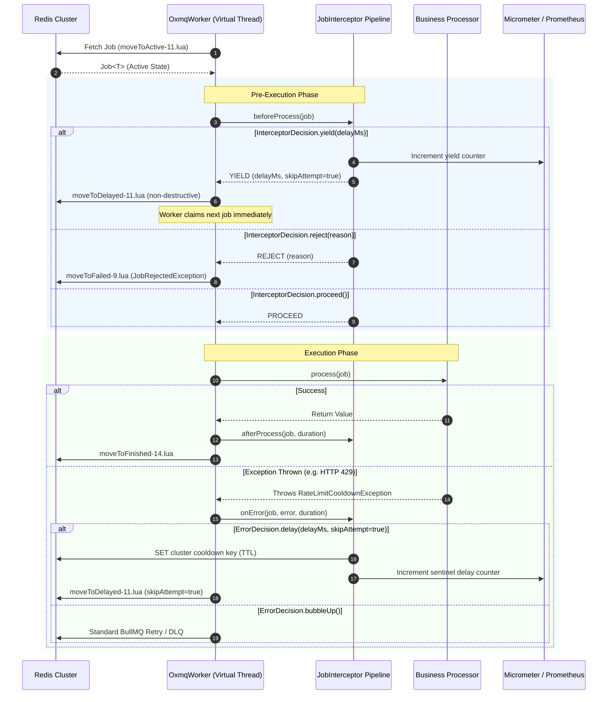

# Plugins & Interceptors SPI

OxMQ provides a non-intrusive, zero-overhead **Interceptor & Plugin Architecture** via `JobInterceptor`.

It allows enterprise applications to intercept jobs at every stage of the execution lifecycle—enforcing distributed multi-tenant rate limits, circuit-breaking external HTTP 429 errors, governing priority quotas, propagating distributed tracing context (MDC/OpenTelemetry), and emitting audit events—**without modifying business worker code and with zero changes to upstream BullMQ Lua scripts**.

---

## 🏛️ Interceptor Lifecycle & Architecture

The worker execution lifecycle in `OxmqWorker` executes an interceptor chain around every job dispatch:



> [!IMPORTANT] Upstream Lua Script Invariance
> All OxMQ plugins use standard BullMQ Lua primitives (`moveToDelayed-*.lua` with `skipAttempt=true`). No upstream Lua scripts are modified or diverged, preserving **100% byte-for-byte polyglot compatibility** with Node.js and Python BullMQ workers.

---

## 🧩 Native Built-in Plugins

OxMQ bundles three production-grade enterprise plugins out of the box in `io.oxmq.plugin`:

| Plugin | Primary Enterprise Purpose | Key Metrics Emitted |
| :--- | :--- | :--- |
| **`GroupRateLimiterPlugin`** | Dynamic sliding-window token bucket partitioned by custom group key (tenant, customer, license tier). | `oxmq.plugin.ratelimiter.yields` |
| **`RateLimitSentinelPlugin`** | Distributed circuit-breaker sentinel for external HTTP 429/503 `Retry-After` cooldowns across all cluster nodes. | `oxmq.plugin.sentinel.delays`<br/>`oxmq.plugin.sentinel.cooldowns` |
| **`PriorityQuotaGovernorPlugin`** | Headroom-based yielding: lower-priority background sweeps automatically defer execution to reserve quota for real-time priority jobs. | `oxmq.plugin.governor.yields` |

---

## 1. `GroupRateLimiterPlugin` (Multi-Tenant Token Bucket)

Enforces dynamic or static rate limits per tenant/group across all distributed cluster nodes using an atomic Redis `INCR` + `EXPIRE` pipeline.

### Standalone Pure Java Configuration

```java
import io.oxmq.OxmqWorker;
import io.oxmq.plugin.GroupRateLimiterPlugin;
import io.oxmq.redis.RedisConnectionManager;
import java.time.Duration;

// 1. Instantiate the plugin
GroupRateLimiterPlugin rateLimiter = GroupRateLimiterPlugin.builder()
        .connectionManager(connectionManager)
        .keyPrefix("oxmq:limiter:tenant")
        .groupKeyResolver(job -> ((TenantPayload) job.getData()).getTenantId())
        .dynamicLimit(tenantId -> licenseTierService.getBurstLimit(tenantId)) // e.g. 50-200 req/sec
        .windowDuration(Duration.ofSeconds(1))
        .retryDelayMs(150)
        .meterRegistry(meterRegistry) // Optional Micrometer registry
        .build();

// 2. Attach directly to worker
OxmqWorker<TenantPayload> worker = OxmqWorker.<TenantPayload>builder()
        .queueName("drive-sync")
        .redisUri("redis://localhost:6379")
        .addInterceptor(rateLimiter)
        .processor(job -> syncDrive(job.getData()))
        .build();

worker.start();
```

### Spring Boot 3 Auto-Configuration

In Spring Boot, simply declare the plugin as a `@Bean`. The starter automatically discovers all `JobInterceptor` beans and injects them into all `@OxmqListener` and `@OxmqBatchListener` workers:

```java
@Configuration
public class OxmqPluginConfiguration {

    @Bean
    public GroupRateLimiterPlugin groupRateLimiter(
            RedisConnectionManager connectionManager,
            LicenseTierService licenseTierService,
            MeterRegistry meterRegistry
    ) {
        return GroupRateLimiterPlugin.builder()
                .connectionManager(connectionManager)
                .keyPrefix("oxmq:limiter:tenant")
                .groupKeyResolver(job -> {
                    if (job.getData() instanceof TenantScopedPayload tsp) {
                        return tsp.tenantId();
                    }
                    return "default";
                })
                .dynamicLimit(tenantId -> licenseTierService.getAllowedRequestsPerSecond(tenantId))
                .windowDuration(Duration.ofSeconds(1))
                .retryDelayMs(150)
                .meterRegistry(meterRegistry)
                .build();
    }
}
```

### Runtime Headroom Inspection APIs

You can query token consumption and remaining headroom programmatically at any time:

```java
// Current usage within active window
long currentCount = rateLimiter.getCurrentUsage("tenant-acme");

// Remaining tokens before exhaustion
long remaining = rateLimiter.getRemainingTokens("tenant-acme");

// Headroom percentage (0.0 to 1.0)
double headroomPercent = rateLimiter.getRemainingHeadroomPercent("tenant-acme");
```

---

## 2. `RateLimitSentinelPlugin` (External 429 Cooldown Sentinel)

When calling third-party SaaS APIs (such as Microsoft Graph, Salesforce, OpenAI, Claude, or Stripe), downstream services will respond with HTTP 429 Too Many Requests and a `Retry-After: N` header when rate limits are exceeded.

Without a sentinel, every worker thread across your cluster will continue attempting HTTP calls, resulting in cascading failures, blocked threads, and severe API bans.

### How It Works:
1. When any worker encounters an HTTP 429/503 response, it throws [`RateLimitCooldownException`](file:///Users/gaurav/git/oxmq/oxmq-core/src/main/java/io/oxmq/exception/RateLimitCooldownException.java).
2. The `RateLimitSentinelPlugin` intercepts the exception in `onError`:
   - It sets a distributed cooldown flag in Redis with a TTL matching `Retry-After`: `SET oxmq:sentinel:tenant:{tenantId} "1" EX {seconds}`.
   - It defers the failed job via `moveToDelayed` with `skipAttempt=true`, preserving all retry attempts.
3. In subsequent runs, `beforeProcess()` checks the distributed sentinel:
   - Any worker on **any cluster node** processing jobs for that tenant immediately defers the job without making the external HTTP call.

### Spring Boot Configuration

```java
@Bean
public RateLimitSentinelPlugin rateLimitSentinel(
        RedisConnectionManager connectionManager,
        MeterRegistry meterRegistry
) {
    return RateLimitSentinelPlugin.builder()
            .connectionManager(connectionManager)
            .keyPrefix("oxmq:sentinel:tenant")
            .groupKeyResolver(job -> ((TenantScopedPayload) job.getData()).tenantId())
            .errorMatcher(t -> t instanceof RateLimitCooldownException)
            .meterRegistry(meterRegistry)
            .build();
}
```

### Worker Implementation with HTTP Client

```java
@Component
public class GraphDriveWorker {

    @Autowired
    private HttpClient httpClient;

    @OxmqListener(queue = "drive-sync", concurrency = 50)
    public void processSync(Job<DriveSyncPayload> job) throws Exception {
        HttpRequest request = HttpRequest.newBuilder()
                .uri(URI.create("https://graph.microsoft.com/v1.0/drives/" + job.getData().driveId()))
                .GET()
                .build();

        HttpResponse<String> response = httpClient.send(request, HttpResponse.BodyHandlers.ofString());

        if (response.statusCode() == 429 || response.statusCode() == 503) {
            long retryAfterSec = response.headers()
                    .firstValueAsLong("Retry-After")
                    .orElse(5L);

            // Throws cooldown exception -> trips distributed cluster-wide sentinel!
            throw new RateLimitCooldownException(
                    Duration.ofSeconds(retryAfterSec), 
                    job.getData().tenantId()
            );
        }

        // Process response payload...
    }
}
```

---

## 3. `PriorityQuotaGovernorPlugin` (Headroom-Based Yielding)

In enterprise data platforms, low-priority background sweeps (e.g. historical crawls, bulk malware audits, compliance reconciliations at Priority 10) can easily saturate a tenant's API quota, starving real-time interactive user actions (e.g. user webhooks, checkout submissions, live delta syncs at Priority 1).

The **`PriorityQuotaGovernorPlugin`** enforces headroom preservation:
- It monitors remaining quota headroom: `headroom = remainingTokens / limit`.
- If headroom drops below the configured safety threshold (e.g., 25% remaining), low-priority jobs (`priority > priorityThreshold`) are non-destructively yielded back to Redis delayed state.
- Strictly protected high-priority jobs (`priority <= priorityThreshold`) continue executing uninterrupted.

### Spring Boot Configuration

```java
@Bean
public PriorityQuotaGovernorPlugin priorityQuotaGovernor(
        GroupRateLimiterPlugin rateLimiter,
        MeterRegistry meterRegistry
) {
    return PriorityQuotaGovernorPlugin.builder()
            .rateLimiter(rateLimiter)
            .groupKeyResolver(job -> ((TenantScopedPayload) job.getData()).tenantId())
            .headroomYieldThreshold(0.25) // Reserve 25% quota buffer for high-priority traffic
            .priorityThreshold(1)         // Priority <= 1 jobs are strictly protected!
            .yieldDelayMs(200)            // Yielded jobs defer 200ms before re-checking
            .meterRegistry(meterRegistry)
            .build();
}
```

---

## 🛠️ Building Custom Interceptors

You can implement the [`JobInterceptor`](file:///Users/gaurav/git/oxmq/oxmq-core/src/main/java/io/oxmq/interceptor/JobInterceptor.java) interface to add cross-cutting concerns to your workers.

### Example: Distributed Tracing & MDC Propagation Interceptor

This interceptor extracts a trace ID from job metadata, binds it to SLF4J MDC before execution so all logs include the trace context, and cleanly purges MDC after completion:

```java
import io.oxmq.interceptor.ErrorDecision;
import io.oxmq.interceptor.InterceptorDecision;
import io.oxmq.interceptor.JobInterceptor;
import io.oxmq.model.Job;
import org.slf4j.MDC;
import org.springframework.stereotype.Component;
import java.time.Duration;

@Component
public class MdcTracingInterceptor implements JobInterceptor {

    private static final String MDC_TRACE_ID = "traceId";
    private static final String MDC_JOB_ID = "jobId";

    @Override
    public <T> InterceptorDecision beforeProcess(Job<T> job) {
        String traceId = job.getOpts() != null && job.getOpts().getJobId() != null
                ? job.getOpts().getJobId()
                : job.getId();

        MDC.put(MDC_TRACE_ID, traceId);
        MDC.put(MDC_JOB_ID, job.getId());

        return InterceptorDecision.proceed();
    }

    @Override
    public <T> void afterProcess(Job<T> job, Duration executionDuration) {
        MDC.remove(MDC_TRACE_ID);
        MDC.remove(MDC_JOB_ID);
    }

    @Override
    public <T> ErrorDecision onError(Job<T> job, Throwable error, Duration duration) {
        MDC.remove(MDC_TRACE_ID);
        MDC.remove(MDC_JOB_ID);
        return ErrorDecision.bubbleUp(); // Delegate to standard BullMQ retry logic
    }
}
```

---

## 📊 Prometheus & Grafana Observability

All plugins natively export high-precision telemetry to Micrometer.

### Exported Metrics Catalog

| Metric Name | Type | Tags | Description |
| :--- | :--- | :--- | :--- |
| `oxmq.plugin.ratelimiter.yields` | Counter | `group`, `queue` | Total jobs delayed by dynamic token-bucket limit exhaustion. |
| `oxmq.plugin.sentinel.delays` | Counter | `group`, `queue` | Total jobs intercepted and delayed by active 429/503 sentinel cooldowns. |
| `oxmq.plugin.sentinel.cooldowns` | Counter | `group` | Total 429 circuit-breaker trips activated across the cluster. |
| `oxmq.plugin.governor.yields` | Counter | `group`, `queue` | Total low-priority jobs yielded to protect high-priority quota headroom. |

### Bundled Enterprise Grafana Dashboard

A production-ready Grafana dashboard is packaged directly inside the starter:
`oxmq-spring-boot-starter/src/main/resources/dashboards/oxmq-grafana-dashboard.json`.

#### Key Dashboard Panels:
1. **Queue Backlog & States**: Real-time gauges for Waiting, Active, Delayed, and Failed jobs.
2. **Cluster Throughput**: Ingestion rate vs completion rate ($jobs/sec$) across all queues.
3. **Multi-Tenant Token Bucket Yields**: Stacked time-series breakdown of yields per tenant.
4. **Sentinel Circuit-Breaker Cooldowns**: Heatmap and alert state for external API throttling.
5. **Execution Latency Percentiles**: $p50$, $p95$, and $p99$ execution durations per queue.

Import this JSON into Grafana (`Dashboards -> New -> Import`) with a Prometheus datasource to monitor your production queues immediately.
