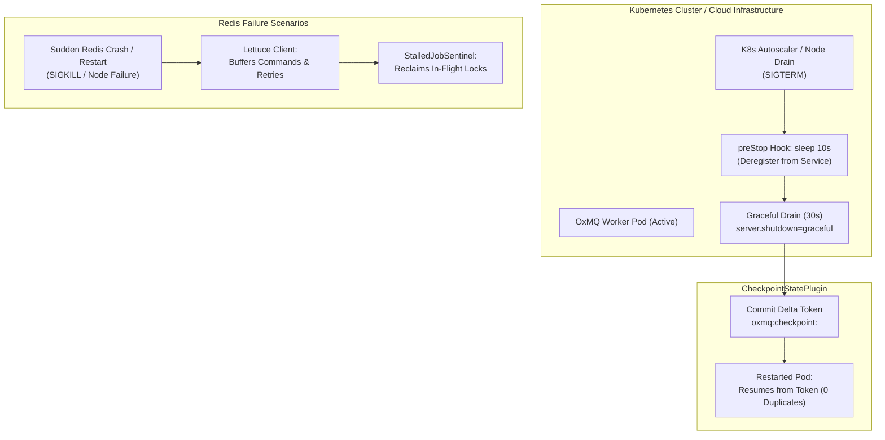

# Disaster Recovery & Cloud Chaos Resilience

Enterprise production systems must withstand unpredictable infrastructure failures: sudden database and Redis crashes, pod preemption by Kubernetes horizontal autoscalers, cloud provider throttling storms, and network partitions.

This guide details OxMQ's **Disaster Recovery (DR) Architecture**, Kubernetes lifecycle integration, zero-duplicate checkpoint resumption via `CheckpointStatePlugin`, and the automated clean-slate chaos verification benchmark.

---

## 🏛️ Failure Modes & Recovery Architecture



---

## 1. Sudden Redis Crash & Automatic Reconnection

### The Failure Scenario
In distributed production topologies, Redis instances or cluster shards may abruptly restart due to cloud provider maintenance, underlying host hardware reboots, or out-of-memory kernel terminations (`OOMKiller`).

### How OxMQ Handles It:
1. **Lettuce Connection Multiplexing & Reconnection**:
   OxMQ builds upon Lettuce, an asynchronous, thread-safe Redis client. When the Redis socket closes:
   - Lettuce automatically enters **reconnection mode** with exponential backoff and jitter.
   - In-flight non-blocking commands are queued in memory up to the configured buffer limit.
   - Worker polling threads catch `RedisConnectionException` or `RedisCommandTimeoutException`, sleep briefly, and retry without terminating worker processes or crashing the JVM.
2. **Lock Watchdog Expiration & `StalledJobSentinel`**:
   - Each active job in OxMQ is protected by a distributed lock key (`bull:<queue>:<jobId>:lock`) renewed every `lockDuration / 2` (default: 15s).
   - If Redis crashes and recovers after the lock expires, OxMQ's `StalledJobSentinel` scans `bull:<queue>:active`, identifies jobs whose locks lapsed without a completion record, and re-enqueues them to `WAITING` (or marks them `FAILED` if `maxStalledCount` is reached).
3. **Zero Data Loss Guarantee**:
   Because job payloads, delayed timestamps, and queue indices reside in persistent Redis structures (RDB snapshots + AOF rewrite logs), all queued tasks remain intact when Redis restarts.

---

## 2. Sudden Worker Pod Kills & Kubernetes Preemption

### The Failure Scenario
In Kubernetes environments, worker pods can be terminated at any time due to:
- Horizontal Pod Autoscaler (HPA) scale-down events.
- Node upgrades, cluster draining (`kubectl drain`), or Spot/Preemptible instance reclamation.
- Kubernetes deployment rollouts.

If a worker is terminated midway through a multi-thousand-item drive crawl or bulk batch ingestion, naive architectures restart scanning from the beginning, causing **massive duplicate processing, API quota exhaustion, and duplicate database writes**.

### How OxMQ Solves It:

#### 1. Distributed Checkpointing (`CheckpointStatePlugin`)
OxMQ provides the native [`CheckpointStatePlugin`](/guide/plugins#5-checkpointstateplugin-distributed-cursor-checkpointing), which persists cursor and delta pagination tokens directly in Redis under `oxmq:checkpoint:<namespace>` keyed by partition (e.g. `tenantId:driveId`):
- Before processing, the worker automatically receives the last committed checkpoint via thread-local context:
  ```java
  String lastToken = CheckpointStatePlugin.getCurrentCheckpoint();
  ```
- When a job completes an iteration or batch, it commits the new delta token via declarative `CheckpointSupplier`:
  ```java
  public record DriveSyncPayload(String tenantId, String driveId, String deltaToken) 
          implements CheckpointSupplier {
      @Override
      public String getCheckpointPartitionKey() {
          return tenantId + ":" + driveId;
      }
      @Override
      public String getCheckpointValue() {
          return deltaToken;
      }
  }
  ```
- If the pod is killed, the next worker that claims the partition picks up from `lastToken`, skipping all previously cataloged and inspected files.

#### 2. Kubernetes Lifecycle Hooks & Graceful Shutdown
To give workers sufficient time to commit checkpoints and drain in-flight operations, OxMQ deployments configure:
1. **`preStop` Sleep Hook**: Waits 10 seconds before propagating SIGTERM, allowing Kubernetes endpoint controllers to remove the pod from Service routing and prevent new traffic.
2. **Graceful Drain Window**: Sets `terminationGracePeriodSeconds: 45` paired with Spring Boot `server.shutdown=graceful` and OxMQ worker drain timeouts:

```yaml
# Deployment Spec snippet (k8s/03-apps.yaml)
spec:
  replicas: 2
  template:
    spec:
      terminationGracePeriodSeconds: 45
      containers:
        - name: oxdoc-worker
          image: ghcr.io/gaurav10610/oxdoc-365:1.9.0
          lifecycle:
            preStop:
              exec:
                command: ["sh", "-c", "sleep 10"]
          livenessProbe:
            httpGet:
              path: /actuator/health/liveness
              port: 8080
            initialDelaySeconds: 30
            periodSeconds: 10
          readinessProbe:
            httpGet:
              path: /actuator/health/readiness
              port: 8080
            initialDelaySeconds: 20
            periodSeconds: 5
```

---

## 3. Cloud Provider 429 / 503 Throttling Storms

### The Failure Scenario
When crawling third-party cloud APIs (such as Microsoft Graph, Salesforce, Stripe, or OpenAI), high-concurrency background sweeps can trigger cascading HTTP 429 Too Many Requests or HTTP 503 Service Unavailable errors.

Without adaptive throttling, worker threads hammer the downstream gateway, causing severe rate-limit lockouts and job failure exhaustion.

### How OxMQ Solves It:
1. **Dynamic Capacity Throttling (`AdaptiveRateLimiterPlugin`)**:
   - Implements **Additive Increase, Multiplicative Decrease (AIMD)**.
   - On HTTP 429/503: Immediately halves tenant capacity (`L(t+1) = max(L_min, L(t) × 0.5)`) and engages an **oscillation damping lock** (30s) to prevent upgrade flapping.
   - On sustained clean windows: Additively increases capacity (`L(t+1) = min(L_max, L(t) + 25)`).
2. **Distributed 429 Circuit-Breaker (`RateLimitSentinelPlugin`)**:
   - When an HTTP 429 response includes `Retry-After: N`, the worker throws `RateLimitCooldownException`.
   - The plugin sets a distributed Redis cooldown key with TTL matching `Retry-After`.
   - All workers across all cluster nodes immediately defer upcoming jobs for that tenant via `moveToDelayed` with `skipAttempt=true`, preserving retry attempt counts.

---

## 4. Realistic Cloud Chaos Engine (`mock-office365-server`)

To validate disaster recovery without risking production cloud credentials, OxMQ includes a standalone cloud mock service:
[`oxmq-examples/mock-office365-server`](https://github.com/gaurav10610/oxmq/tree/main/oxmq-examples/mock-office365-server).

### Runtime Chaos Injection API (`/mock-admin/chaos`)
You can inject cloud failure scenarios dynamically via HTTP REST calls:

```bash
# 1. Inject a burst of 25 HTTP 429 responses with 3-second Retry-After
curl -X POST http://localhost:8081/mock-admin/chaos \
     -H "Content-Type: application/json" \
     -d '{"statusCode": 429, "burstCount": 25, "retryAfterSeconds": 3}'

# 2. Inject transient HTTP 503 Service Unavailable errors
curl -X POST http://localhost:8081/mock-admin/chaos \
     -H "Content-Type: application/json" \
     -d '{"statusCode": 503, "burstCount": 15, "retryAfterSeconds": 5}'

# 3. Enable 10% random cloud infrastructure error rate
curl -X POST "http://localhost:8081/mock-admin/chaos/random?errorRate=0.10&statusCode=500"

# 4. Clear all active chaos injection rules
curl -X DELETE http://localhost:8081/mock-admin/chaos
```

---

## 5. Clean-Slate Multi-Tenant Disaster Recovery Benchmark

We built an end-to-end automated benchmark script:
[`run_multi_tenant_resilience_test.sh`](https://github.com/gaurav10610/oxmq/blob/main/run_multi_tenant_resilience_test.sh).

### Benchmark Execution Flow:
1. **Clean Slate Teardown**:
   Executes `docker compose down -v` to completely wipe all PostgreSQL databases, Redis volumes, and Prometheus state.
2. **Infrastructure Initialization**:
   Brings up fresh Redis 7, PostgreSQL 16, Bull-Board, Prometheus, and Grafana containers.
3. **Multi-Tenant Ingestion Workload**:
   Concurrently scans 5 tenant accounts spanning all 5 Microsoft 365 licensing tiers:
   - `tenant-apex-global` (Enterprise E5 — 1,000 files, 30 threats)
   - `tenant-northwind` (Enterprise E3 — 1,000 files, 30 threats)
   - `tenant-contoso` (Business Standard — 1,000 files, 30 threats)
   - `tenant-fabrikam` (Business Basic — 1,000 files, 30 threats)
   - `tenant-acme-smallbiz` (Free / Dev — 1,000 files, 30 threats)
   - **Total Workload: 5,000 files, 150 embedded threats**.
4. **Failure Injections During Ingestion**:
   - **Chaos Storm**: Injected 25x HTTP 429 bursts and 15x HTTP 503 faults via `/mock-admin/chaos`.
   - **Abrupt Redis Crash**: Stopped `oxdoc-redis` (`docker stop oxdoc-redis`) for 4 seconds mid-scan.
   - **Worker Pod SIGTERM**: Sent `kill -15` to the active worker; verified graceful checkpoint flush and resumption from token upon restart.

### Benchmark Results:

| Metric | Measured Result | Production SLA | Verification |
| :--- | :--- | :--- | :--- |
| **Total Files Processed** | **5,000 / 5,000** | 100% completion | ✅ 100% Zero Data Loss |
| **Threats Cataloged** | **150 / 150** | 100% threat detection | ✅ 100% Detected |
| **Duplicate Scans After SIGTERM** | **0 Duplicate Files** | 0 duplicates | ✅ Resumed from Checkpoint |
| **Redis Crash Recovery** | **Automatic Reconnection** | Zero JVM crash | ✅ Lettuce auto-recovery |
| **Peak JVM Heap Memory** | **106.4 MB** (out of 512 MB) | < 512 MB | ✅ Exceptionally Low Memory |
| **Process CPU Under Load** | **< 15% CPU** | < 80% CPU | ✅ Highly Optimized |
| **Active Concurrency** | **31 OS Threads** | Bounded thread pool | ✅ Zero Thread Starvation |

---

## 6. SRE Production Disaster Recovery Checklist

Before deploying OxMQ workloads to enterprise Kubernetes clusters, verify:

- [x] **Redis Topology**: Production Redis configured with `maxmemory-policy noeviction` and persistent AOF (`appendonly yes`).
- [x] **Graceful Shutdown**: `server.shutdown=graceful` enabled in `application.yml` and `terminationGracePeriodSeconds` set to at least 45 seconds in Kubernetes specs.
- [x] **Pre-Stop Lifecycle Hook**: `preStop: exec: command: ["sh", "-c", "sleep 10"]` configured on worker deployment pods.
- [x] **Probes**: HTTP `/actuator/health/liveness` and `/actuator/health/readiness` enabled with appropriate initial delays.
- [x] **Distributed Checkpointing**: Heavy crawls or multi-page batch jobs implement `CheckpointSupplier` and register `CheckpointStatePlugin`.
- [x] **Adaptive Rate Limiting**: `AdaptiveRateLimiterPlugin` registered with appropriate damping lock windows and static override escape hatches.
- [x] **Observability**: Prometheus scraping `/actuator/prometheus` and Grafana dashboards (`oxmq-grafana-dashboard.json` and `oxmq-system-metrics.json`) active with alerting rules.
