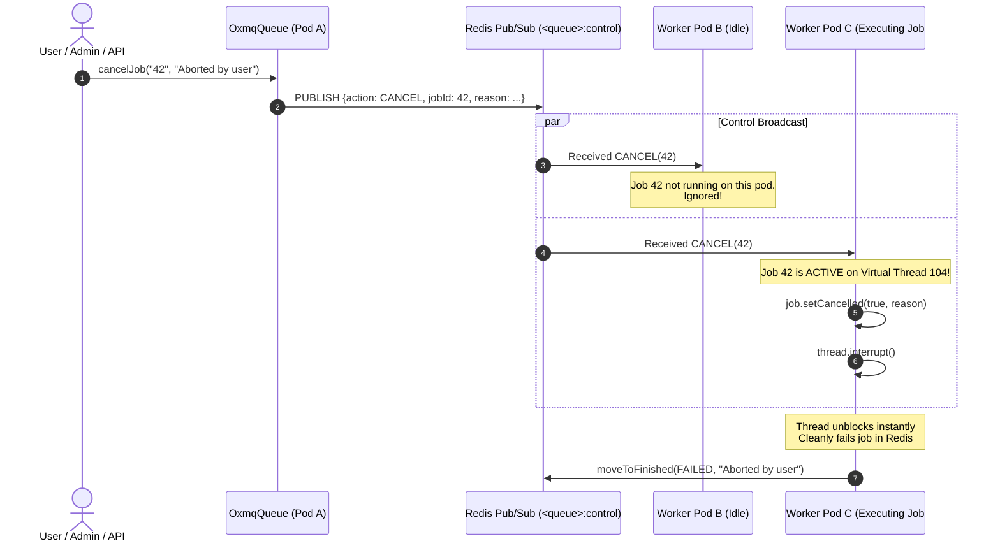

# Cluster-Wide Distributed Job Cancellation

> **100% Free & Open-Source (Apache-2.0)** — Cluster-wide distributed job cancellation across worker pods is included natively in OxMQ core with **zero licensing fees, zero pro tier, and zero commercial paywalls**.

In modern distributed microservice deployments running across Kubernetes pods, jobs frequently need to be aborted in real time (e.g. an end-user cancels an in-flight export, an order is cancelled while payments are charging, or an administrator halts a rogue process).

OxMQ provides **Cluster-Wide Distributed Cancellation** using Redis Pub/Sub control channels to instantly locate and halt active Virtual Threads running across any worker node in the cluster.

---

## 1. Architectural Overview

When an application node or administrator cancels a job, OxMQ:
1. Dispatches a broadcast cancellation control message over the dedicated Redis pub/sub channel `<prefix>:<queue>:control`.
2. Every active worker pod across the cluster subscribed to `<queue>:control` receives the broadcast.
3. If a worker pod is actively executing that specific job ID on a Virtual Thread:
   - It marks `job.isCancelled()` as `true` with the cancellation reason.
   - It immediately interrupts the executing Virtual Thread (`Thread.interrupt()`).
4. Blocking I/O or sleep calls throw `InterruptedException` / `JobCancelledException`, halting execution immediately.
5. The worker cleans up Redis locks and marks the job as `FAILED` (or discarded).



---

## 2. Pure Java API Usage

### Enqueueing and Cancelling Jobs

```java
import io.oxmq.OxmqQueue;
import io.oxmq.model.Job;

OxmqQueue<String> queue = OxmqQueue.<String>builder()
        .name("long-running-reports")
        .redisUri("redis://localhost:6379")
        .build();

// Enqueue long-running job
Job<String> job = queue.add("generate-report", "{\"reportId\": 42}");

// Later, cancel the job cluster-wide with a custom reason:
queue.cancelJob(job.getId(), "Report was aborted by user from dashboard");
```

### Worker Processor Cancellation Handling

In OxMQ, workers run tasks on Java 21 **Virtual Threads**. Standard blocking I/O calls (`Socket.read()`, `Thread.sleep()`, HTTP requests, database queries) automatically respond to thread interruption:

```java
import io.oxmq.OxmqWorker;
import io.oxmq.exception.JobCancelledException;

OxmqWorker<String> worker = OxmqWorker.<String>builder()
        .queueName("long-running-reports")
        .redisUri("redis://localhost:6379")
        .concurrency(10)
        .processor(job -> {
            for (int i = 0; i < 1000; i++) {
                // Check cooperative cancellation flag if performing CPU-heavy loops:
                if (job.isCancelled()) {
                    throw new JobCancelledException("Stopping loop: " + job.getCancelReason());
                }

                // Standard blocking I/O unblocks immediately on cancellation:
                processChunk(i);
                Thread.sleep(100);
            }
            return "SUCCESS";
        })
        .build();

worker.start();
```

---

## 3. Spring Boot 3+ Starter Integration

### Enqueue and Cancel via `OxmqTemplate`

```java
@Service
public class ReportService {

    @Autowired
    private OxmqTemplate oxmqTemplate;

    public String submitReport(ReportRequest request) {
        Job<ReportRequest> job = oxmqTemplate.send("reports", "generate", request);
        return job.getId();
    }

    public void abortReport(String jobId, String reason) {
        // Dispatches cluster-wide cancellation across all running worker pods
        oxmqTemplate.cancelJob("reports", jobId, reason);
    }
}
```

### `@OxmqListener` Processor

```java
@Component
public class ReportWorker {

    @OxmqListener(queue = "reports", concurrency = 20)
    public void processReport(Job<ReportRequest> job) throws InterruptedException {
        while (!job.isCancelled()) {
            executeReportBatch();
            Thread.sleep(200); // Interrupted immediately if cancelled!
        }
    }
}
```

---

## 4. Key Advantages

- **Zero Polling Overhead:** Uses Redis Pub/Sub push channels; workers do not poll Redis hashes for cancellation status.
- **Cross-Pod Synchronization:** Works seamlessly across tens or hundreds of Kubernetes worker pods.
- **Virtual Thread Cleanliness:** Directly invokes `Thread.interrupt()` on the exact Virtual Thread executing the target job.
- **Auditable Failure Reason:** The cancellation reason is permanently recorded in Redis under `failedReason` and propagated to Bull-Board dashboards and OpenTelemetry spans.
