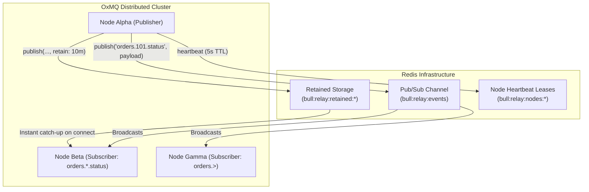

# Distributed Pub/Sub Control Plane & Event Relay (`OxmqRelay`)

> **100% Free & Open-Source (Apache-2.0)** — Distributed cluster pub/sub messaging and inter-node event routing is included natively in OxMQ with **zero licensing fees, zero pro tier, and zero commercial paywalls**.

While message queues handle asynchronous, persistent task dispatch, distributed architectures also require a high-throughput **Control Plane and Event Relay** for real-time inter-service communication:
- Cache invalidation broadcasts across microservices
- Real-time client notifications & WebSocket broadcast relays
- Dynamic configuration & feature flag synchronizations
- Cluster node heartbeats & active topology discovery

OxMQ includes **`OxmqRelay`**: a lightweight, ultra-fast distributed pub/sub routing engine backed by Redis.

---

## 1. Architectural Highlights



### Core Features:
1. **Hierarchical Topic Pattern Matching:**
   - Exact matching: `"orders.status"`
   - Single-segment wildcard (`*`): `"orders.*.status"` (matches `"orders.42.status"`, but not `"orders.42.v1.status"`)
   - Multi-segment trailing wildcard (`>`): `"orders.>"` (matches `"orders.42.status"`, `"orders.checkout.payment.processed"`)
2. **Retained Messages with TTL:** Publish configuration updates or current states with a retention duration; any node subscribing later immediately receives the latest retained message on connect.
3. **Automated Deduplication:** Guarantees that subscribers connecting during active publishing never receive duplicate deliveries between initial retained catch-up and live pub/sub broadcast.
4. **Heartbeat Leases & Node Discovery:** Nodes periodically renew an ephemeral lease in Redis; `getActiveNodes()` returns currently alive cluster nodes.

---

## 2. Pure Java API Usage

### Starting and Publishing Messages

```java
import io.oxmq.relay.OxmqRelay;
import io.oxmq.relay.RelaySubscription;
import java.time.Duration;

// 1. Build an OxmqRelay instance
OxmqRelay relay = OxmqRelay.builder()
        .redisUri("redis://localhost:6379")
        .nodeId("order-service-pod-1")
        .prefix("my-app:relay")
        .build();

// 2. Publish standard fire-and-forget message
relay.publish("orders.101.created", new OrderCreatedEvent("101", 150.00));

// 3. Publish retained state message (cached for 1 hour in Redis)
relay.publish("config.features.darkmode", "enabled", Duration.ofHours(1));
```

### Subscribing to Hierarchical Topics

```java
// Exact topic subscription
RelaySubscription subExact = relay.subscribe("orders.101.created", msg -> {
    OrderCreatedEvent event = msg.getPayload(OrderCreatedEvent.class);
    System.out.println("Received order: " + event.orderId());
});

// Single-segment wildcard (*) subscription: matches any single order ID
RelaySubscription subWildcard = relay.subscribe("orders.*.status", msg -> {
    System.out.printf("Topic: %s, Sender: %s%n", msg.getTopic(), msg.getSenderNodeId());
});

// Multi-segment trailing wildcard (>) subscription: matches all sub-topics
RelaySubscription subTree = relay.subscribe("telemetry.>", msg -> {
    System.out.println("Cluster metric: " + msg.getPayloadJson());
});

// Retained message immediate delivery:
// If "config.features.darkmode" was already published with retention,
// this handler will execute immediately upon registration!
RelaySubscription subRetained = relay.subscribe("config.features.*", msg -> {
    System.out.println("Feature config catch-up: " + msg.getPayload(String.class));
});

// Unsubscribe when no longer needed
subWildcard.unsubscribe();
```

### Discovering Active Nodes

```java
List<String> liveNodes = relay.getActiveNodes();
System.out.println("Active cluster nodes: " + liveNodes);
```

---

## 3. Spring Boot 3+ Starter Integration

In Spring Boot applications, `OxmqRelay` is automatically registered as a `@Lazy` bean using your configured connection manager:

```java
@Service
public class ClusterCacheService {

    @Autowired
    private OxmqRelay relay;

    @PostConstruct
    public void init() {
        // Subscribe to cluster-wide cache invalidation events
        relay.subscribe("cache.invalidate.>", msg -> {
            String cacheKey = msg.getPayload(String.class);
            localCache.evict(cacheKey);
        });
    }

    public void evictAcrossCluster(String cacheKey) {
        // Broadcast eviction to all nodes
        relay.publish("cache.invalidate." + cacheKey, cacheKey);
    }
}
```

---

## 4. Performance & Wire Characteristics

- **Throughput:** Capable of routing $> 150,000 \text{ msg/sec}$ over local Redis pub/sub.
- **Memory Footprint:** Ephemeral memory only; non-retained messages are dispatched directly in Redis memory without persistent storage.
- **Zero Third-Party Broker:** Avoids running a separate NATS or RabbitMQ broker when Redis is already part of your infrastructure.
