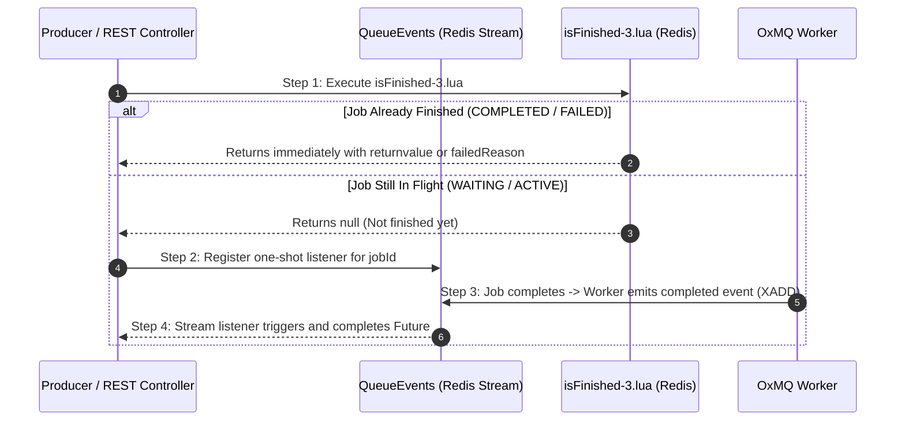

# Pattern: Request-Reply (`waitUntilFinished`)

In modern microservices, web APIs frequently need to offload computationally heavy tasks (e.g., PDF generation, AI prompt inferences, image rendering, or fraud analysis) to asynchronous worker pools, but the calling HTTP request or parent service needs to await the final computed result or a timeout before replying to the user.

Without native support, developers are forced to write clumsy polling loops with `Thread.sleep()` or wire custom Redis Pub/Sub channels.

**OxMQ provides native, event-driven Request-Reply** powered by Redis Streams and official BullMQ `isFinished-3.lua` scripts.

---

## ⚡ Synchronous vs. Asynchronous Waiting

OxMQ offers two waiting paradigms:
1. **Asynchronous (Non-Blocking)**: Returns a `CompletableFuture<Object>`, ideal for reactive Spring WebFlux or non-blocking Spring MVC controllers.
2. **Synchronous (Virtual-Thread Safe)**: Blocks the calling thread with an explicit timeout. On Java 21, blocking Virtual Threads unmount from OS carrier threads with zero thread starvation.

---

## 💻 1. Asynchronous Request-Reply in Spring Boot

In a Spring Boot REST Controller, enqueue the job and return a non-blocking `CompletableFuture`:

```java
package com.example.controller;

import io.oxmq.QueueEvents;
import io.oxmq.model.Job;
import io.oxmq.spring.OxmqTemplate;
import org.springframework.beans.factory.annotation.Autowired;
import org.springframework.http.HttpStatus;
import org.springframework.http.ResponseEntity;
import org.springframework.web.bind.annotation.*;

import java.time.Duration;
import java.util.concurrent.CompletableFuture;

@RestController
@RequestMapping("/api/reports")
public class ReportController {

    @Autowired
    private OxmqTemplate oxmqTemplate;

    @PostMapping("/generate")
    public CompletableFuture<ResponseEntity<ReportResult>> generateReport(@RequestBody ReportRequest request) {
        // 1. Submit the heavy job to the worker queue
        Job<ReportRequest> job = oxmqTemplate.send("report-generation", "compile-pdf", request);

        // 2. Await completion asynchronously via OxmqTemplate (30-second timeout)
        return oxmqTemplate.waitUntilFinishedAsync("report-generation", job.getId(), Duration.ofSeconds(30))
                .thenApply(result -> ResponseEntity.ok((ReportResult) result))
                .exceptionally(ex -> ResponseEntity.status(HttpStatus.GATEWAY_TIMEOUT).build());
    }
}
```

---

## ☕ 2. Standalone Java Usage (`Job` and `QueueEvents`)

When using pure `oxmq-core`, you can await results directly from the `Job` instance or via `QueueEvents`:

```java
package com.example;

import io.oxmq.OxmqQueue;
import io.oxmq.QueueEvents;
import io.oxmq.model.Job;

import java.time.Duration;
import java.util.concurrent.ExecutionException;
import java.util.concurrent.TimeoutException;

public class RequestReplyExample {

    public static void main(String[] args) throws Exception {
        String redisUri = "redis://localhost:6379";

        // 1. Initialize Queue & Event Listener
        OxmqQueue<InferencePrompt> queue = OxmqQueue.<InferencePrompt>builder()
                .name("ai-inferences")
                .redisUri(redisUri)
                .payloadClass(InferencePrompt.class)
                .build();

        QueueEvents events = QueueEvents.builder()
                .queueName("ai-inferences")
                .redisUri(redisUri)
                .build()
                .start();

        // 2. Submit the inference job
        Job<InferencePrompt> job = queue.add("prompt-task", new InferencePrompt("Summarize Q3 earnings"));

        try {
            // 3. Block and await the worker's return value
            Object result = job.waitUntilFinished(events, Duration.ofSeconds(15));
            System.out.println("Computed AI Result: " + result);

        } catch (TimeoutException e) {
            System.err.println("Worker did not finish within 15 seconds!");
        } catch (ExecutionException e) {
            System.err.println("Worker encountered an error: " + e.getCause().getMessage());
        } finally {
            events.close();
            queue.close();
        }
    }
}
```

---

## 🔍 3. Waiting from Queue (`Queue.waitUntilFinished`)

If you already have a `jobId` and need to await its result from another process:

```java
Object result = queue.waitUntilFinished(jobId, events, Duration.ofSeconds(20));
```

Or non-blocking:

```java
CompletableFuture<Object> future = queue.waitUntilFinishedAsync(jobId, events, Duration.ofSeconds(20));
future.thenAccept(output -> log.info("Job output: {}", output));
```

---

## 🔬 How It Works Under the Hood



### Race-Free Guarantees
1. **Immediate Completion Check**: Before listening to Redis streams, OxMQ invokes official BullMQ `isFinished-3.lua`. If the job finished before the listener was registered, the result returns immediately ($O(1)$) with zero latency.
2. **Stream Notification**: If the job is still running, OxMQ registers a one-shot handler on the Redis Stream event listener. The moment the worker completes the task, the stream event delivers the return value.
3. **Automatic Deregistration**: If the timeout expires or an error occurs, the listener unregisters itself via `QueueEvents.off(...)` to prevent memory leaks.

---

## 🛡️ Best Practices & Production Guidelines

1. **Always Set Realistic Timeouts**: Never call `waitUntilFinished` without an explicit `Duration`. Long-running background jobs should not tie up client connections indefinitely.
2. **Share `QueueEvents` Instances**: A single `QueueEvents` instance per queue should be shared across the entire microservice. Do not create a new `QueueEvents` instance per HTTP request.
3. **Use Virtual Threads on Java 21**: Blocking waits on Java 21 Virtual Threads unmount from carrier threads, allowing single nodes to handle thousands of concurrent request-reply jobs without thread pool exhaustion.
