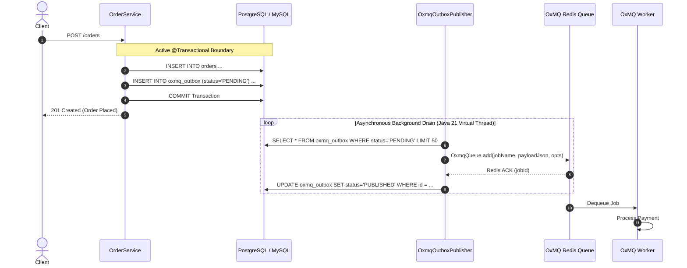

# Transactional Outbox Pattern

> **Guarantee At-Least-Once Delivery with Zero Message Loss** across relational databases (PostgreSQL, MySQL, Oracle, H2) and Redis in Spring Boot 3+ applications.

The **Transactional Outbox Pattern** solves the classic distributed systems "Dual-Write Problem" where an application must update an RDBMS database and publish a background job to a message queue in the same business transaction.

---

## 1. The Dual-Write Problem

Consider an e-commerce order service that creates an order in PostgreSQL and enqueues a background payment job in Redis:

```
Approach A (DB Commit First):
1. db.save(order) -> Database COMMITTED!
2. queue.add("process-payment") -> APP CRASHES OR REDIS IS DOWN!
Result: Order exists in DB, but payment job was never sent! Money is lost.

Approach B (Queue Publish First):
1. queue.add("process-payment") -> Job sent to Redis!
2. db.save(order) -> DB UNIQUE CONSTRAINT VIOLATION! Transaction rolls back!
Result: Job runs and charges customer for an order that does not exist in DB!
```

Distributed 2PC (Two-Phase Commit / XA) is notoriously fragile, slow, and unsupported by Redis. 

The **Transactional Outbox Pattern** solves this without 2PC by writing the job into an **Outbox Table** inside the *same database transaction* as the business entity. A background publisher then reliably relays the jobs to Redis.



---

## 2. Architecture & Components in OxMQ

OxMQ provides built-in outbox support in `oxmq-spring-boot-starter`:

| Component | Role |
| :--- | :--- |
| `OxmqOutboxRecord` | Encapsulates outbox state (`id`, `queueName`, `jobName`, `payloadJson`, `optionsJson`, `groupKey`, `status`, `attempts`, `publishedAt`, `lastError`). |
| `OxmqOutboxRepository` | Pluggable SPI for persisting and querying outbox records in RDBMS or in-memory stores. |
| `OxmqOutboxService` | High-level API injected into business code (`enqueue`, `enqueueGroup`). |
| `OxmqOutboxPublisher` | SmartLifecycle background worker that runs on a Java 21 Virtual Thread, draining pending records and committing them to Redis. |
| `@EnableOxmqOutbox` | Spring Boot annotation that activates the outbox subsystem. |

---

## 3. Quickstart in Spring Boot 3+

### Step 1: Enable the Outbox Subsystem

Annotate your configuration or main application class:

```java
import io.oxmq.spring.outbox.EnableOxmqOutbox;
import org.springframework.boot.SpringApplication;
import org.springframework.boot.autoconfigure.SpringBootApplication;

@SpringBootApplication
@EnableOxmqOutbox
public class OrderServiceApplication {
    public static void main(String[] args) {
        SpringApplication.run(OrderServiceApplication.class, args);
    }
}
```

### Step 2: Enqueue Jobs Transactionally in Business Services

Inject `OxmqOutboxService` into your transactional service:

```java
import io.oxmq.model.JobOptions;
import io.oxmq.spring.outbox.OxmqOutboxService;
import org.springframework.stereotype.Service;
import org.springframework.transaction.annotation.Transactional;

@Service
public class OrderService {

    private final OrderRepository orderRepository;
    private final OxmqOutboxService outboxService;

    public OrderService(OrderRepository orderRepository, OxmqOutboxService outboxService) {
        this.orderRepository = orderRepository;
        this.outboxService = outboxService;
    }

    @Transactional
    public Order placeOrder(CreateOrderRequest request) {
        // 1. Mutate business entity in SQL DB
        Order order = new Order(request.customerId(), request.items(), request.totalAmount());
        orderRepository.save(order);

        // 2. Enqueue background job in the same SQL transaction
        PaymentJobPayload payload = new PaymentJobPayload(order.getId(), order.getTotalAmount());
        outboxService.enqueueGroup(
            "payments-queue",
            "process-payment",
            request.tenantId(), // Multi-tenant virtual group!
            payload,
            JobOptions.builder().attempts(3).build()
        );

        // 3. Method returns -> Transaction COMMITS atomically!
        // Both the order and the outbox record are committed simultaneously.
        return order;
    }
}
```

---

## 4. Customizing the Database Repository (JPA / JDBC)

By default, an `InMemoryOxmqOutboxRepository` is registered for testing and rapid development. For production environments with PostgreSQL, MySQL, or Oracle, implement `OxmqOutboxRepository`:

### SQL Schema Example (PostgreSQL)

```sql
CREATE TABLE oxmq_outbox (
    id VARCHAR(64) PRIMARY KEY,
    queue_name VARCHAR(128) NOT NULL,
    job_name VARCHAR(128) NOT NULL,
    payload_json TEXT NOT NULL,
    options_json TEXT,
    group_key VARCHAR(128),
    status VARCHAR(32) NOT NULL DEFAULT 'PENDING',
    attempts INT NOT NULL DEFAULT 0,
    created_at TIMESTAMP WITH TIME ZONE NOT NULL DEFAULT NOW(),
    published_at TIMESTAMP WITH TIME ZONE,
    last_error TEXT
);

CREATE INDEX idx_oxmq_outbox_pending ON oxmq_outbox(created_at) WHERE status = 'PENDING';
```

### Spring Data JDBC / JdbcTemplate Implementation

```java
import io.oxmq.spring.outbox.OxmqOutboxRecord;
import io.oxmq.spring.outbox.OxmqOutboxRepository;
import org.springframework.jdbc.core.JdbcTemplate;
import org.springframework.stereotype.Repository;

import java.sql.Timestamp;
import java.time.Duration;
import java.time.Instant;
import java.util.List;
import java.util.Optional;

@Repository
public class PostgresOxmqOutboxRepository implements OxmqOutboxRepository {

    private final JdbcTemplate jdbc;

    public PostgresOxmqOutboxRepository(JdbcTemplate jdbc) {
        this.jdbc = jdbc;
    }

    @Override
    public void save(OxmqOutboxRecord r) {
        jdbc.update(
            "INSERT INTO oxmq_outbox (id, queue_name, job_name, payload_json, options_json, group_key, status, attempts, created_at) " +
            "VALUES (?, ?, ?, ?, ?, ?, ?, ?, ?)",
            r.getId(), r.getQueueName(), r.getJobName(), r.getPayloadJson(), r.getOptionsJson(),
            r.getGroupKey(), r.getStatus().name(), r.getAttempts(), Timestamp.from(r.getCreatedAt())
        );
    }

    @Override
    public List<OxmqOutboxRecord> findPending(int limit) {
        return jdbc.query(
            "SELECT * FROM oxmq_outbox WHERE status = 'PENDING' ORDER BY created_at ASC LIMIT ?",
            (rs, rowNum) -> {
                OxmqOutboxRecord r = new OxmqOutboxRecord();
                r.setId(rs.getString("id"));
                r.setQueueName(rs.getString("queue_name"));
                r.setJobName(rs.getString("job_name"));
                r.setPayloadJson(rs.getString("payload_json"));
                r.setOptionsJson(rs.getString("options_json"));
                r.setGroupKey(rs.getString("group_key"));
                r.setStatus(OxmqOutboxRecord.Status.valueOf(rs.getString("status")));
                r.setAttempts(rs.getInt("attempts"));
                r.setCreatedAt(rs.getTimestamp("created_at").toInstant());
                return r;
            },
            limit
        );
    }

    @Override
    public void markPublished(String id) {
        jdbc.update("UPDATE oxmq_outbox SET status = 'PUBLISHED', published_at = NOW() WHERE id = ?", id);
    }

    @Override
    public void markFailed(String id, String error) {
        jdbc.update("UPDATE oxmq_outbox SET attempts = attempts + 1, last_error = ? WHERE id = ?", error, id);
    }

    @Override
    public Optional<OxmqOutboxRecord> findById(String id) {
        List<OxmqOutboxRecord> list = jdbc.query(
            "SELECT * FROM oxmq_outbox WHERE id = ?",
            (rs, rowNum) -> {
                OxmqOutboxRecord r = new OxmqOutboxRecord();
                r.setId(rs.getString("id"));
                r.setStatus(OxmqOutboxRecord.Status.valueOf(rs.getString("status")));
                return r;
            },
            id
        );
        return list.isEmpty() ? Optional.empty() : Optional.of(list.get(0));
    }

    @Override
    public long purgePublishedOlderThan(Duration maxAge) {
        Instant cutoff = Instant.now().minus(maxAge);
        return jdbc.update("DELETE FROM oxmq_outbox WHERE status = 'PUBLISHED' AND published_at < ?", Timestamp.from(cutoff));
    }
}
```

---

## 5. Configuration Properties

You can tune the publisher parameters in your `application.yml`:

```yaml
oxmq:
  redis:
    uri: redis://localhost:6379
  outbox:
    enabled: true              # Defaults to true
    batch-size: 100            # Records fetched per drain cycle
    poll-interval-ms: 50       # Milliseconds between database poller runs
    purge-retention: 24h       # Time to keep published records before purging
```

---

## 6. Resilience & Idempotence

1. **Crash Resilience:** If Redis is down for 10 minutes, the publisher simply retries on subsequent cycles without losing a single message.
2. **At-Least-Once Guarantee:** If the publisher crashes right after pushing to Redis but before writing `markPublished` to the DB, the record will be republished upon recovery. To ensure strict idempotence downstream, use BullMQ's deduplication ID:
   ```java
   JobOptions.builder()
           .deduplicationId("order-payment-" + order.getId())
           .build()
   ```
   OxMQ's native deduplication engine will atomically discard the duplicate publish in Redis!
