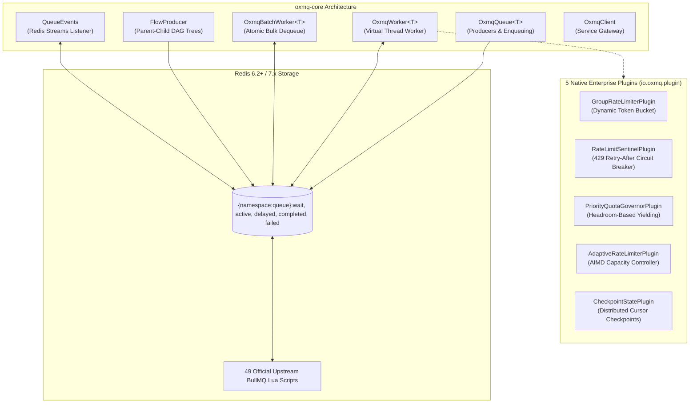

# 🐂 OxMQ Core Engine (`oxmq-core`)

<p align="center">
  <a href="https://central.sonatype.com/artifact/io.github.gaurav10610/oxmq-core"></a>
  <a href="https://github.com/gaurav10610/oxmq/releases/tag/v1.7.0"></a>
  <a href="https://jitpack.io/#gaurav10610/oxmq"></a>
  <a href="https://openjdk.org/projects/jdk/17/"></a>
  <a href="https://opensource.org/licenses/Apache-2.0"></a>
</p>

> The high-performance, pure Java distributed job queue and DAG workflow engine for **Java 17+ & Java 21 Loom (Virtual Threads)** with **100% BullMQ Wire Parity**.

---

## 📦 Maven / Gradle Dependency

### Maven Central (Global Standard — Zero Config)
```xml
<dependency>
    <groupId>io.github.gaurav10610</groupId>
    <artifactId>oxmq-core</artifactId>
    <version>1.7.0</version>
</dependency>
```

### Gradle
```kotlin
implementation("io.github.gaurav10610:oxmq-core:1.7.0")
```

---

## ⚡ Core Components Architecture



---

## 🚀 60-Second Quickstart

### 1. Initialize Queue & Enqueue Jobs
```java
import io.oxmq.OxmqQueue;
import io.oxmq.model.Job;
import io.oxmq.model.JobOptions;
import io.oxmq.model.KeepJobs;
import java.time.Duration;

public record EmailNotification(String to, String subject, String body) {}

OxmqQueue<EmailNotification> queue = OxmqQueue.<EmailNotification>builder()
        .name("notifications")
        .redisUri("redis://localhost:6379")
        .payloadClass(EmailNotification.class)
        .build();

Job<EmailNotification> job = queue.add("welcome-email",
        new EmailNotification("alice@example.com", "Welcome!", "Hello Alice!"),
        JobOptions.builder()
                .delay(Duration.ofSeconds(5))
                .attempts(3)
                .exponentialBackoff(Duration.ofSeconds(1), Duration.ofSeconds(30))
                .removeOnComplete(KeepJobs.count(500))
                .build());
```

### 2. Consume on Virtual Threads (Java 21+)
```java
import io.oxmq.OxmqWorker;

OxmqWorker<EmailNotification> worker = OxmqWorker.<EmailNotification>builder()
        .queueName("notifications")
        .redisUri("redis://localhost:6379")
        .concurrency(100) // 100 concurrent Virtual Threads
        .processor(job -> {
            job.updateProgress(50);
            job.log("Dispatching email to " + job.getData().to());
            emailService.send(job.getData());
            return "DELIVERED";
        })
        .build();

worker.start();
```

### 3. Request-Reply: Await Job Completion
```java
// Await completion with microsecond-accurate timeout enforcement:
Object result = job.waitUntilFinished(queue.getQueueEvents(), Duration.ofSeconds(10));
System.out.println("Job output: " + result); // "DELIVERED"
```

### 4. High-Throughput Batch Dequeue (`OxmqBatchWorker`)
```java
OxmqBatchWorker<AuditEvent> batchWorker = OxmqBatchWorker.<AuditEvent>builder()
        .queueName("audit-stream")
        .redisUri("redis://localhost:6379")
        .batchSize(100)
        .maxBatchBytes(16 * 1024 * 1024) // 16 MB heap guardrail
        .batchTimeout(Duration.ofMillis(200))
        .processor(batch -> {
            clickHouseService.batchInsert(batch.stream().map(Job::getData).toList());
            return "INSERTED_" + batch.size();
        })
        .build();

batchWorker.start();
```

### 5. Parent-Child DAG Workflows (`FlowProducer`)
```java
FlowProducer flow = new FlowProducer("redis://localhost:6379");

FlowJob<VideoChunk> chunk1 = FlowJob.of("chunks", "chunk-1", new VideoChunk(1));
FlowJob<VideoChunk> chunk2 = FlowJob.of("chunks", "chunk-2", new VideoChunk(2));

FlowJob<Assembly> parent = FlowJob.of("assembly", "master", new Assembly("vid-1"))
        .addChild(chunk1)
        .addChild(chunk2);

// Atomically enqueue the DAG; parent resolves only when all children finish!
String rootJobId = flow.add(parent);
```

---

## 🧩 5 Native Enterprise Plugins (`io.oxmq.plugin`)

OxMQ core bundles five battle-tested plugins implementing the zero-overhead `JobInterceptor` SPI:

1. **`GroupRateLimiterPlugin`**: Distributed token bucket rate limiter partitioned by custom group key (tenant, customer, license tier).
2. **`RateLimitSentinelPlugin`**: Cluster-wide circuit breaker that intercepts HTTP 429 `Retry-After` exceptions and locks cooldown keys in Redis.
3. **`PriorityQuotaGovernorPlugin`**: Headroom-based yielding: forces low-priority background sweeps (Priority 10) to defer when capacity drops below 25%, strictly reserving quota for real-time priority jobs (Priority 1).
4. **`AdaptiveRateLimiterPlugin`**: AIMD dynamic capacity controller that halves limits upon 429/503 errors, locks against oscillation, and steps up capacity on sustained clean execution windows.
5. **`CheckpointStatePlugin`**: Distributed cursor and delta token persistence in Redis (`oxmq:checkpoint:<namespace>`) with thread-local context injection and zero-duplicate crash recovery.

---

## 🧪 Testing & Verification
The `oxmq-core` test suite is 100% automated and verified:
```bash
mvn test -pl oxmq-core
```
**Status: 77 / 77 passing (0 failures, 0 errors)**.
