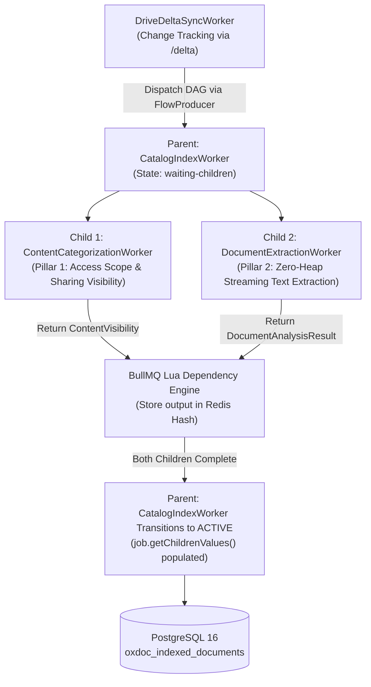
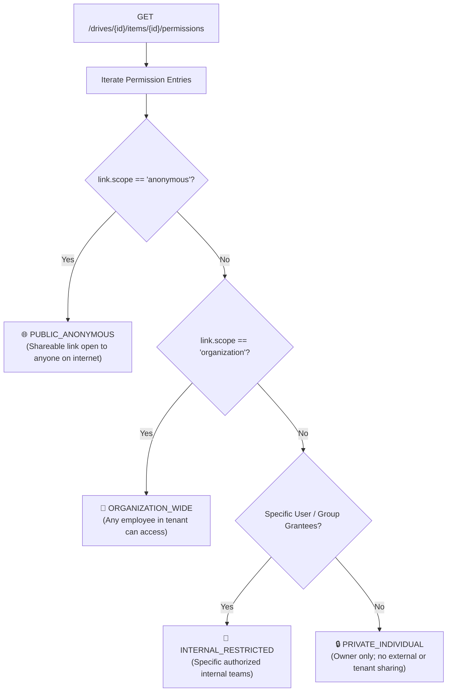
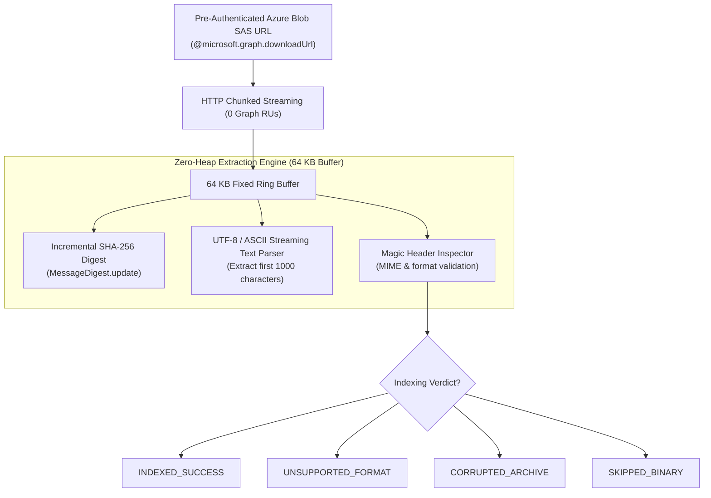

# 🔬 OxDoc 365: Dual-Pillar Document Intelligence DAG & Content Analysis Pipeline

---

## 1. Executive Summary & Design Overview

Enterprise Content Intelligence and Document AI require evaluating two orthogonal dimensions for every document across Microsoft 365 SharePoint and OneDrive:
1. **Pillar 1: Access Scope & Content Visibility Classification (Who has visibility?):** Who can read and collaborate on this document? Is it open to the entire internet? Shared organization-wide? Restricted to specific internal groups? Or private to the owner?
2. **Pillar 2: Document Extraction & Deep Text Analysis (What knowledge does it contain?):** Can text and metadata be extracted? What is its character encoding and content format? Does it contain valid readable sections or corrupted binary headers? What is its cryptographic content digest?

Processing both dimensions sequentially for millions of files creates severe throughput bottlenecks. Processing them as disconnected jobs creates database race conditions.

**OxDoc 365** solves this using an **OxMQ `FlowProducer` Directed Acyclic Graph (DAG)**:



---

## 2. OxMQ FlowProducer DAG Execution Mechanics

### 2.1 The DAG Structure
For every file modified or discovered, [`DriveDeltaSyncWorker.java`](file:///Users/gaurav/git/oxmq/oxmq-examples/oxdoc-365/src/main/java/io/oxmq/oxdoc/queue/DriveDeltaSyncWorker.java) constructs a 3-node dependency tree:

```java
// Parent Aggregator Node
FlowJob<DocumentCatalogPayload> parentFlow = FlowJob.of(
        OxDocQueueConstants.QUEUE_CATALOG_INDEX,
        "catalog-" + item.name(),
        catalogPayload,
        JobOptions.builder()
                .priority(priority)
                .attempts(3)
                .backoff(new BackoffStrategy.Exponential(1000L))
                .build()
);

// Child 1: Content Categorization Worker (Pillar 1)
FlowJob<DocumentProcessingPayload> childCategorize = FlowJob.of(
        OxDocQueueConstants.QUEUE_CONTENT_CATEGORIZATION,
        "cat-" + item.name(),
        processPayload,
        JobOptions.builder().priority(priority).attempts(3).failParentOnFailure(false).build()
);

// Child 2: Document Extraction Worker (Pillar 2)
FlowJob<DocumentProcessingPayload> childExtract = FlowJob.of(
        OxDocQueueConstants.QUEUE_DOCUMENT_EXTRACTION,
        "extract-" + item.name(),
        processPayload,
        JobOptions.builder().priority(priority).attempts(3).failParentOnFailure(false).build()
);

parentFlow.addChildren(List.of(childCategorize, childExtract));
flowProducer.add(parentFlow);
```

### 2.2 BullMQ Lua Dependency Resolution
1. **Atomic Ingestion:** `flowProducer.add(parentFlow)` executes BullMQ's native Lua script (`addFlowJob.lua`), writing the parent and both children atomically to Redis.
2. **Initial State:**
   - Both child jobs are placed into their respective queue `wait` states.
   - The parent job is placed into the `waiting-children` state in Redis.
3. **Parallel Execution:** `ContentCategorizationWorker` and `DocumentExtractionWorker` claim and execute child jobs concurrently across independent worker threads.
4. **Result Propagation:** When a child completes, its return value (`ContentVisibility` or `DocumentAnalysisResult`) is serialized to JSON and stored in the parent's Redis dependency map.
5. **Parent Activation:** When the last child finishes, BullMQ automatically transitions the parent job from `waiting-children` to `wait` in `catalog-index-queue`.
6. **Record Consolidation:** `CatalogIndexWorker.processCatalog(job)` executes. It reads `job.getChildrenValues()`, merges both results, and performs an atomic UPSERT into PostgreSQL.

---

## 3. Pillar 1: Access Scope & Content Categorization Engine

The Content Categorization Engine in [`ContentCategorizationEngine.java`](file:///Users/gaurav/git/oxmq/oxmq-examples/oxdoc-365/src/main/java/io/oxmq/oxdoc/engine/ContentCategorizationEngine.java) resolves raw Access Control Lists (ACLs) from Microsoft Graph into normalized governance scopes.



### 3.1 Scope Hierarchy
1. 🌐 **`PUBLIC_ANONYMOUS`:** The file has an active sharing link with `scope: "anonymous"`. Anyone on the internet with the link can access the document without authentication.
2. 🏢 **`ORGANIZATION_WIDE`:** The file is shared via a tenant-wide link (`scope: "organization"`). Any authenticated employee across the organization can discover and read the file.
3. 👥 **`INTERNAL_RESTRICTED`:** The file is shared with specific, named internal users or security groups.
4. 🔒 **`PRIVATE_INDIVIDUAL`:** Only the document owner possesses access; zero sharing links or secondary ACLs exist.

### 3.2 Unique Permissions Resolution
* If a permission entry has `inheritedFrom: { id: "folder-id" }`, the file inherits access rules from an ancestor folder.
* If `inheritedFrom` is null, the file has **Unique / Direct Permissions**.
* OxDoc captures this via `hasUniquePermissions = true` to allow downstream systems to audit intentional privilege alterations.

---

## 4. Pillar 2: Zero-Heap Streaming Document Extraction Engine

Traditional document parsers load entire files into byte arrays in JVM heap memory before extracting text. For enterprise files (e.g. 50 MB PDFs or 100 MB datasets), parsing 50 files concurrently would require $2.5\text{ to }5\text{ GB}$ of JVM heap memory, causing GC pauses and OutOfMemory (OOM) errors.

OxDoc 365 implements a **Zero-Heap Streaming Extraction Engine** in [`DocumentExtractionEngine.java`](file:///Users/gaurav/git/oxmq/oxmq-examples/oxdoc-365/src/main/java/io/oxmq/oxdoc/engine/DocumentExtractionEngine.java).



### 4.1 Azure Blob SAS URL Direct Streaming (0 Graph RUs)
Instead of streaming content through Microsoft Graph gateway (`GET /drives/{id}/items/{id}/content`), OxDoc selects `@microsoft.graph.downloadUrl`. This returns a direct Azure Blob Storage Shared Access Signature (SAS) URL. Streaming directly from Azure Blob storage consumes **$0\text{ RUs}$** against Microsoft Graph API quotas, completely insulating the scanner from rate limits during high-throughput document extraction.

### 4.2 Stream Processing (Computed in a Single Pass):
1. **Incremental SHA-256 Digest:** Bytes pass through a fixed 64 KB buffer (`byte[] buffer = new byte[65536];`) and are fed directly into `MessageDigest.update(buffer, 0, bytesRead)`. The complete SHA-256 hash is computed at end-of-stream without buffering.
2. **Text Extraction Preview:** Extracts readable text content up to 1,000 characters for search index previews while filtering binary non-printable control sequences.
3. **Format & Magic Byte Verification:** Verifies file signatures against expected MIME formats to flag corrupted archives or disguised binary payloads.
