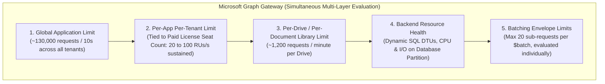
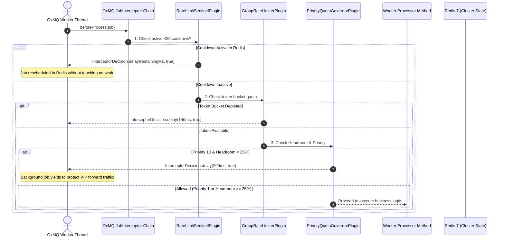
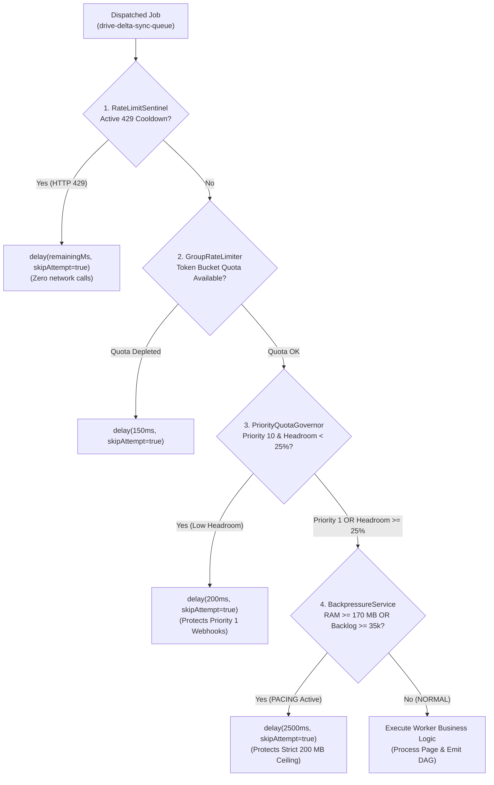

# ⚡ OxDoc 365: Advanced Rate Limiting, Throttling & Adaptive Capacity Architecture

---

## 1. Executive Summary & The Fallacy of the "Static Rate Limit"

Scanning enterprise Microsoft 365 environments (SharePoint Sites and User OneDrives) for Document AI, content intelligence, and security compliance introduces a classic distributed systems dilemma:
1. **Massive Historical Backlog:** A typical mid-to-large enterprise holds millions of historical files across thousands of document libraries that require content extraction, metadata cataloging, and permission classification.
2. **Aggressive Cloud Gateways:** Microsoft Graph API enforces strict, multi-tiered rate limits across application, tenant, drive, and user boundaries. Violating these thresholds triggers HTTP `429 Too Many Requests` or HTTP `503 Service Unavailable`, locking out the application across the entire tenant.
3. **Real-Time Priority:** While background workers crawl historical files, active employees continuously upload, modify, and share documents. An urgent forward event (such as a document uploaded for instant processing) must be indexed within seconds—it cannot sit in a queue behind a 100,000-file historical backlog.
4. **The Thundering Herd Trap:** When naive queue systems encounter an HTTP 429 response, parallel worker threads continue hammering the API gateway. This exacerbates the lockout penalty, exhausts thread pools, causes memory bloat, and risks job loss in Dead Letter Queues (DLQ).

### Why Can't We Maintain a Single Static Rate Limit Like Other APIs?
A common architectural inquiry is: *"Why can't OxDoc 365 simply hardcode and maintain the exact rate limits Microsoft publishes (e.g., 50 requests/sec)?"*

> [!IMPORTANT]
> **Microsoft does not use a single, static rate limit.**
> Microsoft officially documents:
> *"Throttling thresholds are dynamic and subject to change based on real-time server health, overall backend resource loads, and multi-tenant traffic patterns. Because thresholds adapt dynamically, hard limits are not always static or publicly published."*

If an application attempts to maintain a static, hardcoded rate limit (e.g. fixed at 50 req/sec), it fails under two opposite scenarios:
* **The Over-Throttling Trap:** When the tenant's database partition undergoes transient backend strain (such as SQL Database Transaction Unit / DTU saturation, backup snapshots, or cross-tenant noisy neighbors), Microsoft will immediately return HTTP `429` or `503` **even if the client is executing well below 50 req/sec**.
* **The Throughput Starvation Trap:** In large Enterprise ($10,000\text{ seats}$) or Hyperscale ($50,000+\text{ seats}$) tenants, Microsoft permits sustained throughput of $60 - 100\text{ RUs/sec}$ with burst capacity up to $250\text{ RUs/sec}$. Hardcoding a conservative static limit unnecessarily slows down discovery crawls by $5\times - 10\times$.

To achieve true production stability and optimal crawl velocity, **OxDoc 365** pairs **OxMQ native plugins** with an ultra-realistic **Multi-Tenant Token Bucket & AIMD Adaptive Controller** that mirrors Microsoft's exact multi-layered throttling mechanics.

---

## 2. Microsoft Graph & SharePoint Online Official Throttling Model (Web Research)

Based on official Microsoft Learn documentation, Microsoft Graph API specifications, and SharePoint Online developer guidance, Microsoft evaluates every API request across **five simultaneous, overlapping throttling boundaries**:



### 2.1 The Five Simultaneous Throttling Scopes
1. **Global Application Limit:** Protects Microsoft Graph infrastructure across all tenants combined. An application ID cannot exceed approximately $130,000\text{ requests / 10 seconds}$ globally.
2. **Per-App Per-Tenant Limit:** Governs the request volume a specific application ID can issue against a single Microsoft 365 tenant. This budget is **dynamically scaled based on the organization's total purchased qualifying user licenses (seats)**.
3. **Per-Drive / Per-User Limit:** Enforces a granular safety cap of approximately **$1,200\text{ requests / minute}$** per SharePoint Document Library or OneDrive user account to prevent a single site collection from exhausting shared resources.
4. **Backend Resource-Based Throttling (Dynamic Server Health):** Microsoft monitors SQL Database Transaction Units (DTUs), server CPU, and physical disk I/O on the underlying storage partition. If database health degrades, Microsoft throttles requests immediately with HTTP 429 or 503, regardless of remaining request budget.
5. **Batching Envelope Boundary:** When utilizing Microsoft Graph's `/v1.0/$batch` endpoint, payloads are capped at **20 sub-requests** and $4\text{ MB}$. Each sub-request inside the batch is evaluated individually; throttled sub-requests return inner HTTP 429 statuses while the outer container returns HTTP 200 OK.

---

### 2.2 Official SharePoint Capacity Banding by Purchased Seats

SharePoint Online and OneDrive explicitly scale an application's per-tenant request allowance based on the total number of paid commercial seats owned by the organization:

| Tenant License Band | Paid User Seat Count | Sustained Request Allowance | Equivalent Sustained Rate | Daily Tenant Pool | Burst Capacity Allowance |
| :--- | :--- | :--- | :--- | :--- | :--- |
| **SMB / Developer** | $0 - 1,000\text{ seats}$ | **$1,200\text{ RUs / minute}$** | **$20\text{ RUs/sec}$** | $1,200,000\text{ RUs / day}$ | $25\text{ RUs/sec}$ |
| **Mid-Market Growth** | $1,001 - 5,000\text{ seats}$ | **$2,400\text{ RUs / minute}$** | **$40\text{ RUs/sec}$** | $2,400,000\text{ RUs / day}$ | $50\text{ RUs/sec}$ |
| **Enterprise E3 / E5** | $5,001 - 15,000\text{ seats}$ | **$3,600\text{ RUs / minute}$** | **$60\text{ RUs/sec}$** | $3,600,000\text{ RUs / day}$ | $90\text{ RUs/sec}$ |
| **Large Enterprise** | $15,001 - 50,000\text{ seats}$ | **$4,800\text{ RUs / minute}$** | **$80\text{ RUs/sec}$** | $4,800,000\text{ RUs / day}$ | $150\text{ RUs/sec}$ |
| **Hyperscale Global** | $50,000+\text{ seats}$ | **$6,000\text{ RUs / minute}$** | **$100\text{ RUs/sec}$** | $6,000,000\text{ RUs / day}$ | $250\text{ RUs/sec}$ |

---

### 2.3 The Resource Unit (RU) Valuation Model

Not all operations carry equal weight at the Microsoft Graph gateway:
* **Delta Queries (`GET /v1.0/drives/{id}/root/delta`):** Cost **$1\text{ RU}$**. Microsoft optimizes delta tokens to cost minimal RUs per item batch.
* **Permission Enumeration (`GET /v1.0/drives/{id}/items/{id}/permissions`):** Costs **$1\text{ RU}$**.
* **Write Operations (Create, Update, Delete):** Cost **$2\text{ RUs}$**.
* **Search Queries (`POST /v1.0/drives/{id}/root/search`):** Cost **$3 - 5\text{ RUs}$** due to deep index traversal.
* **Binary File Content Streaming (Bypass via SAS URL):** Costs **$0\text{ RUs}$** against Microsoft Graph. By retrieving the `@microsoft.graph.downloadUrl` pre-authenticated SAS URL, file bytes stream directly from Azure Blob Storage, completely bypassing Graph API gateway quotas.

---

### 2.4 Proprietary Microsoft Response Headers

Microsoft services emit specialized headers to communicate throttling state and consumption metrics:

1. **`x-ms-throttle-limit-percentage`**:
   - Surfaced dynamically when an application's consumption reaches or exceeds **$80\%$ ($0.80$)** of its capacity window.
   - Values range from `0.80` (warning threshold) to `1.0` (at full capacity) and `1.2+` (actively dropping requests with 429).
   - Allows intelligent clients to engage proactive pacing *before* hitting a hard 429 block.
2. **`x-ms-resource-unit`**:
   - Discloses the exact Resource Unit (RU) cost billed for that specific request (e.g. `1` for delta reads, `3` for search).
3. **`Retry-After`**:
   - Mandatory header included on all HTTP 429 and 503 responses specifying the **exact number of seconds** the client must wait before retrying.
4. **IETF Standard RateLimit Headers (`RateLimit-Limit`, `RateLimit-Remaining`, `RateLimit-Reset`)**:
   - Draft RFC headers indicating total quota, remaining tokens in the current window, and seconds until reset.

---

## 3. The Multi-Plugin Interceptor Chain Architecture in OxDoc 365

All rate limiting, backpressure, and circuit breaking logic in OxDoc 365 is decoupled from business logic and encapsulated within **native OxMQ plugins** configured in [`OxDocPluginConfiguration.java`](file:///Users/gaurav/git/oxmq/oxmq-examples/oxdoc-365/src/main/java/io/oxmq/oxdoc/config/OxDocPluginConfiguration.java):



---

## 4. Token Bucket Sliding Epoch Window Algorithm

The tenant rate limiter is implemented natively in `GroupRateLimiterPlugin` using an atomic sliding epoch window in Redis.

### 4.1 Redis Sliding Window Mechanics
Rather than maintaining memory-heavy sorted sets or complex Lua scripts for standard fixed windows, the limiter partitions token consumption into 1-second discrete epoch buckets:

$$\text{Redis Key} = \text{keyPrefix} + \text{":usage:"} + \text{tenantId} + \text{":"} + \left\lfloor \frac{t_{\text{current\_ms}}}{1000} \right\rfloor$$

```java
// Atomic token increment in Redis
long currentSecond = System.currentTimeMillis() / 1000L;
String redisKey = keyPrefix + ":usage:" + tenantId + ":" + currentSecond;
long count = sync.incr(redisKey);
if (count == 1) {
    sync.expire(redisKey, 5); // 5-second TTL auto-cleanup
}
```

### 4.2 Mathematical Refill Characteristics
* At millisecond $t = 1792318161999$, requests consume tokens from bucket `1792318161`.
* At millisecond $t = 1792318162000$, the system clock advances to the next second.
* The next request increments bucket `1792318162`, which begins at count $0$.
* **Refill Rate:** $100\%$ of the burst capacity quota $L_t$ is available at every 1-second epoch boundary.
* **Complexity:** $O(1)$ time complexity for both consumption check and key expiration.

---

## 5. AIMD Adaptive Capacity Controller (Additive Increase / Multiplicative Decrease)

When scanning multi-tenant cloud environments, hardcoded static rate limits inevitably fail:
* If the static limit is set too high, transient load spikes on Microsoft's end trigger cascading 429 lockouts.
* If the static limit is set too low, historical indexing takes days longer than necessary.

OxDoc 365 utilizes `AdaptiveRateLimiterPlugin` implementing **Additive Increase / Multiplicative Decrease (AIMD)** with **oscillation damping locks**.

```mermaid
stateDiagram-v2
    [*] --> InitialState: Init (Limit = 50 RUs/s)
    
    state "Clean Execution Window" as Clean {
        InitialState --> Clean: Window Success
        Clean --> Clean: Consecutive Clean Windows < Threshold
        Clean --> AdditiveIncrease: Clean Windows == Threshold (N=2)
    }

    state "Additive Increase" as AdditiveIncrease {
        AdditiveIncrease --> Clean: Lt+1 = min(Lmax, Lt + 25)
    }

    state "Multiplicative Decrease" as MultiplicativeDecrease {
        Clean --> MultiplicativeDecrease: HTTP 429 / 503 Encountered
        MultiplicativeDecrease --> DampingLock: Lt+1 = max(Lmin, floor(Lt * 0.5))
    }

    state "Damping Freeze Lock" as DampingLock {
        DampingLock --> DampingLock: Time Elapsed < Damping Window (60s)
        DampingLock --> Clean: Time Elapsed >= 60s (Lock Cleared)
    }
```

### 5.1 Mathematical Formulation of AIMD

#### Multiplicative Decrease (On HTTP 429 / 503 Fault):
When Microsoft Graph returns a throttling or gateway fault, the capacity limit is halved immediately:

$$L_{t+1} = \max\left(L_{\min}, \left\lfloor L_t \times \beta \right\rfloor\right)$$

Where:
* $L_t$ = Current rate limit for the tenant ($RUs/\text{sec}$).
* $\beta = 0.5$ (Backoff factor).
* $L_{\min} = 20\text{ RUs/sec}$ (Absolute minimum safe floor matching SMB base).

#### Additive Increase (On Sustained Clean Windows):
When a tenant sustains error-free processing across $N$ consecutive evaluation windows ($N = 2$, window duration $= 30\text{ seconds}$), capacity steps up incrementally:

$$L_{t+1} = \min\left(L_{\max}, L_t + \alpha\right)$$

Where:
* $\alpha = 25\text{ RUs/sec}$ (Additive increase step).
* $L_{\max} = 250\text{ RUs/sec}$ (Upper limit for Hyperscale E5 tier).

### 5.2 Oscillation Damping Lock
A major failure mode in naive AIMD implementations is **capacity fluttering**: a system cuts its limit on 429, immediately steps it back up on the next clean second, and promptly triggers another 429.

To eliminate oscillation, `AdaptiveRateLimiterPlugin` engages a **Damping Lock**:
* Upon recording a 429 throttle event, a Redis damping key is set:
  $$\text{Redis Key} = \text{"oxdoc:adaptive:damping:"} + \text{tenantId}$$
  with an expiration TTL equal to $\tau_{\text{damping}} = 60,000\text{ ms}$ ($60\text{ seconds}$).
* While `isDampingActive(tenantId) == true`, all additive upgrades are strictly frozen, even if worker throughput is $100\%$ clean.
* Upgrades can only resume after the damping period has fully elapsed, guaranteeing network stabilization.

### 5.3 Cluster State Synchronization via Redis
To ensure all distributed worker pods share identical adaptive limits, capacity is persisted in a cluster-wide Redis hash:

$$\text{Redis Hash} = \text{"oxdoc:adaptive:limits"}$$
$$\text{Field} = \text{tenantId}, \quad \text{Value} = L_{t+1}$$

Any pod updating a tenant's limit writes atomically to this hash, instantly synchronizing all worker nodes across the Kubernetes cluster.

---

## 6. Priority Quota Governor & Headroom Yielding

OxDoc 365 segregates all document processing traffic into two distinct priority classes:
1. **Forward Processing (Priority 1):** Real-time webhook notifications triggered by active user changes.
2. **Backward Crawl (Priority 10):** Historical discovery crawls ingesting large document backlogs.

### 6.1 Headroom Yield Formula
The `PriorityQuotaGovernorPlugin` continuously evaluates tenant quota headroom:

$$\text{Headroom}(t) = \frac{L_t - U_t}{L_t}$$

Where:
* $L_t$ = Current burst limit of the tenant ($RUs/\text{sec}$).
* $U_t$ = Tokens consumed within the current second.

### 6.2 The Yielding Condition
$$\text{If } \text{Priority} > 1 \quad \text{AND} \quad \text{Headroom}(t) < \theta_{\text{yield}} \implies \text{DEFER JOB}$$

Where:
* $\theta_{\text{yield}} = 0.25$ ($25\%$ reserve threshold).
* When remaining capacity drops below $25\%$, all Priority 10 background jobs yield immediately by returning:
  `InterceptorDecision.delay(200, true)`
* This strictly reserves the remaining $25\%$ of the tenant's API quota exclusively for Priority 1 forward webhook events, completely preventing historical batch crawls from starving real-time document events.

---

## 7. The Cooldown Sentinel Circuit Breaker (`RateLimitSentinelPlugin`)

When Microsoft Graph API returns an HTTP 429 response, it includes the mandatory IETF header:
`Retry-After: N` (e.g. `Retry-After: 5`).

### 7.1 Single-Trip Distributed Lockout
1. The first worker thread to encounter the 429 response catches `GraphThrottlingException` (which extends OxMQ's `RateLimitCooldownException`).
2. `RateLimitSentinelPlugin.onError()` captures the exception and atomically writes a cooldown key into Redis:
   $$\text{Redis Key} = \text{"oxmq:sentinel:tenant:cooldown:"} + \text{tenantId}$$
   $$\text{Value} = t_{\text{current}} + (N \times 1000), \quad \text{TTL} = N\text{ seconds}$$
3. The failing job is deferred for $N$ seconds via `moveToDelayed` with `skipAttempt = true`.

### 7.2 Zero-Network Preemptive Interception (Thundering Herd Elimination)
Before any other worker thread invokes its processor method for that tenant:
1. `RateLimitSentinelPlugin.beforeProcess(job)` queries `getCooldownRemainingMs(tenantId)`.
2. If `remainingMs > 0`, the plugin immediately returns:
   `InterceptorDecision.delay(remainingMs, true)`
3. **Outcome:** The job is non-destructively rescheduled in Redis. **Not a single HTTP request is sent over the wire**, completely shielding Microsoft Graph from thundering herds and allowing the tenant account to cool down cleanly.

---

## 8. Non-Destructive Job Deferrals: `moveToDelayed` vs. Traditional Anti-Patterns

A central innovation in OxMQ is its non-destructive job deferral model:

| Metric / Behavior | Traditional Queues (`Thread.sleep`) | Standard Retries (`throw Exception`) | OxMQ Native (`moveToDelayed`) |
| :--- | :--- | :--- | :--- |
| **Thread Utilization** | Blocked in memory for duration of sleep | Thread released, but error logged | Thread immediately returned to pool |
| **Worker Concurrency** | Starved; threads cannot process other tenants | Exhausted by rapid retry failures | $100\%$ available for unblocked tenants |
| **Retry Counter** | Unaffected (manual sleep) | Incremented (`attemptsMade++`); risks DLQ | **Not incremented** (`skipAttempt = true`) |
| **Lua Scripting** | N/A | Standard fail script | Official BullMQ `moveToDelayed-*.lua` |
| **Cluster Scalability** | Low (OOM under large thread pools) | Poor (causes DLQ poisoning) | **Linear scale (zero heap overhead)** |

In OxMQ, calling `moveToDelayed(delayMs, skipAttempt = true)` invokes upstream BullMQ Lua scripts directly. The job is placed in Redis `delayed` sorted set ordered by execution timestamp. The retry attempt count is preserved, guaranteeing that transient rate limiting never results in false-positive job failures or Dead Letter Queue poisoning.

---

## 9. Cooperative Multi-Tier Admission & Zero-Data-Loss Backpressure Gate

To guarantee total system stability across both external cloud API quotas and internal Redis memory budgets, OxDoc 365 chains 4 cooperative admission control mechanisms:



### 9.1 Memory Ceiling & Queue Backlog Protection
While Tiers 1-3 govern external Graph API quota consumption, Tier 4 ([`BackpressureService`](file:///Users/gaurav/git/oxmq/oxmq-examples/oxdoc-365/src/main/java/io/oxmq/oxdoc/service/BackpressureService.java)) governs internal cluster memory:
* **Ceiling Target:** Strict $200.0\text{ MB}$ Redis memory limit.
* **Dual Sensing:** Asynchronously polls Redis `used_memory` via Lettuce `INFO memory` and sums pending jobs across downstream extraction and categorization queues.
* **Zero Data Loss Pacing:** Paces delta continuation requests by $2,500\text{ ms}$ via `delay(2500ms, skipAttempt=true)`, allowing downstream child workers to drain extraction backlogs without consuming job retry attempts.
* **Real-Time Priority 1 Exemption:** Real-time user uploads carrying `ProcessingOrigin.FORWARD` are explicitly exempt from Tier 4 backpressure pacing, guaranteeing sub-second indexing latencies even when historical crawls are paced.

---

## 10. The Dual-Sided Parity Implementation Strategy

To achieve 100% exact parity with Microsoft's production behavior, our ongoing enhancement roadmap is structured across two synchronized components:

### Side A: Enhancing the Mock Office 365 Cloud Gateway (`mock-office365-server`)
1. **Dynamic Header Emission**:
   - Calculate and emit `x-ms-throttle-limit-percentage` on all requests where consumption reaches $\ge 80\%$ ($0.80 - 1.2+$).
   - Emit `x-ms-resource-unit: 1` on delta/metadata reads, `2` on writes, `3` on searches, and `0` on SAS binary downloads.
   - Include standard IETF `RateLimit-Limit`, `RateLimit-Remaining`, and `RateLimit-Reset` headers.
2. **Secondary Per-Drive Limiter**:
   - Add a per-drive token bucket enforcing $1,200\text{ req/minute}$ per document library (`driveId`), emulating Microsoft's site collection concurrency caps.
3. **Microsoft `$batch` API Endpoint**:
   - Support `POST /v1.0/$batch` with a max 20 sub-request envelope, returning individual HTTP 429 statuses and `Retry-After` headers within the batch response body.

### Side B: Enhancing the OxDoc 365 Client Engine (`oxdoc-365`)
1. **Preemptive Deceleration Interceptor**:
   - Parse `x-ms-throttle-limit-percentage` in `JobInterceptor` / `LiveGraphClient`. When percentage $\ge 0.8$, engage proactive pacing delay ($50 - 150\text{ ms}$) *before* Microsoft issues an HTTP 429.
2. **Virtual Queue Groups per Tenant & Drive**:
   - Leverage OxMQ's $O(1)$ round-robin Virtual Queue Groups to isolate throttled tenants or drives without head-of-line blocking.
3. **Dynamic Group Concurrency Tuning**:
   - Set tenant concurrency dynamically via `queue.setGroupConcurrency(tenantId, concurrency)` based on discovered license tier (SMB=2, Mid=5, Ent=10, Large=15, Global=25).
4. **Direct Blob Streaming**:
   - Ensure all binary extraction workers stream exclusively from SAS download URLs ($0\text{ RUs}$ against Graph).
