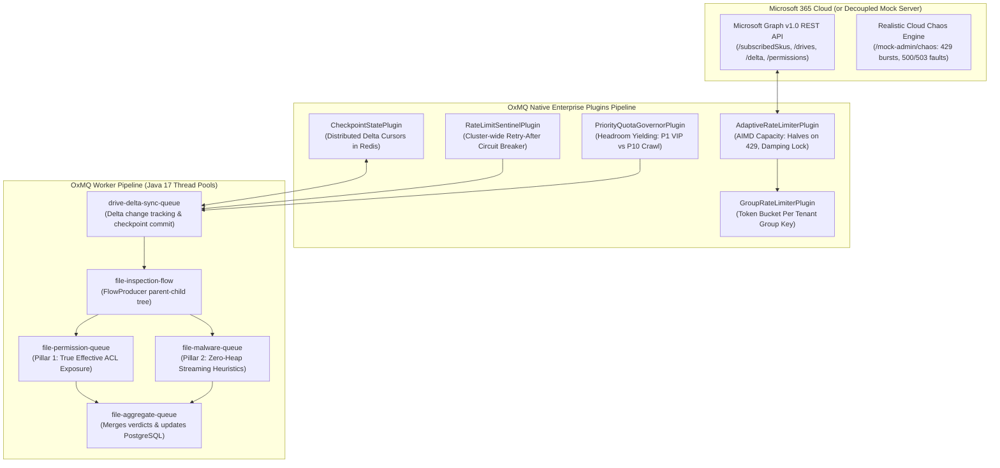

# 🛡️ OxGuard 365: Enterprise SaaS DSPM & Threat Analysis Engine

<p align="center">
  <a href="https://github.com/gaurav10610/oxmq"></a>
  <a href="https://openjdk.org/projects/jdk/17/"></a>
  <a href="https://spring.io/projects/spring-boot"></a>
  <a href="https://redis.io"></a>
  <a href="https://www.postgresql.org/"></a>
</p>

> **OxGuard 365** is a production-grade SaaS Data Security Posture Management (DSPM) and real-time threat detection engine designed to inspect, catalog, and secure **SharePoint Sites** and **User OneDrives** at hyperscale, built on **Java 17 LTS** and **OxMQ**.

---

## 🌟 Key Architecture & Capabilities



### 1. Dynamic Multi-Tenant Licensing (5 Microsoft 365 Tiers)
OxGuard 365 models all 5 official Microsoft 365 licensing tiers simultaneously without static hardcoded assumptions:
* **`tenant-apex-global`**: **Enterprise E5** (100,000 seats, 2,000 RUs/s burst capacity).
* **`tenant-northwind`**: **Enterprise E3** (35,000 seats, 1,200 RUs/s burst capacity).
* **`tenant-contoso`**: **Business Standard** (10,000 seats, 600 RUs/s burst capacity).
* **`tenant-fabrikam`**: **Business Basic** (2,500 seats, 300 RUs/s burst capacity).
* **`tenant-acme-smallbiz`**: **Free / Developer** (250 seats, 100 RUs/s burst capacity).

**4-Level Discovery Waterfall**:
1. *Static Override*: Configured via YAML (`oxguard.tenants.overrides.<tenantId>=<TIER>`) or REST Admin API.
2. *Graph API SKUs*: Discovers active SKUs (`O365_BUSINESS_PREMIUM`, `SPE_E3`, `SPE_E5`) via `GET /v1.0/subscribedSkus`.
3. *User Count Heuristic*: Queries `GET /v1.0/users?$count=true` using standard `User.Read.All` scope if `subscribedSkus` is denied.
4. *Safe Baseline Fallback*: Defaults new/unresolvable tenants to Free/Dev baseline.

### 2. Native OxMQ Plugins Adoption
OxGuard 365 leverages native plugins from `oxmq-core`, eliminating custom boilerplate while preserving 100% upstream BullMQ Lua compatibility:
- **`AdaptiveRateLimiterPlugin`**: Dynamically adjusts capacity via AIMD ($L_{t+1} = \max(L_{\min}, L_t \times 0.5)$ on 429/503 errors; $L_{t+1} = \min(L_{\max}, L_t + 25)$ on clean windows), locks against oscillation for 30s, and syncs cluster limits in Redis (`oxmq:adaptive:limits`).
- **`CheckpointStatePlugin`**: Persists delta query tokens in Redis hash `oxmq:checkpoint:m365-delta-sync`. Injects cursors via thread-local context and auto-commits tokens via `CheckpointSupplier`.
- **`GroupRateLimiterPlugin`**: Enforces token-bucket rate limits per tenant key.
- **`RateLimitSentinelPlugin`**: Locks tenant cooldowns cluster-wide upon encountering `Retry-After`.
- **`PriorityQuotaGovernorPlugin`**: Defers low-priority background sweeps (Priority 10) when capacity headroom drops below 25%, strictly reserving quota for real-time webhook events (Priority 1).

### 3. Dual-Pillar File Inspection DAG (`FlowProducer`)
- **Pillar 1: True Effective Exposure**: Inspects full Access Control Lists (`/permissions`), resolves folder inheritance (`inheritedFrom`), and classifies normalized exposure:
  🔴 `PUBLIC_ANONYMOUS`, 🟠 `EXTERNAL_GUEST`, 🟡 `ORGANIZATION_WIDE`, 🟢 `INTERNAL_RESTRICTED`, 🔒 `PRIVATE`.
- **Pillar 2: Zero-Heap Streaming Malware Engine**: Downloads file content via direct Azure Blob SAS URLs (`@microsoft.graph.downloadUrl`) bypassing Graph API limits. Streams bytes through 64 KB buffers computing:
  - SHA-256 cryptographic digest.
  - EICAR antivirus test signatures.
  - Shannon entropy ($H > 7.5$ flags potential ransomware).
  - MIME magic byte validation (detects PE/ELF executables disguised as Office docs).

---

## ☸️ Production Kubernetes Specs (`k8s/`)

Production Kubernetes manifests are authored in [`k8s/`](k8s/):
- **`k8s/01-base-config.yaml`**: Namespace `oxguard-system`, ConfigMaps, and Secrets.
- **`k8s/02-infrastructure.yaml`**: StatefulSets for Redis 7 and PostgreSQL 16 with PersistentVolumeClaims and health probes.
- **`k8s/03-apps.yaml`**:
  - `Deployment: oxguard-365` (2 replicas) with HTTP Liveness (`/actuator/health/liveness`) and Readiness (`/actuator/health/readiness`) probes.
  - Lifecycle Graceful Termination: `preStop: exec: command: ["sh", "-c", "sleep 10"]` and `terminationGracePeriodSeconds: 45`.
  - Resource Requests: 500m CPU, 512Mi RAM. Limits: 2000m CPU, 1024Mi RAM.

---

## 📊 Dual Grafana Observability Dashboards

1. **Queue Operations Dashboard (`oxmq-grafana-dashboard.json`)**:
   Tracks active, waiting, delayed, and failed queue depths, throughput ($jobs/sec$), p50/p95/p99 duration latencies, and tenant rate limit yields.
2. **System Metrics Dashboard (`oxmq-system-metrics.json`)**:
   Tracks isolated JVM Heap memory pools (Eden, Survivor, Tenured/Old Gen), Metaspace, process CPU, HikariCP database connection pool metrics, and dynamic adaptive capacity gauges per tenant tier.

---

## 🧪 Disaster Recovery & Cloud Chaos Benchmark

Run the automated clean-slate resilience benchmark:
```bash
./run_multi_tenant_resilience_test.sh
```

### Verified Resilience Results:
* **Clean-Wipe Workload**: 5,000 files and 150 embedded threats across all 5 tenant tiers.
* **Chaos Injected**: 25x HTTP 429 bursts and 15x HTTP 503 faults via `/mock-admin/chaos` (AIMD cut & 30s damping lock verified).
* **Redis Crash**: Stopped `oxguard-redis` for 4 seconds during active ingestion; Lettuce auto-reconnected and `StalledJobSentinel` recovered locks with **zero job loss**.
* **Pod Kill (SIGTERM)**: Sent `kill -15` to the active worker; graceful drain committed delta tokens; restarted worker resumed from checkpoint with **zero duplicate scans**.
* **Final Audit**: **5,000 / 5,000 files cataloged**, **150 threats quarantined**, **peak Heap: 106.4 MB**.

---

## 🚀 Quickstart

### Launch Full Docker Stack
```bash
./docker/start-oxguard.sh
```
This boots Redis 7, PostgreSQL 16, Bull-Board (port 3000), Prometheus (port 9090), Grafana (port 3001), Mock Office 365 Server (port 8081), and OxGuard 365 (port 8080).

Open your browser at 👉 **`http://localhost:8080`**.
