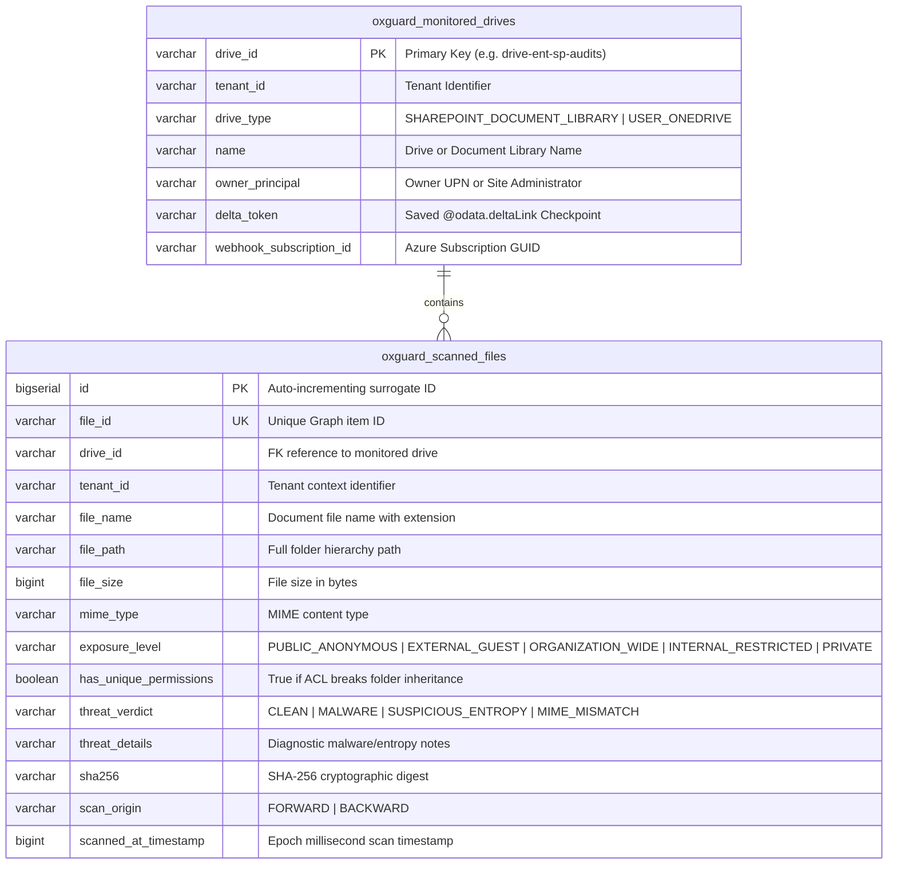

# 📐 OxGuard 365: Data Model, Schemas & Low-Level Design (LLD) Specification

---

## 1. Executive Summary

This document provides the definitive technical specification of OxGuard 365's data persistence layer, Redis key topology, Java domain transfer objects (DTOs), and REST/Webhook API contracts.

---

## 2. PostgreSQL 16 Relational Schema

OxGuard 365 uses Spring Data JPA with PostgreSQL 16. The database stores the discovered monitored drives and the security-analyzed file inventory.



### 2.1 Complete PostgreSQL DDL
```sql
-- 1. Discovered Document Libraries & User OneDrives
CREATE TABLE IF NOT EXISTS oxguard_monitored_drives (
    drive_id VARCHAR(255) PRIMARY KEY,
    tenant_id VARCHAR(255) NOT NULL,
    drive_type VARCHAR(64) NOT NULL,
    name VARCHAR(255) NOT NULL,
    owner_principal VARCHAR(255),
    delta_token VARCHAR(2048),
    webhook_subscription_id VARCHAR(255)
);

CREATE INDEX IF NOT EXISTS idx_drive_tenant ON oxguard_monitored_drives(tenant_id);

-- 2. Security-Indexed Scanned Files Inventory
CREATE TABLE IF NOT EXISTS oxguard_scanned_files (
    id BIGSERIAL PRIMARY KEY,
    file_id VARCHAR(255) NOT NULL UNIQUE,
    drive_id VARCHAR(255) NOT NULL,
    tenant_id VARCHAR(255) NOT NULL,
    file_name VARCHAR(255) NOT NULL,
    file_path VARCHAR(1024) NOT NULL,
    file_size BIGINT NOT NULL,
    mime_type VARCHAR(255),
    exposure_level VARCHAR(64) NOT NULL,
    has_unique_permissions BOOLEAN NOT NULL DEFAULT FALSE,
    threat_verdict VARCHAR(64) NOT NULL,
    threat_details VARCHAR(1024),
    sha256 VARCHAR(64),
    scan_origin VARCHAR(32) NOT NULL,
    scanned_at_timestamp BIGINT NOT NULL
);

-- Strategic Query Indexes
CREATE INDEX IF NOT EXISTS idx_file_id ON oxguard_scanned_files(file_id);
CREATE INDEX IF NOT EXISTS idx_exposure_level ON oxguard_scanned_files(exposure_level);
CREATE INDEX IF NOT EXISTS idx_threat_verdict ON oxguard_scanned_files(threat_verdict);
CREATE INDEX IF NOT EXISTS idx_scan_origin ON oxguard_scanned_files(scan_origin);
CREATE INDEX IF NOT EXISTS idx_scanned_at ON oxguard_scanned_files(scanned_at_timestamp);
CREATE INDEX IF NOT EXISTS idx_file_tenant ON oxguard_scanned_files(tenant_id);
```

---

## 3. Distributed Redis Key Topology

OxGuard 365 and OxMQ utilize Redis 7 for queue management, distributed token buckets, circuit breakers, and delta sync checkpoints:

| Redis Key Pattern | Data Type | TTL | Owning Component | Description |
| :--- | :--- | :--- | :--- | :--- |
| `bull:<queueName>:id` | `String (integer)` | None | BullMQ Core | Atomic counter generating unique sequential job IDs. |
| `bull:<queueName>:wait` | `List` | None | BullMQ Core | FIFO queue of pending jobs awaiting worker dispatch. |
| `bull:<queueName>:active` | `List` | None | BullMQ Core | In-flight jobs currently executing on worker threads. |
| `bull:<queueName>:delayed` | `ZSet` | None | BullMQ Core | Jobs scheduled to run in the future (sorted by execution epoch ms). |
| `bull:<queueName>:completed` | `ZSet` | None | BullMQ Core | History of successfully completed jobs. |
| `bull:<queueName>:failed` | `ZSet` | None | BullMQ Core | Exhausted or unhandled failed jobs. |
| `oxmq:limiter:tenant:usage:<tenantId>:<epochSec>` | `String (integer)` | $5\text{ seconds}$ | `GroupRateLimiterPlugin` | Sliding epoch token bucket tracking RUs consumed within the current second. |
| `oxmq:sentinel:tenant:cooldown:<tenantId>` | `String (timestamp)` | $N\text{ seconds}$ | `RateLimitSentinelPlugin` | Distributed circuit breaker locked upon encountering HTTP 429 `Retry-After: N`. |
| `oxguard:adaptive:limits` | `Hash` | None | `AdaptiveRateLimiterPlugin` | Cluster-wide synchronized adaptive capacity limits per tenant ($L_t$). |
| `oxguard:adaptive:damping:<tenantId>` | `String` | $60\text{ seconds}$ | `AdaptiveRateLimiterPlugin` | Damping lock freezing additive upgrades following an HTTP 429/503 fault. |
| `oxguard:checkpoint:drives` | `Hash` | None | `CheckpointStatePlugin` | High-speed cache of latest `@odata.deltaLink` tokens mapped by `driveId`. |

---

## 4. Domain Payload Specifications (Java Records & JSON)

### 4.1 `DriveDeltaSyncPayload`
Transferred across `drive-delta-sync-queue`:
```java
public record DriveDeltaSyncPayload(
        String tenantId,
        String driveId,
        ScanOrigin scanOrigin // FORWARD (Priority 1) or BACKWARD (Priority 10)
) implements TenantScopedPayload {}
```
*JSON Representation:*
```json
{
  "tenantId": "tenant-ent-10k",
  "driveId": "drive-ent-sp-audits",
  "scanOrigin": "BACKWARD"
}
```

### 4.2 `FileScanPayload`
Transferred to child DAG workers (`file-permission-queue` and `file-malware-queue`):
```java
public record FileScanPayload(
        String tenantId,
        String driveId,
        String itemId,
        String itemName,
        String itemPath,
        long fileSize,
        String mimeType,
        String downloadUrl,
        ScanOrigin scanOrigin
) implements TenantScopedPayload {}
```

### 4.3 `FileAggregatePayload`
Transferred to parent DAG worker (`file-aggregate-queue`):
```java
public record FileAggregatePayload(
        String tenantId,
        String driveId,
        String itemId,
        String itemName,
        String itemPath,
        long fileSize,
        String mimeType,
        String downloadUrl,
        ScanOrigin scanOrigin
) implements TenantScopedPayload {}
```

---

## 5. REST API & Webhook Endpoint Contracts

### 5.1 Multi-Tenant Management (`/api/v1/dashboard`)

#### `GET /api/v1/dashboard/tenants`
Lists all onboarded tenants, active license tiers, and live token usage.
*Response (HTTP 200 OK):*
```json
[
  {
    "tenantId": "tenant-global-100k",
    "organizationName": "MegaCorp Global",
    "tier": "HYPERSCALE",
    "tierDisplayName": "Hyperscale Global (100,000 seats)",
    "seatCount": 100000,
    "dailyRuBudget": 6000000,
    "burstLimitRUsPerSec": 250,
    "tierSource": "GRAPH_SKU_DISCOVERY",
    "isOverridePinned": false,
    "upgradeCount": 0,
    "downgradeCount": 0,
    "connected": true
  }
]
```

#### `POST /api/v1/dashboard/tenants/{tenantId}/override?tier={TIER}`
Pins a static administrative override on a tenant, bypassing adaptive auto-tuning.
*Request Example:* `POST /api/v1/dashboard/tenants/tenant-smb-250/override?tier=HYPERSCALE`
*Response (HTTP 200 OK):* Returns updated `TenantProfile` with `isOverridePinned = true`.

#### `DELETE /api/v1/dashboard/tenants/{tenantId}/override`
Clears the administrative override, re-enabling dynamic Graph discovery and adaptive tuning.

#### `POST /api/v1/dashboard/trigger/crawl-all`
Dispatches historical baseline discovery across all 5 onboarded tenants concurrently.

---

### 5.2 Microsoft Graph Webhook Lifecycle (`/api/v1/webhooks/graph`)

#### `GET /api/v1/webhooks/graph?validationToken={token}`
*Handshake Protocol:* Microsoft Graph issues this verification call when creating a subscription. The endpoint immediately replies with HTTP 200 and the plain-text `validationToken` in the response body.

#### `POST /api/v1/webhooks/graph`
*Ingestion Protocol:* Receives resource change invalidation notifications from Microsoft Graph.
*Request Payload:*
```json
{
  "value": [
    {
      "subscriptionId": "7f9e8a7b-6c5d-4e3f-2a1b-0c9d8e7f6a5b",
      "clientState": "oxguard-secret-state-token",
      "changeType": "updated",
      "resource": "drives/drive-ent-sp-audits/root",
      "tenantId": "tenant-ent-10k"
    }
  ]
]
```
*Processing Action:* Extracts `driveId` and dispatches a Priority 1 forward scan job to `drive-delta-sync-queue` with 15-second debounce deduplication.
