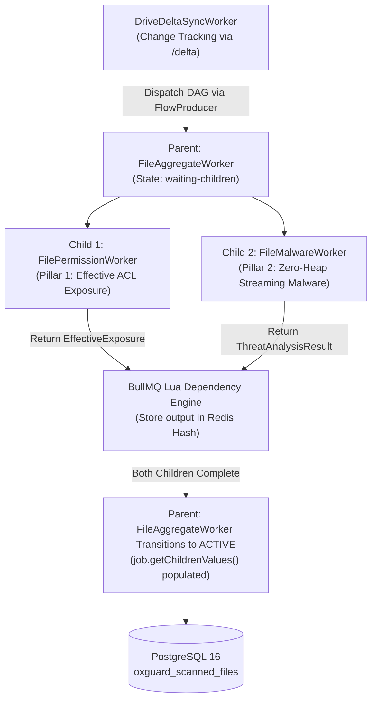
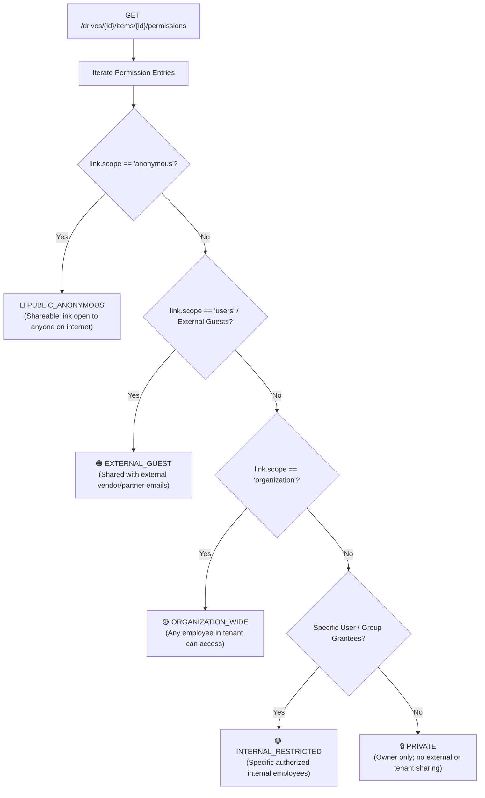
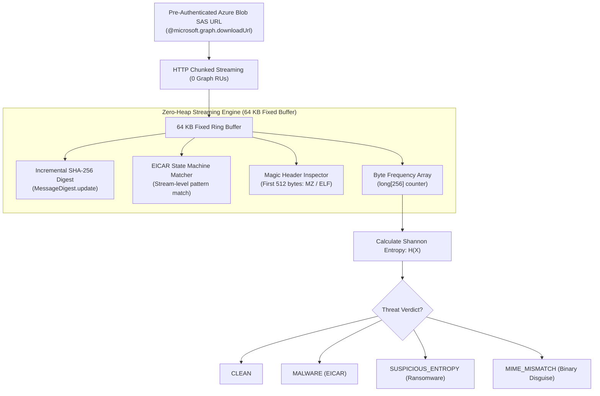

# 🔬 OxGuard 365: Dual-Pillar File Inspection DAG & Threat Analysis Engine

---

## 1. Executive Summary & Design Overview

Data Security Posture Management (DSPM) requires evaluating two orthogonal security vectors for every document in an organization:
1. **Pillar 1: Data Exposure & Access Control (Where can it leak?):** Who has access to this document? Is it shared anonymously with the entire internet? Shared with external guests? Shared organization-wide? Or properly restricted to internal owners?
2. **Pillar 2: Threat & Malware Analysis (What danger does it contain?):** Does the document contain embedded ransomware? Is it an executable binary disguised with an Office extension (`.docx`, `.pdf`)? Does it match known malware signatures?

Processing both vectors sequentially for millions of files creates severe latency bottlenecks. Running them as isolated unlinked jobs creates state race conditions in the database.

**OxGuard 365** solves this using an **OxMQ `FlowProducer` Directed Acyclic Graph (DAG)**:



---

## 2. OxMQ FlowProducer DAG Execution Mechanics

### 2.1 The DAG Structure
For every file modified or discovered, [`DriveDeltaSyncWorker.java`](file:///Users/gaurav/git/oxmq/oxmq-examples/oxguard-365/src/main/java/io/oxmq/oxguard/queue/DriveDeltaSyncWorker.java) constructs a 3-node dependency tree:

```java
// Parent Aggregator Node
FlowJob<FileAggregatePayload> parentFlow = FlowJob.of(
        OxGuardQueueConstants.QUEUE_FILE_AGGREGATE,
        "aggregate-" + item.name(),
        aggregatePayload,
        JobOptions.builder()
                .priority(priority)
                .attempts(3)
                .backoff(new BackoffStrategy.Exponential(1000L))
                .build()
);

// Child 1: Permission Scanner (Pillar 1)
FlowJob<FileScanPayload> childPerm = FlowJob.of(
        OxGuardQueueConstants.QUEUE_FILE_PERMISSION,
        "perm-" + item.name(),
        scanPayload,
        JobOptions.builder().priority(priority).attempts(3).failParentOnFailure(false).build()
);

// Child 2: Malware Scanner (Pillar 2)
FlowJob<FileScanPayload> childMalware = FlowJob.of(
        OxGuardQueueConstants.QUEUE_FILE_MALWARE,
        "malware-" + item.name(),
        scanPayload,
        JobOptions.builder().priority(priority).attempts(3).failParentOnFailure(false).build()
);

parentFlow.addChildren(List.of(childPerm, childMalware));
flowProducer.add(parentFlow);
```

### 2.2 BullMQ Lua Dependency Resolution
1. **Atomic Ingestion:** `flowProducer.add(parentFlow)` executes BullMQ's native Lua script (`addFlowJob.lua`), writing the parent and both children atomically to Redis.
2. **Initial State:**
   - Both child jobs are placed into their respective queue `wait` states.
   - The parent job is placed into the `waiting-children` state in Redis.
3. **Parallel Execution:** `FilePermissionWorker` and `FileMalwareWorker` claim and execute the child jobs concurrently across independent thread pools.
4. **Result Propagation:** When a child completes, its return value (e.g. `EffectiveExposure` or `ThreatAnalysisResult`) is serialized to JSON and stored in the parent's Redis dependency map.
5. **Parent Activation:** When the last child finishes, BullMQ automatically transitions the parent job from `waiting-children` to `wait` in `file-aggregate-queue`.
6. **Verdict Consolidation:** `FileAggregateWorker.processAggregate(job)` executes. It reads `job.getChildrenValues()`, merges both verdicts, and performs an atomic UPSERT into PostgreSQL.

---

## 3. Pillar 1: Effective Exposure Engine

The Effective Exposure Engine in [`ExposureEngine.java`](file:///Users/gaurav/git/oxmq/oxmq-examples/oxguard-365/src/main/java/io/oxmq/oxguard/engine/ExposureEngine.java) resolves raw Access Control Lists (ACLs) from Microsoft Graph into normalized security exposure classifications.



### 3.1 Exposure Classification Hierarchy
1. 🔴 **`PUBLIC_ANONYMOUS` (Critical Severity):** The file has an active sharing link with `scope: "anonymous"`. Anyone on the internet with the link can access the document without authentication.
2. 🟠 **`EXTERNAL_GUEST` (High Severity):** The file is explicitly shared with external guests, personal accounts (`@gmail.com`, `@yahoo.com`), or external vendor domains.
3. 🟡 **`ORGANIZATION_WIDE` (Medium Severity):** The file is shared via a tenant-wide link (`scope: "organization"`). Any authenticated employee across the organization can discover and read the file.
4. 🟢 **`INTERNAL_RESTRICTED` (Low Severity):** The file is shared with specific, named internal users or security groups.
5. 🔒 **`PRIVATE` (Baseline):** Only the document owner possesses access; zero sharing links or secondary ACLs exist.

### 3.2 Folder Inheritance Resolution
Microsoft SharePoint Online uses folder inheritance for permissions. In Graph API:
* If a permission entry has `inheritedFrom: { id: "folder-id" }`, the file inherits access rules from an ancestor folder.
* If `inheritedFrom` is null, the file has **Unique / Direct Permissions**.
* OxGuard captures this via `hasUniquePermissions = true`. Security teams prioritize investigating files with unique permissions because they represent deliberate departures from organizational folder access baselines.

---

## 4. Pillar 2: Zero-Heap Streaming Malware & Threat Engine

Standard malware scanners download the entire file into a byte array in JVM heap memory before scanning. For enterprise files (e.g. 50 MB PDFs or 100 MB datasets), scanning 50 files concurrently would require $2.5\text{ to }5\text{ GB}$ of JVM heap memory, triggering heavy Garbage Collection pauses and OutOfMemory (OOM) crashes.

OxGuard 365 implements a **Zero-Heap Streaming Heuristics Engine** in [`MalwareInspectionEngine.java`](file:///Users/gaurav/git/oxmq/oxmq-examples/oxguard-365/src/main/java/io/oxmq/oxguard/engine/MalwareInspectionEngine.java).



### 4.1 Azure Blob SAS URL Bypass (0 Graph RUs)
Instead of streaming content through Microsoft Graph gateway (`GET /drives/{id}/items/{id}/content`), OxGuard selects `@microsoft.graph.downloadUrl`. This returns a direct Azure Blob Storage Shared Access Signature (SAS) URL. Streaming directly from Azure Blob storage consumes **$0\text{ RUs}$** against Microsoft Graph API quotas, completely insulating the scanner from rate limits during high-throughput malware scanning.

### 4.2 Stream Heuristics (All Computed in a Single Pass):

#### 1. Incremental SHA-256 Cryptographic Hash
Bytes pass through a fixed 64 KB buffer (`byte[] buffer = new byte[65536];`) and are fed directly into `MessageDigest.update(buffer, 0, bytesRead)`. The complete SHA-256 hash is finalized at end-of-stream without ever buffering the file.

#### 2. EICAR Antivirus Test Signature Matcher
A streaming state-machine matches the official standard EICAR test signature byte sequence across chunk boundaries:
`X5O!P%@AP[4\PZX54(P^)7CC)7}$EICAR-STANDARD-ANTIVIRUS-TEST-FILE!$H+H*`
If matched, the file is immediately flagged with verdict `MALWARE`.

#### 3. Magic Byte Header Verification (MIME Mismatch Detection)
Attackers frequently disguise malicious executable payloads by giving them innocuous extensions like `quarterly_invoice.docx` or `contract.pdf`.

OxGuard inspects the first 512 bytes of the stream:
* **Windows Portable Executable (PE):** If an Office document begins with `0x4D, 0x5A` (`MZ` header), it is an executable binary disguised as a document.
* **Linux ELF Binary:** If an Office document begins with `0x7F, 0x45, 0x4C, 0x46` (`\x7FELF` header), it is a Linux binary disguised as a document.
* **Verdict:** Flagged immediately as `MIME_MISMATCH`.

#### 4. Shannon Entropy Calculation (Ransomware & Encryption Detection)
Ransomware payloads and encrypted packers exhibit near-random byte distributions with extremely high information entropy.

As bytes stream through the buffer, a 256-element frequency array tracks byte occurrences:
$$\text{byteFrequencies}[b]++ \quad \text{for } b \in [0, 255]$$

At end-of-stream, Shannon Entropy $H(X)$ is computed:

$$H(X) = - \sum_{i=0}^{255} p(b_i) \log_2 p(b_i)$$

Where:
* $p(b_i) = \frac{\text{byteFrequencies}[i]}{\text{totalBytesRead}}$ is the empirical probability of byte $i$.

**Decision Rule:**
* If $H(X) > 7.5$ on files $> 4,096\text{ bytes}$ that are not compressed archives (`.zip`, `.png`, `.jpg`), the file is flagged as `SUSPICIOUS_ENTROPY` (Potential Ransomware or Packed Payload).
